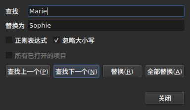
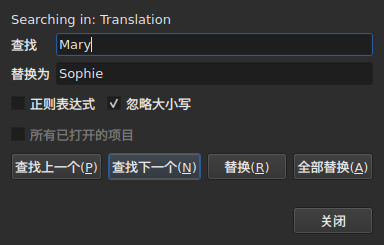

# 查找与替换

<!-- machine-translated -->
> 本页为机器翻译，尚未经过熟悉该语言的读者审校。

`编辑(E) ▸ 查找和替换…(F)` 或 `Ctrl+F` 会打开搜索对话框。




**该对话框不是模态的**：在你查看表格、编辑单元格、再次搜索时，它一直保持打开。`Close` 关闭它；重新打开时，它恢复为你离开时的样子，模式和替换文本都包括在内。

| 字段 | 内容 |
| :---- | :-------------- |
| `Find` | 要搜索的模式 |
| `Replace with` | 用什么来替换它 |
| `Regular expression` | 模式是正则表达式，而不是纯文本 |
| `Ignore case` | “marie”可以找到“Marie” |
| `All open projects` | 搜索会遍历所有标签页——[见下文](#在所有已打开的项目中) |

在空文档上，该条目被禁用：没有可搜索的内容。

## 四个按钮

| 按钮 | 作用 |
| :----- | :----------- |
| `Find Previous` | 查找上一个匹配项，表格会跳到它 |
| `Find Next` | 查找下一个——按 `Enter` 时按下的就是这个按钮 |
| `Replace` | 替换找到的匹配项，然后查找下一个 |
| `Replace All` | 替换目标中的所有匹配项 |

只要 `Find` 为空，这四个按钮就全部被禁用。

**表格通过选中匹配项所在的行来跳到该匹配项。** 到达最后一个之后，`Find Next` 从第一个重新开始；`Find Previous` 则在相反的方向上同样处理。

**没有找到匹配项时按 `Replace`，会先搜索**：第一次按下，显示将要替换什么，再按一次才会替换它。Gaupol 就是这样做的。

## 搜索涵盖的范围

**选区；如果没有选中任何内容，则是整个文档**——这是 `Tools` 菜单的规则。参见[操作](operations.md#作用对象)。

**目标在第一次操作时确定，并在搜索进行期间保持不变**：`Find Next` 会选中匹配项所在的行，而这个选区不会缩小目标。**你自己选中其他行，则会改变**下一次操作的目标。

搜索涵盖字幕的文本；不会搜索位置，也不会搜索序号。

### 在所有已打开的项目中

**`All open projects`** 复选框把范围扩大到每个标签页。**只打开一个项目时被禁用**——没有可扩大的范围——一旦打开第二个标签页，它就变为可用，而当只剩一个标签页时，它会自行取消勾选。

**勾选后，选区不再起作用**：每个项目都被完整搜索，搜索的是**目标文档**——当前列的那一份，即主文档或翻译，与单个项目时相同。

- **`Find Next` 和 `Find Previous` 按标签页的顺序，在各标签页之间依次移动。** 先搜索显示在前面的项目；当它没有更多匹配项时，转到下一个项目，窗口显示它的标签页，并选中其中的行。
- **一轮在开始的地方结束**：当搜索越过最后一个标签页回到第一个——向上搜索时则相反——对话框中的那一行会这样说明，而不是一声不吭地重新开始：

  ```text
  Search wrapped around
  ```

  之后的一步就是普通的一步，那一行随之清除。
- **`Replace` 在搜索所在之处替换**，然后转到下一个匹配项，它可能在另一个标签页中。
- **`Replace All` 遍历所有项目**，并且**对每个被改动的项目产生一条历史记录**：在某个标签页中撤销，只撤销该标签页收到的内容。计数说明有多少个项目被更改，而不只是有多少处替换：

  ```text
  replaced 4 matches in 3 projects
  ```

  模式不存在的项目不会被触碰，也没有需要撤销的内容。**没有任何标签页会被置于前台**：每个项目在其标签页背后接受替换，标签页会带上星号，而发起该操作的标签页仍然显示着，连同它的影片。

### 在哪种文本中

**有翻译时，搜索只涵盖两份文本之一：当前单元格所在列的那一份**——当前单元格在 `Translation` 列时是翻译，其他情况都是主文本。这是所有文本操作的规则，没有额外的设置：参见[操作所针对的文本](table.md#操作所针对的文本)。

**对话框会说明它在哪种文本中搜索**，说明位于 `Find` 上方的一行，并在当前列改变时随之改变——即使对话框已经打开：




| 当前单元格位于 | 该行显示 |
| :--------------------- | :------------ |
| `Translation` 列 | `Searching in: Translation` |
| 任何其他列 | `Searching in: Main` |
| ——项目没有翻译，或者该列已被移除 | 什么也不显示：没有这一行 |

**替换只写入那份文本，并且仅写入那份文本。** 对翻译执行 `Replace` 和 `Replace
All`，主文本保持原样，反之亦然；
`Undo` 会还原它们写入的内容。**标签是那份文本所在文件的格式的标签**：Advanced SSA 的翻译按其 `{\i1}` 来读取，即使主文本是 SubRip。`Replace with` 在那里也以同样的标签写入。

**表格停留在原来的列中。** `Find Next` 选中匹配项所在的行，而不会把当前单元格从一列移到另一列：在翻译中开始的搜索，会继续在翻译中进行。

**不存在同时搜索两份文本的功能**：每个匹配项都会是一对（字幕，文本），表格要跳到它，就没有明确的去处。你在其中一份文本中搜索，然后切换列。

**会从头重新开始的内容**：

| 操作 | 被遗忘的内容 |
| :------ | :---------------- |
| 更改 `Find`、`Replace with` 或某个选项 | 当前匹配项，以及状态行 |
| 自己选中其他行 | 目标和匹配项 |
| 把当前单元格从一份文本移到另一份——从 `Text` 到 `Translation`，或者相反 | 匹配项：它是某份文本中的一个位置 |
| 打开另一个文件 | 目标和匹配项；对话框保持打开，模式也保留 |

## 搜索的是可见文本

**标签不是文本。** 搜索 `<i>` 什么也找不到，而搜索 `Bonjour` 可以找到被标签切开的 `<i>Bon</i>jour`。

**替换在文件的文本中进行，不会破坏标签**：

| 文本 | 搜索的内容 → 替换成的内容 | 写入的内容 |
| :--- | :-------------------------- | :-------------- |
| `<i>Bonjour</i>` | `Bonjour` → `Salut` | `<i>Salut</i>` |
| `<i>Bon</i>jour` | `Bonjour` → `Salut` | `<i>Salut</i>` |
| `<i>Bonjour</i> Marie` | `Bonjour Marie` → `Salut Sophie` | `<i>Salut Sophie</i>` |

切开一个单词的标签会包住整个单词，任何触及匹配项的样式都会覆盖替换后的文本。**匹配项没有触及的标签保持原位**，即使它切开了同一条字幕中的另一个单词：把 `<i>Bon</i>jour Marie` 中的 `Marie` 替换掉，得到 `<i>Bon</i>jour Sophie`。单词由字母和数字构成——不间断空格或引号不属于单词。**`Replace with` 按目标文本的标签来读取**：在 SubRip 中于其中输入 `<b>Salut</b>`，会使该单词变为粗体。

## 两个选项

| 选项 | 默认值 | 它改变什么 |
| :----- | :------ | :-------------- |
| `Regular expression` | 不勾选 | `.` 不再搜索句点，而是搜索任意字符 |
| `Ignore case` | 勾选 | 大小写不起作用，带重音的字母也是如此：`élise` 可以找到 `Élise` |

这些是 Gaupol 的默认值。**两者都会被记住**，从一次打开到下一次打开，从一次会话到下一次会话，保存在[设置文件](preferences.md#文件)的 `search.regex` 和 `search.ignore-case` 选项中。

### 正则表达式

模式由 ICU 读取。和在 Gaupol 中一样，`.` 可以跨越换行，`^` 和 `$` 作用于字幕**每一行**的开头和结尾：把 `^` 替换为 `- `，会在每一行之前加上一个破折号。

在 `Replace with` 中，并且仅对正则表达式而言：

| 写法 | 放入什么 |
| :------ | :----------- |
| `$1` 到 `$9` | 该编号的分组；不存在的分组放入空内容 |
| `$0` | 整个匹配项 |
| `\n` | 一个换行 |
| `\$`、`\\` | 一个 `$`，一个反斜杠 |
| `\` 后接任何其他字符 | 该字符：`\t` 放入一个 `t` |

**`\1` 不是分组**，它放入一个 `1`。这是 Gaupol 的语法，它用 Python 来读取表达式；这里用的是 ICU 的语法，由它读取模式。

## 对话框说了什么

在按钮下方，有一行说明搜索无法做什么，或者 `Replace All` 做了什么：

| 情形 | 显示的内容 |
| :-------- | :------------ |
| 目标中没有匹配项 | `"Sophie" not found` |
| 无法读取的正则表达式 | `not a regular expression (U_REGEX_MISMATCHED_PAREN)` |
| `Replace All` 做了替换 | `replaced 3 matches` |
| `Replace All` 找到了模式，但替换不改变任何文本 | `nothing to change` |

**什么也没找到的搜索不会触碰任何内容**：选区停留在原处，也没有任何内容进入历史记录。

**`not found` 和 `nothing to change` 说的不是同一件事。** `not found` 说明模式在目标中根本不存在。`nothing to change` 说明它存在，但替换让每条文本保持原样——例如把 `Marie` 替换为 `Marie`。两种情况下都没有任何内容进入历史记录。`replaced N matches` 中的数字，统计的是文本发生了变化的那些字幕中的匹配项。

## 撤销操作怎么说

| 操作 | `Undo` 显示的内容 |
| :------ | :---------------- |
| `Replace` | `Undo: replacing`——每次替换一条 |
| `Replace All` | `Undo: replacing all`——**只有一条记录**，无论有多少个匹配项 |

参见[撤销与重做](undo.md)。
