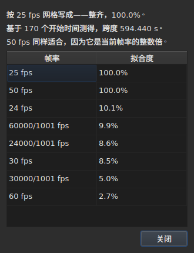

# 帧网格

<!-- machine-translated -->
> 本页为机器翻译，尚未经过熟悉该语言的读者审校。

字幕文件**不会声明**其位置是按哪个帧率计算的：SubRip 没有文件头，WebVTT 的文件头是自由文本。窗口在打开文件时**根据位置本身推断**帧率，并在两个地方显示，二者回答的不是同一个问题。

| 位置 | 提供的内容 |
| :------ | :------------ |
| 状态栏 | **答案**，始终显示，无需询问 |
| `工具(O) ▸ 帧率分析…(R)` | **推理过程**，需要查看时再看 |

## 状态栏显示的内容

在右侧，位于文件读取时的[编码](files.md#状态栏中的编码)信息与[关联视频](video.md#状态栏显示的内容)信息之间：

| 情形 | 显示内容 |
| :-------- | :-------------- |
| 位置落在网格上 | `Grid: 24 fps` |
| 只有一部分位置落在网格上 | `Grid: 29.97 fps (partial)` |
| 没有已知网格与之吻合 | `No grid` |

**`No grid` 不给出任何帧率，这是有意为之**。候选集合是封闭的——就是转换对话框提供的那八个——如果报告其中错得最少的一个，就是在“不知道”才是正确答案时给出了错误答案。

**`No grid` 有两种原因，二者的含义并不相同**。要么没有任何网格吻合，要么文件中的字幕太少，无从判断——两个开始时间看上去总是完美对齐，这什么也说明不了。状态栏对两者的说法相同；**分析则会区分二者**，并在第一种情况下给出最佳候选的偏差有多大。

这一行**在每次操作之后更新**。把文件对齐到另一个帧率会改变网格，状态栏不能继续显示旧的网格。

### 以帧计数的文档没有网格，只有帧率

**在九种格式中，只有 MicroDVD 以帧计数**。它的每一行带有两个帧编号，别无其他内容，而文件**没有说明**应按哪个帧率来读取。此时状态栏的同一位置显示：

| 情形 | 显示内容 |
| :-------- | :-------------- |
| 文档以帧计数 | `Frames: 24000/1001 fps` |

**这不是网格，而且在这里推断网格会形成循环。** MicroDVD 文档的位置正是*根据*其帧数、按这个帧率计算出来的；再由这些位置推断网格，只会得出同一个数字，也就是把一项给定的数据伪装成了测量结果。

**这个帧率从何而来，会由读取过程说明一次**，列在[诊断信息列表](files.md#读取的诊断信息)中：`counts in frames and states no rate; it was read at ("24000/1001")`。而状态栏的这一行说明的是当前的实际情况，始终显示。

**帧率弄错会使整个文件发生偏移**，可在 [`Convert Frame Rate…`](operations.md#convert-frame-rate) 对话框中更正：它打开时显示的是读取所用的帧率，并说明这就是读取所用的那个。

## 分析显示的内容

`工具(O) ▸ 帧率分析…(R)` **不会修改任何内容**。它打开时显示一份摘要，以及八个候选帧率及其得分的排名。




摘要先给出答案，再给出对答案的限定——每一句只在有话可说时才出现：

| 可读到的内容 | 出现时机 |
| :--------------------- | :--- |
| 依据多少个开始时间，以及时间跨度多长 | 始终出现 |
| 文件相对于其网格偏移了多少 | 其位置在网格上，仅相差一个常量 |
| 另一个帧率同样吻合 | 它是所选帧率的整数倍 |
| 该时间跨度不足以区分两个帧率 | 文件太短，无法将它们分开 |
| 有多少个开始时间偏离网格，**以及分成多少段** | 文件为部分吻合 |

**段数能够区分两种情形**，只看百分比会把它们混为一谈。许多只含一个开始时间的段，是被逐个手动修正过的位置。少数几个较长的段，则是重新调整过时间的一部分，或是由另外两个文件拼合而成的文件。

**这里显示完整的排名，而不是单一的答案**。一个文件对 25 的吻合度为百分之百，对 50 的吻合度也为百分之百，这说明了一些仅凭一个结论会被掩盖的信息。

## 转换出错时

一个不落在任何网格上的文件，有时是**按错误的帧率转换过**的文件：它实际上位于一个真实的网格上，只是被一个不属于那八个帧率中任何一个的比率偏移了。当推断得到 `none` 或 `partial` 时，分析会在**八个标准帧率的五十六个有序组合**——这个集合是封闭的——中搜索，找出哪一个的转换能使位置回到网格上。每个比率都会应用到位置上，**由推断本身来评判结果**：置信度就是推断会给出的值，绝不是编造的数字。比率相同的两个组合，例如从 30 到 25 和从 60 到 50，算作同一次转换。

这句话会加入摘要：

```text
converting from 24 to 25 fps puts the positions on a 24 fps grid: 99.9%, against 11.8% as they are and 14.9% for the next best conversion
```

它给出转换本身、位置将落在哪个网格上以及吻合得有多好，**然后给出与当前位置的差距，以及与其他转换中最佳者的差距**。`Convert Frame Rate…` 按钮会关闭分析并打开[转换
对话框](operations.md#convert-frame-rate)，**其中已填入找到的组合**——对话框未被接受之前不会应用任何内容，取消即可返回。在旁边打开的视频，可以让你根据画面判断这个答案是否正确。

**当两个组合同样好时，不会提出任何建议，并且这句话会说明这一点：**

```text
converting from 30 to 25 fps and converting from 25 to 24 fps fit equally well (99.7% and 99.6%), so none is proposed
```

这是常态而非例外：每秒 28.8 帧的网格，既可以回到 24，也可以回到 30，而时间全部翻倍的文件仍然落在 25 的网格上。只有一种修复办法的操作，是转换一个**已经**处于目标帧率的文件。出现并列时由视频来决定：你自己在其中一个组合上打开 `Convert Frame Rate…`。

对于已经落在网格上的文件、太短而无法给出有价值结论的文件，以及没有任何转换能使其回到网格上的文件——漂移、不在这八个帧率之内的比率、没有结构的位置——**不会作任何提示。**

## 表格不显示的内容

**表格的任何一行都不会因为网格而被标记**，永远不会。

一旦手动修正了某个位置，它就不再对齐了。因此自动标记会把用户的工作报告成异常，而且恰恰是在用户正在修正的文件上。这种推断说的是**文档**；分析是唯一的例外——因为你打开它就是为了这个。

表格的标记则涉及不自洽的内容：结束时间早于开始时间、重叠、顺序被打乱。参见[表格](table.md)。
