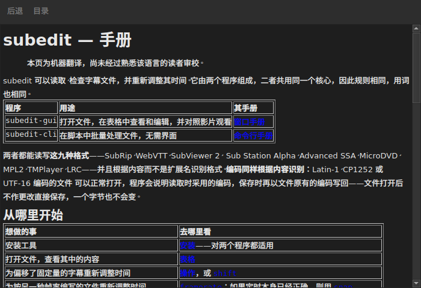

# 窗口中的手册

<!-- machine-translated -->
> 本页为机器翻译，尚未经过熟悉该语言的读者审校。

`帮助(H) ▸ 手册(M)`，或 `F1`，会在单独的窗口中打开**本手册本身**。




## 它打开什么，以及为什么不用网址

**打开的是随程序一同安装的手册**，而不是互联网上的页面。

网址描述的是开发中的版本，而不是用户手头的版本。读到自己并未使用的版本的手册，比没有手册还糟——所以窗口读取的是安装时放在 `<prefix>/share/subedit/manual` 下的文件。见[安装](../subedit-cli/installation.md)。

手册从[首页](../index.md)打开，那里会告诉你从哪里开始。

## 使用哪种语言

**使用窗口的语言**。手册以界面所用的语言打开：即在 `编辑(E) ▸ 首选项…(E)` 中选定的语言，未选定时则为环境的语言——见[界面语言](preferences.md#界面语言)。

| 窗口使用的语言 | 手册打开时使用的语言 |
| :---------------- | :------------------ |
| 英语 | 英语 |
| 已安装手册的语言——加泰罗尼亚语、捷克语、德语、西班牙语、芬兰语、法语、加利西亚语、希伯来语、匈牙利语、西方国际语、冰岛语、意大利语、荷兰语、波兰语、葡萄牙语、巴西葡萄牙语、俄语、塞尔维亚语、土耳其语、简体中文 | 该语言 |
| 未安装手册的语言 | 英语 |

**逐页处理，而不是全有或全无**：翻译中没有的页面以英文打开，其余各页仍使用窗口的语言。链接在两者之间也同样跳转。

各种译文与英文手册并排安装，每种语言一个以其语言命名的目录：法语是 `<prefix>/share/subedit/manual/fr`。所用语言是窗口启动时的语言，因此在首选项中选定的语言，对手册同样在下次启动时生效。

## 浏览

| 操作 | 结果 |
| :---------- | :----------- |
| 单击手册中的链接 | 页面在同一窗口中打开 |
| 单击指向某一节的链接 | 页面打开，窗口滚动到该节 |
| 单击只指向某一节的链接 | 窗口滚动到该节，不切换页面 |
| `Back` | 返回上一页；在第一页时禁用 |
| `Contents` | 返回首页；已在首页时禁用 |

窗口**不是模态的**：在你工作时它一直保持打开，这正是手边备有手册的意义所在。再次选择该条目不会创建第二个窗口，而是把这个窗口带到最前面。

## 它打不开什么，并且会明说

手册有时会引用**路线图**或**架构决策**。这些是仓库中的文档，不属于软件包：它们不会被安装，窗口会直接说明这一点，而不是让单击没有任何反应。

```
../../feuille-de-route.md is not part of the installed manual;
it lives in the project's repository.
```

可以在仓库中阅读它们，仓库的地址在 `帮助(H) ▸ 关于 subedit(A)` 中。

## 条目被禁用时

**如果程序旁没有手册，`帮助(H) ▸ 手册(M)` 会被禁用**。有两种情形，都不是故障：

| 情形 | 原因 |
| :--- | :-- |
| 二进制文件是从构建目录运行的 | 那里没有安装任何内容，因此没有可读的东西 |
| 安装不完整 | 手册被删除了，或者从未复制过来 |

将鼠标悬停在该条目上会说明是哪一种：“此程序旁没有安装手册”。

手册存在而缺少某一页——例如文件被手动删除——不会关闭窗口：它会指出无法读取的文件名，并保持显示原先显示的内容。

## 在哪里查找手册

**在可执行文件旁边**，即 `../share/subedit/manual`——无论前缀是什么，每次安装都是这样的布局。因此，安装在 `~/.local` 下的版本和安装在 `/usr` 下的软件包一样能找到它的手册。
