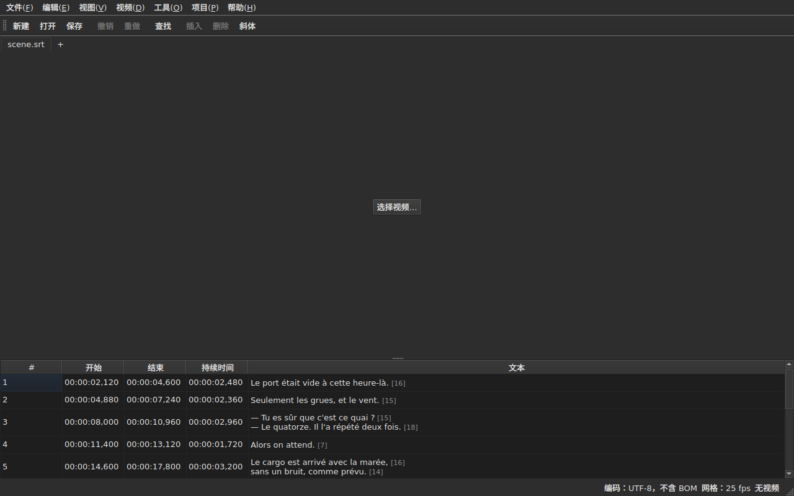

# subedit-gui — 手册

<!-- machine-translated -->
> 本页为机器翻译，尚未经过熟悉该语言的读者审校。

subedit 的窗口：打开一个字幕文件，并在表格中查看。关于另一个程序以及从哪里开始，见[手册](../index.md)。

> **当前状态**。窗口可以**同时打开多个文件，每个文件一个标签页**，不论其编码——通过 `Open…` 打开，或将文件拖放到窗口上——；可以**显示**、**编辑单元格**、**插入和删除行**、**撤销**、**保存——可选择编码、行尾和字节序标记**——，并**标出位置前后矛盾的字幕**。可以**合并与拆分**行，**剪切、复制和粘贴**文本，并在可见文本中**查找与替换**而不破坏标签，范围可以是一个项目，也可以是所有项目。可以**在主文件旁打开翻译**，按位置或按序号对齐，显示在多出的一列中，并单独保存。`Tools` 菜单有十六项操作和两个拼写条目——移动、变换、转换帧率、调整持续时间、**追加文件、把项目拆成两份**、设为斜体、添加对话破折号、以四种方式更改大小写、删除听障提示、**通过多页向导更正文本**、**逐词检查拼写**、对齐到帧率、恢复到网格上——以及不修改任何内容的网格分析。`Projects` 菜单可以**一次操作保存并关闭所有项目**。窗口可以**为文档关联视频**（手动选择或自动推测），并**在窗口内播放**，当前行绘制在画面上；可以**根据影片的位置设定开始时间、结束时间或一条字幕**，**逐帧步进**，并**把边界微调一帧**。播放栏可以**跳转、调节音量和位置**，表格会**跟随播放**而不会撤销手动滚动，位置可以**以帧显示**，`Video` 菜单可以**选择音轨**。两项检测**只提出建议，从不自动应用**：翻译整体偏移了一个固定量时，可以**按偏移后重新打开**；以及把文件恢复到网格上的帧率转换。窗口会**记住其几何位置、各列的顺序、宽度和是否显示，以及各项设置**，下次启动时沿用，并可按选择呈现为**浅色或深色**。`帮助(H) ▸ 手册(M)` 会在窗口中打开**本手册**。本手册描述的是已有的功能，而不是计划中的功能；后续计划见[路线图](../../../../feuille-de-route.md)。

> **本手册的图像是生成的，文字则不是**。`subedit-cli` 的示例是通过运行命令生成的；屏幕截图是通过构建真实的窗口并为其拍照生成的——`make
> manual` 同时完成这两件事。因此，图像不会描述一个已不存在的界面，界面一旦改变，也会体现在仓库的差异中。唯一没有保障的是图像周围的文字，其准确性依赖人工审阅。

**每个界面都以应用设置的两种配色各展示一次**——`Light` 和 `Dark`，即[首选项](preferences.md#主题)提供的两种。在由桌面主题决定外观的桌面环境下，`System` 会根据桌面的选择呈现其中之一。

## 菜单

`File`、`Edit`、`View`、`Video`、`Tools`、`Projects`、`Help`——按使用的顺序排列：文档、对文档所做的操作、查看方式、与文档相关的内容、检查文档的功能、作用于所有已打开项目的功能、说明。

`View` 含一个子菜单 `Columns`，除 `Text` 外每列对应一个可勾选的条目——见[表格](table.md#隐藏和移动列)——以及一个设置项 `Positions in Frames`，它把 `Start` 和 `End` 显示为帧号——见[以帧表示的位置](table.md#以帧表示的位置)。

`Projects` 含两个条目：`Save All` 和 `Close All`——见[“项目”菜单](files.md#项目菜单)。

`Edit` 含五个块，各以分隔线隔开：撤销；剪贴板——剪切、复制、粘贴文本；`Find and Replace…`；插入、删除、合并和拆分行；最后是 `Preferences…`。撤销针对的是对一次编辑的操作，移动文本既不增加也不删除行，下一块的四项会改变行数，而设置主题根本不是编辑。

**按键的名称与菜单显示的一致**，与界面的其余部分一样使用英文：`Ins`、`Del`、`Ctrl+Shift+Z`。按下但没有任何菜单提及的键保留其英文名称：`Enter`、`Esc`、`Shift`。

`Help` 含两个条目，顺序与菜单显示的一致。`Manual`，或 `F1`，在窗口中打开本手册——见[窗口中的手册](help.md)。`About subedit` 给出版本、许可证，以及窗口所运行依赖的库及其版本——见 [`--version`](invocation.md#--version)。

## 工具栏

菜单下方有一个工具栏，分组放置**最常用的操作**。每个按钮上是一个简短的词；完整的条目仍在菜单中，快捷键相同。

| 按钮 | 菜单项 | 快捷键 |
| :----- | :--------- | :------- |
| 新建 | 文件(F) ▸ 新建项目(N) | `Ctrl+N` |
| 打开 | 文件(F) ▸ 打开… | `Ctrl+O` |
| 保存 | 文件(F) ▸ 保存(S) | `Ctrl+S` |
| 撤销 | 编辑(E) ▸ 撤销 | `Ctrl+Z` |
| 重做 | 编辑(E) ▸ 重做 | `Ctrl+Shift+Z` |
| 查找 | 编辑(E) ▸ 查找和替换…(F) | `Ctrl+F` |
| 插入 | 编辑(E) ▸ 插入字幕… | `Ins` |
| 删除 | 编辑(E) ▸ 删除字幕 | `Del` |
| 斜体 | 工具(O) ▸ 斜体(I) | `Ctrl+I` |

**按钮被禁用的原因与其对应条目相同**：没有可撤销的内容时 `Undo` 被禁用，没有选中任何行时 `Remove` 被禁用。翻译相关的条目以及 `Tools` 菜单中除 `Italic` 外的操作仍留在各自的菜单中：它们使用较少，或并非人人都用。

## 各部分

| 部分 | 内容 |
| :------ | :------- |
| [安装](../subedit-cli/installation.md) | 构建与安装——该页同时适用于两个程序 |
| [调用](invocation.md) | 启动窗口、参数、退出码 |
| [打开与保存](files.md) | 各条命令、标签页、`Projects` 菜单、拖放文件、翻译及其按偏移重新打开、诊断信息、状态栏中的编码、往返转换、关闭 |
| [表格](table.md) | 各列显示的内容、隐藏和移动列、以帧表示的位置、翻译列以及各项操作所针对的文本 |
| [编辑单元格](editing.md) | 哪些单元格可以编辑，以及如何编辑 |
| [剪切、复制和粘贴文本](clipboard.md) | 三个条目、传递的内容、添加的行、转换后的标签 |
| [查找与替换](find-and-replace.md) | 对话框、四种操作、两个选项、搜索涵盖的范围、在所有已打开的项目中 |
| [插入、删除、合并、拆分、排序以及使字幕互不重叠](lines.md) | 四个条目、其快捷键、新行的位置 |
| [撤销与重做](undo.md) | 历史记录、两个操作、修改标记 |
| [帧网格](frame-grid.md) | 由位置推断出的帧率、分析，以及把文件恢复到网格上的转换 |
| [操作](operations.md) | 移动、变换、转换、调整持续时间、追加文件、拆分项目、设为斜体、大小写、破折号、删除提示、对齐、恢复到网格上，以及超出影片结尾的内容 |
| [更正文本…](correct-texts.md) | 更正向导：目标和任务、各任务页、进度、确认 |
| [检查拼写…](check-spelling.md) | 拼写检查：其设置、逐词检查、中途关闭、没有词典时 |
| [关联视频](video.md) | 选择视频、自动推测、音轨、状态栏、`ffmpeg` |
| [播放器](player.md) | 视频视图、播放栏、播放、移动、音量、跟随播放的表格、绘制的行 |
| [根据视频设定时间](timing.md) | 设定一条字幕的开始或结束时间、插入、根据影片位置选中、逐帧步进、微调边界 |
| [首选项](preferences.md) | 主题、首选项文件、其选项，以及无法读取的值会怎样 |
| [窗口中的手册](help.md) | `帮助(H) ▸ 手册(M)`，它打开什么以及如何在其中浏览 |
