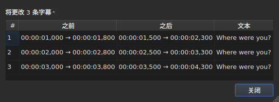
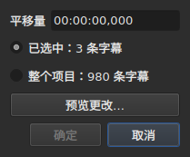
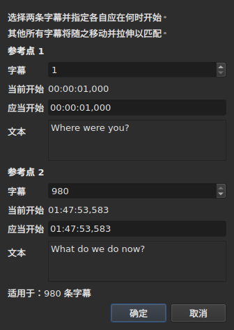
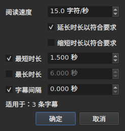
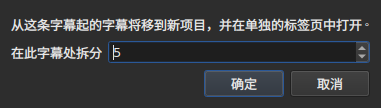

# 操作

<!-- machine-translated -->
> 本页为机器翻译，尚未经过熟悉该语言的读者审校。

**Tools** 菜单有十六项操作、一项分析和两个拼写条目。十六项操作中的每一项都可以用 `Ctrl+Z` 撤销；分析不修改任何内容。`Check Spelling…` 也可以撤销，而 `Spell-Check Settings…` 不触碰任何文本。

| 条目 | 对话框 | 作用 |
| :---- | :----- | :----------- |
| `Shift Positions…` | 有 | 把目标按一个时长移动 |
| `Transform Positions…` | 有 | 根据两个标记点修正目标 |
| `Convert Frame Rate…` | 有 | 把目标从一种帧率重新计时为另一种 |
| `Adjust Durations…` | 有 | 移动结束时间，以满足阅读速度、持续时间和间隔 |
| `Append File…` | 文件选择器 | 把一个文件追加到项目末尾 |
| `Split Project…` | 有 | 把项目一分为二，其余部分进入新标签页 |
| `Italic` | **无** | 把目标设为斜体，或取消斜体 |
| `Dialogue` | **无** | 在每一行行首加上对话破折号，或去掉 |
| `大小写(S) ▸ 标题式大小写(T)` | **无** | 每个单词的首字母大写 |
| `大小写(S) ▸ 句首大写(S)` | **无** | 只有文本的第一个字母大写 |
| `大小写(S) ▸ 全部大写(U)` | **无** | 全部大写 |
| `大小写(S) ▸ 全部小写(L)` | **无** | 全部小写 |
| `Remove Hearing-Impaired Mentions…` | 有，无设置 | 删除听障提示 |
| `Correct Texts…` | 有，多页向导 | 提出更正建议——提示、连接与拆分单词、常见错误、大小写、换行——并在接受后应用，见[更正文本…](correct-texts.md) |
| `Check Spelling…` | 有，逐词检查 | 逐个检查词典中没有的词，并应用所作的更正，见[检查拼写…](check-spelling.md) |
| `Spell-Check Settings…` | 有 | 选择检查的语言、目标和文档，以及输入时的下划线，见[检查拼写…](check-spelling.md#拼写检查设置) |
| `Snap to Frame Rate…` | 有 | 把每个时间戳放回最近的一帧 |
| `Shift Whole File onto Grid (…)` | **无** | 把整个文件恢复到它的网格上 |
| `Frame Rate Analysis…` | 有，无设置 | **不修改任何内容**——见[帧网格](frame-grid.md) |

**操作做了什么，会在一个必须关闭的信息框中说明，`Italic`、`Case` 和 `Dialogue` 除外**：这三项不打开对话框，它们的报告——包括“没有需要更改的内容”——显示在状态栏中，无需关闭。`Split Project…` 同样在状态栏中给出自己的报告：结果已经摆在你面前，就在新标签页中。这些消息在各项操作的小节中引用。

插入、删除、合并和拆分行不在这里，而在 `Edit` 菜单中，因为它们会改变行数。见[插入、删除、合并、拆分、排序以及使字幕互不重叠](lines.md)。

## 作用对象

**选中的行；如果没有选中任何行，则是整个文件**。所有操作规则相同，而对话框（如果有）会用简单的话重申这一点：

```
Applies to: 4 subtitles
```

选中所有行与不选中任何行等效。

**只选中了一部分行时，对话框会询问作用于什么**。显示两个选项并附带数量，**默认勾选的是选区**：

```
(•) Selected: 2 subtitles
( ) Whole project: 4 subtitles
```

勾选 `Whole project` 会把操作扩大到整个文件，无需先更改选区。没有可选的内容时——没有选中任何行，或者选中了全部——，上面的 `Applies to:` 一行会单独出现。

`Shift Positions…`、`Transform Positions…`、`Convert Frame Rate…`、`Adjust Durations…`、`Snap to Frame Rate…` 和 `Remove Hearing-Impaired Mentions…` 的对话框提供这个选择。

### 应用前先预览

`Shift Positions…`、`Transform Positions…`、`Convert Frame Rate…`、`Adjust Durations…` 和 `Snap to Frame Rate…` 带有一个 **`Preview changes…`** 按钮。它会打开一个小窗口，说明在**当前输入的值和已勾选的目标下**，该操作会更改多少条字幕，并列出前十二条：它们的序号、更改前的位置、更改后的位置，以及文本的第一行。**不会应用任何内容**：关闭该窗口即回到对话框，可以修改某个值再次查看。




它打开时足够大，可以显示所有列，也可以手动调整大小。

如果操作不会更改任何内容，窗口会这样说（`Nothing would change.`）。只要输入的内容尚不能构成一项操作——无法读取的时长、两个标记点落在同一条字幕上——，预览就是空的，原因与 `OK` 按钮呈灰色相同。`Remove Hearing-Impaired Mentions…` 没有预览：它更改的是文本，而它事后给出的报告已经说明了这一点。

**有翻译时，是哪一个文本**？位置类和结构类操作作用于整条字幕——它的两个文本都会随之变化。改写文本的操作——`Italic`、`Case`、`Dialogue`、`Remove Hearing-Impaired Mentions…`——针对的是**当前单元格所在列的文本**：翻译列中是翻译，其他位置是主文本。另一个文本保持不变，状态栏会说明针对的是哪一个。见[表格](table.md#操作所针对的文本)。

**有一个例外，而它的标签已经说明了**：`Shift Whole File onto Grid` 忽略选区。网格是文档的属性，半个文档没有自己的网格；因此该条目在名称中就说明了这一点，而不是只写在本手册里。

**`Append File…` 也忽略选区**，原因不同：它改写的不是目标，而是把末尾向后推。见它的[专门小节](#append-file)。**`Split Project…` 也是如此**：它在你指定的位置切开。见[它的小节](#split-project)。

**`Correct Texts…` 在自己的页面上选择目标**，而不是跟随当前选区：选区、当前项目或所有已打开的项目。见[更正文本…](correct-texts.md)。**`Check Spelling…` 在 `Spell-Check Settings…` 中选择**，并且会记住：见[检查拼写…](check-spelling.md)。

**两项网格操作所说的与网格本身所说的不是同一回事**。操作作用于选区；分析和状态栏说的是**整个文档**。在一百七十六行中对齐五行，确实改变了这五行——表格显示了这一点——，而两者都没有变化，看上去就像没有刷新。其实不是：它们没有什么可说的。见 [`Snap to Frame Rate…`](#snap-to-frame-rate)和[帧网格](frame-grid.md)。

### “没有选中任何内容”对各条目意味着什么

这条规则适用于 `Tools` 菜单和搜索。`Edit` 菜单中触及行或清空行的条目对此的理解不同——否则一次不小心的 `Del` 或 `Ctrl+X` 就会清空文档。

| 条目 | 没有选区时 | 前提条件 |
| :---- | :------------------ | :--------------- |
| `Tools` 菜单的各项操作 | 整个文件 | 文档非空 |
| `Shift Whole File onto Grid` | 整个文件，**始终如此** | 找到了网格 |
| `Find and Replace…` | 整个文件 | 文档非空 |
| `Cut Texts`、`Copy Texts`、`Paste Texts` | **禁用** | 至少选中一行 |
| `Remove Subtitles` | **禁用** | 至少选中一行 |
| `Merge Subtitles` | **禁用** | 至少两行相邻的行组成的块 |
| `Split Subtitle` | **禁用** | 恰好一行 |
| `Insert Subtitles…` | 禁用，空文档除外 | 有一行可作为放置它们的参照 |

各页分别给出了原因：[剪贴板](clipboard.md#作用对象)、[行](lines.md)、[搜索](find-and-replace.md#搜索涵盖的范围)。

**在空文件上这些条目是禁用的**：没有什么可移动。`Italic` 还有第二个条件，其小节会说明：已打开的格式必须能写入样式。大小写和破折号则没有——文本在九种格式中都是文本。

## `Shift Positions…`

把目标按一个时长向前或向后移动。每条字幕的两个边界移动相同的量：没有任何一条显示的时间变长或变短。

时长**像时间戳一样书写，包括符号**——`00:00:02,500` 向前移动，`-00:00:01,250` 向后移动。 **该字段是改写而不是输入**：它从 `00:00:00,000` 开始，输入的数字替换光标下的数字，光标会自动跳过 `:` 和 `,`，因此格式永远不会改变。只接受数字，以及用于改变符号的 `-`（或 `+`）；`Backspace` 和 `Delete` 会把该位放回零。凡是设置时间的地方都使用同一个字段：转换对话框、表格的位置单元格和转录的范围。




| 拒绝的情形 | 原因 |
| :------ | :-- |
| 无法读取的时长 | 按钮保持禁用；不会随意移动任何内容 |
| 移动量为零 | 没有可记录的操作 |
| 某条字幕会移到视频开头之前 | **没有任何文件能承载这样的位置** |

第三种情形会指出责任所在——“第 1 条字幕将在原点之前开始，字幕文件无法保存这样的位置”——，看它就能知道你错了多少。不会应用任何内容。

## `Transform Positions…`

修正按另一个剪辑版本计时的文件。你说明**两条**字幕实际从何时开始，其余的一切按比例随之变化。

对话框两次询问同样的内容：字幕序号，以及其开始时间应处的位置。对每个标记点，它都会显示**该序号所指的字幕**——其文本（`Text`）和它**当前**开始的时间（`Now starts`），均为纯标签——，并且它们会随着序号的更改而更新。文本始终保留**三行的空间**，不论字幕写了什么：更长的文本或很长的地址会在其中滚动，标记点更换时对话框的大小保持不变。**每个标记点只需输入一个字段：`Should start`**，即这条字幕必须开始的时间。无需在表格中查找哪一行是 `980`。

`Should start` **以当前值作为建议**：只要你不去动它，该标记点就表示“这条字幕已经在它应在的位置”。你只需更改想更改的内容。第二个标记点预先填入文件的最后一条字幕——两个相距较远的标记点，比两个相邻的标记点能得出更可靠的修正。




**两个标记点都恰好落在所要求的位置**。这不是近似：计算的方式保证了这一点。

| 拒绝的情形 | 原因 |
| :------ | :-- |
| 两个标记点落在同一条字幕上 | 它们不能确定任何修正 |
| 无法读取的位置 | 原因与移动相同 |

无法输入超出文件的序号：该字段以字幕数量为上限。

## `Convert Frame Rate…`

当位置是按一种帧率计算、而必须按另一种帧率时，重新为目标计时。

两个列表都提供八种标准帧率。

> **输入帧率弄错，会让整个文件移位，而不会报告任何内容**。这是该操作最糟糕的失败模式，所以对话框会说明它所建议的值来自哪里，而不是悄悄地设定它们。

### 两个来源及其回答的内容

对话框最多再带两行，每一行在有话要说时才会出现：

| 行 | 它说明什么 | 它预先填入什么 |
| :--- | :----------- | :---------------- |
| `The positions say` | 从文件的位置推断出的[帧网格](frame-grid.md) | `Timed against` |
| `The video declares` | 容器宣称的帧率，例如 `24000/1001` | `Should play at` |
| `The file was read at` | **以帧计数**的文件读取时所用的帧率 | `Timed against` |

**每条建议都会进入它所回答的字段**。网格说明文件是按什么*写成*的——那是上方的列表。容器宣称的是影片*运行*的帧率，也就是字幕必须适配的帧率——那是下方的列表。

**只有干净的网格才会预先填入输入**。部分网格是推断本身就限定为部分的线索，而这个字段决定的是对整个文件的操作。[状态栏](frame-grid.md)和分析负责这种情形；这里不处理。

**以帧计数的文件会取代网格，而不是与它并存**。MicroDVD 带有帧号，文档的位置是按读取时的帧率据此计算出来的：从这些位置推断出的网格，只能再找回那个数字。因此 `The positions say` 会消失，由 `The file was read at` 取而代之——这与[状态栏](frame-grid.md#以帧计数的文档没有网格只有帧率)的选择相同。

**这就是更改 MicroDVD 帧率的方法**。把读取时的帧率设为输入、真实帧率设为输出，即可根据文件的帧重新计算每个位置——无需重新读取任何内容，而且该操作可以像其他操作一样撤销。

### 不一致并不是矛盾

两行可以同时显示，并给出不同的数字。**这不是需要裁决的错误**：影片以一种帧率运行，文件则是按另一种网格写成的。24 帧的文件配 25 帧的影片，正是对齐——命令行中的 `snap`——所要处理的情形。

因此不会替用户选择任何一方：两个列表都保持可编辑，这是有意为之。强加于人的来源会使交叉核对无从进行。

没有话要说时这些行不会出现：没有关联视频、没有 `ffprobe`，或者没有干净的网格。此时的对话框就是上面所描述的那个，**也不会因此拒绝任何操作**——帧率由用户提供。见[关联视频](video.md#不需要-ffmpeg)。

影片宣称的帧率如果不是八种标准帧率之一，会**显示出来但不会被选中**：知道影片以非常规帧率运行本身就是信息，而这里没有可以转换成的目标。

把帧率转换为它自己不会改变任何内容：按钮保持禁用。

## `Adjust Durations…`

通过**移动结束时间、而从不移动开始时间**，来延长或缩短目标中字幕的持续时间。移动开始时间会移动字幕本身，那是 [`Shift Positions…`](#shift-positions) 的工作。




### 四项约束

| 字段 | 它要求什么 | 取值 | 默认值 |
| :---- | :--------------- | :----- | :------ |
| `Reading speed` | 阅读文本所需的时间 | 每秒 1 到 99 个字符，精确到十分位 | 15 个字符/秒 |
| `Lengthen durations to match it` | 延长过短而无法读完的字幕 | 勾选或不勾选 | 勾选 |
| `Shorten durations to match it` | 缩短显示时间超过所需的字幕 | 勾选或不勾选 | 不勾选 |
| `Minimum duration` | 持续时间的下限 | 0 到 99 s，精确到毫秒 | 勾选，1.5 s |
| `Maximum duration` | 持续时间的上限 | 0 到 99 s，精确到毫秒 | 不勾选，6 s |
| `Gap between subtitles` | 在下一条字幕之前要留出的间隔 | 0 到 99 s，精确到毫秒 | 勾选，0 s |

这些是 Gaupol 的默认值。

**未勾选的约束视为不存在**：它的字段呈灰色，不会被读取。勾选为零的约束就等于零——间隔为 0 s 时，字幕不能与下一条重叠。只有勾选了 `Lengthen` 或 `Shorten` 时，才会读取阅读速度。

**全部未勾选时，`OK` 被禁用**：没有什么可要求的。

对话框重新打开时显示上一次调整的值，**并且会在会话之间保留它们**——与两个搜索选项一样。**未勾选的框也保留其值**：设为 2 s 之后取消勾选 `Minimum duration`，并不会恢复为 1.5 s，再次勾选时仍是 2 s。这九项设置在[首选项文件](preferences.md#文件)中，位于 `duration-adjust.` 下。

**命令行共用这些设置**。[`subedit-cli adjust`](../subedit-cli/adjust.md) 默认读取同样的九项设置，因此在这里设定的速度就是它所用的速度，除非它自己的选项另有指定；[`subedit-cli config`](../subedit-cli/config.md) 可以显示并更改它们。见[两个区块，其中一个与命令行共用](preferences.md#两个区块其中一个与命令行共用)。

### 先后顺序，以及哪一项优先

目标中的每条字幕都**按这个顺序**经过四项约束，每一项依次设定结束时间：

| 次序 | 约束 | 它设定什么 |
| ---: | :--------- | :----------- |
| 1 | 阅读速度 | `end = start + length ÷ speed`，如果字幕过短（`Lengthen`）或过长（`Shorten`） |
| 2 | 最小持续时间 | `end = start + minimum`，如果持续时间更短 |
| 3 | 最大持续时间 | `end = start + maximum`，如果持续时间更长 |
| 4 | 间隔 | `end = next start − gap`，如果结束时间离下一条太近——但绝不早于开始时间 |

**最后应用的一项优先**。间隔排在最后，可以把持续时间重新压到刚刚设定的最小值以下：屏幕上同时出现两条字幕是观众看得见的错误，而略短的字幕则不是。

**文本的长度不计标签**，以字符计，包括换行：`<i>été</i>` 计为三个字符。阅读速度针对的是观众所读的内容。

**下一条指文件中的下一条字幕**，不论它是否在目标中。**文件的最后一条字幕没有下一条**：间隔对它没有约束。

### 无法满足的约束会被说明

调整完成后，窗口会说明有多少个结束时间被移动，以及**哪些约束无法满足**——只有至少为一条字幕作出了牺牲的约束才会出现：

```text
adjusted the durations of 12 subtitles; could not satisfy the reading speed in 9 subtitles, the minimum duration in 4 subtitles
```

可能出现的三种提法是 `the reading speed`、`the minimum duration` 和 `the gap`。**最大持续时间始终得到满足**：它排在速度和最小值之后，只有间隔排在它后面，而间隔只会缩短。大于最大值的最小值会让位于最大值，被计数的是最小值。只有当下一条字幕在该字幕自身的开始之前就已开始时，间隔才会被牺牲。

计数涵盖整个目标，**包括结束时间没有移动的字幕**：已经紧贴下一条、又短于最小值的字幕会被计入。没有任何结束时间移动时，窗口会这样说——`no duration to adjust`——，并且不会向历史记录添加任何条目。

## `Append File…`

把一个文件追加到已打开项目的末尾。**两者之间不会插入任何内容**：所选文件会按项目最后一条字幕的结束时间移动，与 Gaupol 完全一样。

**在空文档上禁用**：没有可作为移动起点的结束时间。会打开文件选择器，无需选择编码——与 `Open…` 相同。

**追加的文件要经过转换**，用词与 `Save As…` 以及[从另一种格式粘贴](clipboard.md#其他格式的标签会被转换)相同：它的标签会被转换为项目的格式，该格式无法写入的内容会被说明：

```text
appended 12 subtitles; Advanced SSA into SubRip: 1 tag dropped
```

**被追加文件所带的内容不会完整保留**。它的位置会随之转移，包括标签；它的文件头、格式特有的字段——样式名称、边距——，以及标签在项目格式中无法转换成的内容，则不会转移，并且会说明这一点。**它没有翻译**：翻译专属于接收它的文档，被追加的文件单独到来。

**之后会被选中**，就像粘贴写到末尾之外的那些行一样。没有任何损失时，计数显示在状态栏中，而不是需要关闭的对话框中——规则与[打开翻译](files.md#打开翻译)相同。

**只有一条历史记录**，不论追加了多少条字幕：`Ctrl+Z` 会一次性全部撤销。

**已打开的文件可以追加到它自己**：没有任何东西禁止这样做，与 Gaupol 一样。

**在命令行中**，[`append`](../subedit-cli/append.md) 可以一次对多个文件做同样的事，只产生一个结果。

## `Split Project…`

把项目一分为二：**`Append File…` 的精确逆操作**。会有一个对话框询问从哪条字幕切开——从第二条到最后一条，序号与表格中相同——，并以当前行打开。

**表格在你切之前就显示出切在哪里**：对话框取的每个序号都会选中对应的行。`Cancel` 会恢复之前的选区。




**少于两条字幕时禁用**：切开需要两边各有一条字幕。

**其余部分会被复制到新项目中，在新标签页里打开，并从原项目中删除**。新项目会**移动负的、等于保留下来的最后一条字幕的结束时间的量**：先拆分再追加，就得回起始的项目。它的两个文本——主文本和翻译——随各自的字幕而去，并保持原有的格式和编码——**没有路径**：还没有任何文件保存它。因此它的标签页从诞生起就写作 `untitled*`，不保存就关闭它，会提出对所有未写入内容都会提的那个问题。

**状态栏会说明有多少条字幕离开了**，不需要关闭对话框——新标签页已经显示了结果：

```text
split 12 subtitles into a new project
```

**只有一条历史记录**，在原项目中：`Undo: splitting the project` 会把剩下的部分还给它。新项目有自己的历史记录，是空的；撤销不会触碰它，它也仍然保持打开。

**如果没有任何文件能写入结果，则会被拒绝**。如果两部分在切口处重叠，移动会让某条字幕落到视频开头之前——这是负的位置，没有任何格式会写入。拒绝的对话框会**指出是哪条字幕**，并建议换个地方切开：

```text
Cannot split at subtitle 3: subtitle 3 would fall before the start of the video. Cut somewhere else.
```

恰好到达开头是允许的：零也是一个位置。

**在命令行中**，[`split-file`](../subedit-cli/split-file.md) 以同样的方式切开文件，得到两个命名的文件。

## `Snap to Frame Rate…`

把**每个时间戳**——开始和结束——放到所选帧率中最近的一帧上。只有一个列表，这就是它与转换的全部区别：转换需要两种帧率，因为它把文件从一种缩放到另一种；对齐只需要一个可以落脚的网格。

| | `Convert Frame Rate…` | `Snap to Frame Rate…` |
| :--- | :-------------------- | :-------------------- |
| 移动量 | 与时间成正比——一部长片上**可达数秒** | 最多半帧，**处处如此** |
| 适用于什么文件 | **计时有误**的文件 | 计时**正确**而网格有误的文件 |

**使用场景**，说得具体一些：影片是每秒 25 帧，字幕写在 24 帧的网格上，各行已经大致在各自的位置，误差在几毫秒之内。没有什么需要重新计时，只需要把时间戳放回正确的帧上。

列表**打开时显示视频所声明的值**，而不是位置所显示的值：目的是接入影片的网格，而推断出来的是正要离开的那个。没有视频或没有 `ffprobe` 时，它打开时显示项目的帧率。

把文件对齐到它已经处于的网格上，不会改变它，这也不是错误：操作会应用，什么也不移动，并且像其他操作一样可以撤销。

**对文件的一部分进行对齐，完成后会说明**。当选区没有涵盖全部内容、而文档仍按另一种网格读取时，会显示一条通知：

```
5 of 176 subtitles aligned to 25 fps; the document is still read on a 24 fps grid
```

它把操作与其效果联系起来，并解释了为什么状态栏和分析没有变化：它们说的是文档，而操作作用于五行。不会阻止任何事——对文件的一部分进行对齐可能正是你的本意。

**这几乎总是无意的，而这是经过测量的**。在仓库的八个网格文件上，对整个文件对齐会使推断出的帧率变为目标帧率，其集中度变为 100%；对五行对齐则从不会改变推断出的帧率，并且在八种情形中的七种里会**降低**集中度——已对齐的行离开了文件其余部分所在的网格。第八种是 50 到 25，目标网格整除文件的网格，而位置本来就已经在其上。

选区涵盖整个文件、没有推断出网格，或者文档现在已按所请求的帧率读取时，不会显示该通知——这时对齐已经完成了所要求的事。

## `Shift Whole File onto Grid`

把**整个文件**移动一个量，使其位置回到它们所离开的网格上。位置在某个网格上、只差一个常数的文件，是被平移过的，而这个常数是可以测量的。

**菜单条目带有移动量和范围**——`Shift Whole File onto Grid (+0.001 s)`。没有对话框：该操作不接受任何选项，而一个要移动整个文件的条目，必须在被选择之前就说明移动多少，以及它会整体移动。它是菜单中唯一忽略选区的操作。

**找不到网格时它是禁用的**。此时没有可接入的东西，而在噪声上测得的相位会随意移动文件。“没有可接入的东西”与“接入量为零”说的不是一回事：后者仍会提供，因为文件本来就在其网格上是很正常的情形。

**这不是 `Snap to Frame Rate…`**。这个条目把所有内容移动相同的量，并**精确**保留相对计时；对齐则独立移动每个位置，并顺带吸收那些已经被手动修正过的位置。在干净的文件上两者结果相同；在部分对齐的文件上则不同——[分析的详细信息](frame-grid.md)会说明你面对的是哪一种。

## `Italic`

通过写入**已打开格式**的标签，把目标设为斜体；如果已经是斜体，则取消斜体。没有对话框：该操作没有设置，并且像其他操作一样用 `Ctrl+Z` 撤销。

| 操作 | 快捷键 | 位置 |
| :----- | :------- | :---- |
| 斜体(I) | `Ctrl+I` | **Tools** 菜单、工具栏 |

它是 `Tools` 菜单中唯一在[工具栏](index.md#工具栏)中有按钮的操作。

### 各种格式写入什么

字幕的文本就是其文件的文本，包括标签——见[编辑单元格](editing.md)。每种格式有各自的标签，而这个条目让你无需了解它们：

| 格式 | 写入的内容 |
| :----- | :-------------- |
| SubRip、WebVTT、SubViewer 2 | `<i>text</i>` |
| Sub Station Alpha、Advanced SSA | `{\i1}text{\i0}` |
| MicroDVD | `{Y:i}text`——标签一直作用到字幕末尾，无需闭合 |
| MPL2 | **每一行**行首的 `/`，该标记只作用于它自己所在的行 |
| TMPlayer、LRC | 无：这两种格式不写入样式 |

**对于 TMPlayer 和 LRC，该条目是禁用的，而不是隐藏的**。缺失的条目什么也教不了人；呈灰色的条目则回答了“为什么我不能用？”。

**读取的格式是目标文本的格式**。有翻译时，主文本可以是 SubRip，翻译可以是 Advanced SSA：`Italic` 在前者中写入 `<i>`，在后者中写入 `{\i1}`。同样，当目标文本的格式不写入样式时，即使另一个文本的格式写入，该条目也是禁用的。

### 向哪个方向

一个条目负责两个方向，由目标决定：

- **只要有一条字幕不是斜体**，整个目标就会变为斜体；
- 只有当目标**全部**是斜体时，才会取消斜体。

这是 Gaupol 的规则，也是让单个按钮可用的唯一规则：混合的选区会作为整体处理，而不是逐行取反，按两次即可恢复原样。

报告会说明做了什么，以及朝哪个方向：

```
2 subtitles put in italics
2 subtitles taken out of italics
```

**空行永远不会加上标签**——包围着空内容的 `<i></i>` 会在表格中显示出来。因此，只含这类行的目标不会有任何变化，并且会这样说：“没有需要更改的内容”。此时不会向历史记录添加任何条目。

### 它不触碰什么

**其他标签保持原位**：颜色、字体、Advanced SSA 的 `{\pos(x,y)}` 经过该操作时都不会移动。只会设置和删除斜体标签。

一个同时表示多件事的标签不会被整个去掉：`{\b1\i1}` 变为 `{\b1}`，`{Y:bi}` 变为 `{Y:b}`。粗体保留，而文本确实脱离了斜体。

## `Case` 与 `Dialogue`

对**可见文本**的两种变换，标签不受触碰：设为小写的字幕会原样保留它的 `<I>`，破折号放在文本之前，而不是放在开始标签之前。**没有任何标签会换位置**：大写的 `<i>bon</i>jour` 得到 `<i>BON</i>JOUR`，而[替换](find-and-replace.md#搜索的是可见文本)会把斜体扩展到整个单词。

| 条目 | 快捷键 | 作用 |
| :---- | :------- | :----------- |
| 大小写(S) ▸ 标题式大小写(T) | — | `bonjour marie` 变为 `Bonjour Marie` |
| 大小写(S) ▸ 句首大写(S) | — | `BONJOUR MARIE` 变为 `Bonjour marie` |
| 大小写(S) ▸ 全部大写(U) | — | 全部大写 |
| 大小写(S) ▸ 全部小写(L) | — | 全部小写 |
| 对话(D) | — | 添加或删除破折号 |

### 大小写不触碰什么

**第一个字母或第一个数字之前的内容保持原样**。对话破折号、开引号、括号都会保留：句首大写的 `- bonjour` 得到 `- Bonjour`，而不是把破折号“大写”的 `- bonjour`，那样毫无意义。

**句首大写会把其余部分改回小写**。`BONJOUR MARIE` 变为 `Bonjour marie`：Gaupol 就是这样做的，这也让你能够把用大写输入的字幕缓和下来。

**带重音符号的字母和非拉丁字母处理得当**。`éléonore` 得到 `ÉLÉONORE`，撇号不会切断单词：单词首字母大写的 `l'été` 得到 `L'été`，而不是 `L'Été`。长度会变化的字母，其周围的标签保持不变：大写的 `fi <i>x</i>` 得到 `FI <i>X</i>`。

**大小写不取决于系统的语言**。它遵循所有语言共通的规则：大写的 `istanbul` 得到 `ISTANBUL`，无论机器设置的是法语还是土耳其语。

### `Dialogue` 向哪个方向

一个条目负责两个方向，由目标决定：

- **只要有一行没有破折号**，整个目标就会加上破折号；
- 只有当**所有**行都有破折号时，目标才会去掉它们。

按两次即可让目标恢复原样。这是 [`Italic`](#italic) 的规则，也是让单个按钮可用的唯一规则。

**识别三种破折号**——键盘上的连字符以及排版用的两种破折号 `–` 和 `—`——，写入的是连字符。破折号后多余的空格会消失。空行不会加上破折号。

### 它们的报告

```
2 subtitles recased
2 subtitles dashed
2 subtitles undashed
```

当没有任何变化时——目标已经是所请求的大小写——，会显示“没有需要更改的内容”，且不向历史记录添加任何内容。

## `Remove Hearing-Impaired Mentions…`

删除面向聋人或听障观众的提示——方括号中的声音描述。**圆括号保留**：它们也用于低声说的话，要删除它们得用 `Correct Texts…`，通过它的 `Sound in parentheses` 复选框。**其他一概不动**：井号之间的歌词以及冒号之前的说话者姓名，只能通过 [`Correct Texts…`](correct-texts.md) 的 `Mentions` 页来删除。

对话框不询问任何内容：该操作没有设置，对话框只用于确认并重申它作用于什么。

**它是 `Tools` 菜单中唯一会让行消失的操作**，也是整个程序中唯一不经请求就让行消失的操作。一条*只有*提示的字幕，清理之后没有任何文本，而没有文本的字幕没有存在的理由：它会从文件中删除。其他字幕则被改写为不含其提示。

**格式的标签不算文本**：SubRip 的 `<i>[SOUPIR]</i>` 和 Advanced SSA 的 `{\i1}[SOUPIR]{\i0}` 同样被删除。TMPlayer 或 LRC 中的 `<i>` 不写入标签，因此是文本。

**针对翻译时，它不会删除任何行**。被规则清空的翻译——原来只有一条提示的文本——会被**清空**，而字幕仍保留：它有主文本，而操作并没有针对它，删除字幕会毁掉主文本。报告把它计为已清理：

```text
1 subtitle cleaned, 0 removed
```

所读取的标签是翻译的格式的标签，它可以与主文件的不同。

报告会同时说明两者：

```
1 subtitle cleaned, 1 removed
```

**没有匹配时什么也不会发生**——对话框会这样说：“没有需要删除的提示”。不会向历史记录添加任何条目，因为不更改任何内容的操作不是需要撤销的操作。

**撤销会恢复一切**，被删除的字幕和被改写的文本都会各自带着原有的文本恢复。被规则清空的字幕在被删除之前从不改写，正是为了让它能够完整地恢复。

> **这时选区会丢失**：删除行会改变表格的结构，表格会被重建。`Tools` 菜单中的所有其他操作都会保留选区，包括 `Italic`、`Case` 和 `Dialogue`。`Edit` 菜单中的四个结构条目——插入、删除、合并、拆分——同样改变结构，并且会给出一个取代被取走选区的新选区——见[插入、删除、合并、拆分、排序以及使字幕互不重叠](lines.md)。

纯数字的引用——“See [1] the note”——不是提示，保持原样。

## 超出影片结尾

打开了视频时，**把字幕推到影片结尾之后**的操作，完成后会报告这一点：

```
shifting leaves 3 subtitles past the end of the video, by 4.200 s at most
```

这句话会指出操作的名称——`shifting`、`transforming`、`converting the frame rate`、`adjusting durations`、`aligning on the frame rate`——、有多少条字幕超出，以及最远的一条超出多少。`Shift Whole File onto Grid` 是一种移动，名称为 `shifting`。

| 被计数的 | 不被计数的 |
| :-------------- | :---------- |
| 操作刚刚触及的内容，即目标 | 没有人移动过的字幕 |
| 在结尾**之后**结束的字幕 | 恰好与结尾同时结束的字幕 |

**这只是警告，别无其他**。不会拒绝任何内容，也不会更正任何内容：落在片尾字幕之后的字幕可能正是你想要的，而错误的拒绝，比一个你可以忽略的警告代价更大。该操作已记入历史记录，`Undo` 会像撤销其他操作一样撤销它。

**每个操作只有一个对话框**。`Adjust Durations…` 和 `Align` 本来就有话要说——调整无法满足的内容、部分对齐所遗漏的内容。当它们同时把字幕推到结尾之后时，对话框会包含两句话，上下排列，操作自身的那句在前：

```
adjusted the durations of 2 subtitles
adjusting durations leaves 1 subtitle past the end of the video, by 1.000 s at most
```

没有打开视频时不会出现该消息：时长来自播放器，没有影片就没有可以超出的结尾。只涉及上面列出的五项操作——包括 `Adjust Durations…`，它可能把结束时间延长到影片之外。其他的都不涉及：`Tools` 菜单中改写文本的那些操作，以及 `Edit` 菜单中的插入、合并、拆分、粘贴、替换和编辑单元格——手动输入的、超出影片的结束时间不会被报告。
