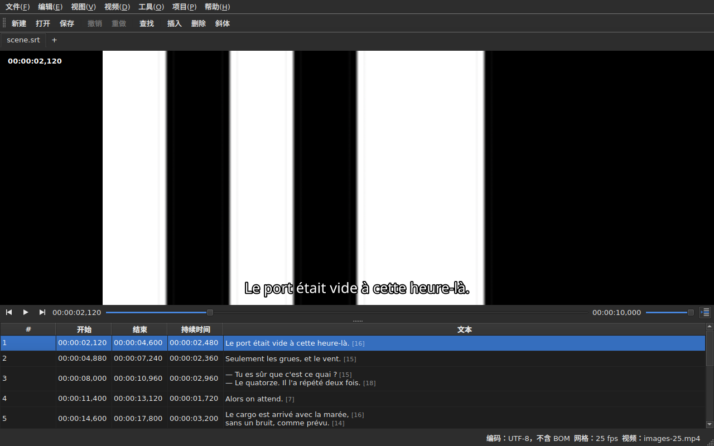

# 播放器

<!-- machine-translated -->
> 本页为机器翻译，尚未经过熟悉该语言的读者审校。

关联的视频**就在窗口中**观看，当前行绘制在画面上。这样就可以在影片上检查移动、变换或帧率转换的结果。

关于如何关联影片，参见[关联视频](video.md)；本页描述关联之后发生的事情。

## 视频视图

| 情形 | 窗口显示什么 |
| :-------- | :-------------------- |
| 已关联视频并且可以打开 | 画面占据上方，表格在下方 |
| 没有关联视频 | 没有画面，表格占据整个窗口 |
| 视频无法打开 | 没有画面，显示一条消息，窗口仍然可用 |

画面与表格之间的分隔条**随鼠标移动**。画面的高度不会低于 180 像素。放大窗口时，多出来的空间归表格，而不是画面：编辑时缺少的是行。

画面下方是**播放栏**：影片播放到哪里、总共多长、播放和暂停，以及音量。参见[播放栏](#播放栏)。

## 播放与停止

| 命令 | 快捷键 | 作用 |
| :------ | :------- | :----------- |
| 视频(D) ▸ 播放 / 暂停 | `Ctrl+P` | 停止时开始播放，否则停止播放 |

**没有打开视频时，该命令被禁用。** 刚刚关联的视频以**停止**状态打开：打开影片不等于观看它。

Gaupol 用的是单独的 `P`，这里用 `Ctrl+P`：窗口范围内的单字母快捷键会先于拥有焦点的控件被截获，所以 `P` 会在到达单元格编辑器的途中被吞掉。这里什么也没有占用这个组合键，它是空闲的。

## 播放栏

画面下方，从左到右——三个按钮都是**图标**，桌面主题有图标时用桌面主题的，否则用 Qt 样式的：

| 元素 | 作用 |
| :------ | :----------- |
| 两个步进按钮 | 把影片向后、向前移动**一个帧步长**——参见[逐帧](timing.md#逐帧) |
| 播放 / 暂停 | 播放或停止，与 `Ctrl+P` 相同——按钮显示的是**它接下来要做的事**：停止时是三角形，播放时是两条竖线；工具提示用文字说明 |
| 位置 | `HH:MM:SS,mmm`，写法与表格写位置的方式相同——勾选 [`视图(V) ▸ 以帧显示位置(F)`](table.md#以帧表示的位置)时，则显示为**帧号** |
| 滑块 | **既显示又移动**：可以拖动滑块，单击滑槽，或使用方向键 |
| 总时长 | 视频声明的时长，写法与位置相同 |
| 音量 | 从 0 到 100，参见[音量](#音量) |
| 表格跟随 | 只要表格跟随播放，它就保持按下状态；按下它，会让表格回到正在播放的行——参见[表格跟随播放](#表格跟随播放) |

**滑块不会在每个像素处都交出位置。** 拖动滑块时，每秒要请求几十个位置，每一个都要花费一个解码帧：第一个位置立即发出，后面的则等待二十分之一秒，而且**最后请求的位置总是会到达的那一个**——至迟在松开滑块时。因此画面不会落在手的后面，也不会开始绘制一条没有人看的路径。

**播放期间滑块会自行移动**，这不算一次手势：只有你的操作才会移动影片。按住滑块时，播放不会把它拉回去。

## 时间码

**位置写在画面上**，在左上角，背景半透明，使它在任何场景中都清晰可读。它由窗口用自己的字体绘制，除了播放器本来就给出的位置之外，不向播放器索取任何东西；每次手势都会更新它，无需等待下一轮跟踪。

## 在影片中跳转

在**视频**菜单中是 **Gaupol 的手势**，名称不变。与播放一样，它们**在没有视频时全部被禁用**；其中作用于选区的三个，在没有选中任何内容时也被禁用。

| 命令 | 快捷键 | 作用 |
| :------ | :------- | :----------- |
| 视频(D) ▸ 播放选中(S) | `Ctrl+Shift+P` | 从选区开始之前**一小段时间**开始播放，**一直播放到最后一条字幕结束**，然后停在画面上 |
| 视频(D) ▸ 跳到上一个(P) | `Ctrl+Left` | 把播放定位到在当前位置之前**已经结束**的最后一条字幕的开始处 |
| 视频(D) ▸ 跳到下一个(N) | `Ctrl+Right` | 把播放定位到在当前位置之后**开始**的第一条字幕的开始处 |
| 视频(D) ▸ 快退(B) | `Ctrl+Shift+Left` | 后退一次跳转的长度——默认三十秒 |
| 视频(D) ▸ 快进(F) | `Ctrl+Shift+Right` | 前进一次跳转的长度 |
| 视频(D) ▸ 跳到选中的开始(E) | `Ctrl+Up` | 把播放定位到选区的开始处，**再提前一个引导时间** |
| 视频(D) ▸ 跳到选中的结束(K) | `Ctrl+Down` | 把播放定位到选区的结束处，**再提前一个引导时间** |

**这些快捷键都是 Gaupol 的**，只有一个例外：`Play Selection` 在那里是 `O`，而单独的字母会先于正在编辑的单元格被窗口截获——在文本中输入一个 `o` 就会启动影片。`Ctrl+P` 是播放的快捷键，`Ctrl+Shift+P` 是选区的。单元格编辑器处于打开状态时，键盘方向键仍归它所有：`Ctrl+Left` 在那里是把光标移动一个单词，而不是移动播放。

- **跳转长度**为 30 秒，可以设置为 1 秒到一小时——参见[首选项](preferences.md#播放器)。它既不会越过影片的开头，也不会越过影片的结尾。
- **引导时间**为一秒：在字幕**之前**稍微看一会儿，以便看到它到来。可以设置为 0 到 60 秒，播放位置不会低于零。
- **不存在的相邻字幕**——第一条字幕之前没有，最后一条字幕之后没有——什么也不做，也不说什么：播放停留在原处。
- **每次手势都立即显示出来**：手势结束时，播放栏、时间码和绘制的线都已更新，无需等待下一轮。

## 音量

音量是**播放器**的音量，范围 0 到 100，而不是系统的音量。可以用播放栏的滑块设置，也可以用 `视频(D) ▸ 音频(A)` 子菜单中的两个手势设置，每次五步：

| 命令 | 快捷键 | 作用 |
| :------ | :------- | :----------- |
| 视频(D) ▸ 音频(A) ▸ 音量减小(D) | `Ctrl+-` | 把音量降低五 |
| 视频(D) ▸ 音频(A) ▸ 音量增大(U) | `Ctrl++` 或 `Ctrl+=` | 把音量提高五——第二个适用于加号需要按住 Shift 键的键盘 |

**它会从一次会话保存到下一次会话**，并交给你打开的每个视频。设置文件中超出 0 到 100 的值不会导致打开失败：它会被忽略，窗口会这样说明。**另一方面，音轨不会被记住**——音轨编号属于它所在的文件；参见[音轨](video.md#音轨)。

## 选区与播放

两者互相影响。

| 你的操作 | 发生什么 |
| :---------- | :----------- |
| 选中一行 | 播放移动到**该字幕的开始处** |
| 向下扩展选区 | 没有更多变化：起作用的是选区的第一行 |
| 播放向前进行 | **当前行**跟随屏幕上的字幕，并且**着色**，表格把它**居中**——参见[表格跟随播放](#表格跟随播放) |

当前行和选区是两个不同的东西。播放移动前者，**绝不触碰后者**：选区是操作所应用的对象，在角落里播放的影片无权一行接一行地改写用户的目标行。

着色遵循同样的规则：它是标记，而不是选区。**异常比它优先**——同时带有两者的行保留其错误的颜色，错误是要被修复的，而显示的行只在一句对白持续的时间内才是如此。参见[表格](table.md)。

### 表格跟随播放

**表格把正在播放的行居中**——放在它所显示内容的中间，而不是刚好能看见的边缘。它在**行改变时**这样做，而不是在跟踪的每一次滴答时：一句对白持续几秒，每十分之一秒重新居中一次，只是毫无意义地滚动。

**手动滚动会暂停跟踪。** 滚轮、滚动条以及在表格中的单击都会暂停它：表格停留在你放置的位置，而当前行、绘制的线和播放栏继续跟随影片。跟踪按钮——**表格各行的图标，其中一行标有箭头**，位于播放栏右侧；其工具提示为“Follow playback”——**只要表格跟随就保持按下**，之后会弹起。

**播放器的手势会恢复跟踪**：开始播放、跳转、步进、设置标记、在当前位置插入，或移动播放栏——此时表格立即在正在播放的行上居中，即使它本来就是同一行。**也可以按需恢复**：按下按钮即恢复，松开则暂停。没有定时器：恢复跟踪的总是一次手势。

切换到另一个标签页，会在那个标签页的影片上恢复跟踪。

**正在进行的编辑不会被打断。** 只要单元格编辑器处于打开状态，当前行就停留在原处；而画面上绘制的线则继续跟随，因为它不妨碍任何人。

## 绘制的线

画面上显示的内容来自**打开的文档**，而不是来自文件：**画面上所见，就是你刚刚输入的**，无需经过磁盘。文本居中显示在画面底部，两条字幕之间则消失。

**有翻译时，绘制的线是目标文本的那一行**：当前单元格在 `Translation` 列时是翻译，其他情况都是主文本。这是所有文本操作的规则——参见[操作所针对的
文本](table.md#操作所针对的文本)——而且**没有任何设置**：从一列移到另一列，画面显示的内容最多十分之一秒后就会改变。没有翻译，或者该列已被移除时，没有任何变化：显示的是主文本。

翻译尚未跟上的字幕，只要当前列是翻译，就**什么也不显示**：不会由主文本来顶替它。

**格式的标签会被理解，绝不会原样绘制。** 模型按文件所写的原样保存文本，由标签枢纽——格式转换所用的那个——先读取它，再交给画面：

| 文件中 | 画面上 |
| :---------- | :------------- |
| 粗体、斜体、下划线 | 会应用：`<i>no</i>` 显示为 *no*，不带标签 |
| 颜色 | 会应用 |
| 字体、字号 | 被去除，文本保留 |
| 位置、对齐、说话者，以及任何在屏幕上没有对应效果的内容 | 被去除，文本保留 |
| 文本中的 `{` 和 `}` | 会绘制：“{laughs}”显示为“{laughs}” |

Advanced SSA 文件的读法相同：其中的 `{\i1}` 会应用，`{\an8}` 被去除——该行仍停留在画面底部。每段文本都按**其自身文件的格式**读取，翻译和主文本都是如此。

**相邻的字幕文件不会被播放器加载**，即使它与影片同名。它就是正在编辑的那个文件，那样的话，画面显示的是磁盘上的状态，而表格显示的是另一回事。

## 预览更改

**无需做任何特别的事**：应用操作，观看影片，如果结果不合适，就选择 `Undo: shifting`——或相应操作的撤销项。参见[撤销与重做](undo.md)。

不存在单独的预览模式，这是有意为之：你观看的是文档本身的样子，而不是一个看不见的临时状态。

## 画面没有出现时

可能有两条消息，都以文件的路径为前缀：

| 消息 | 发生了什么 |
| :------ | :------------ |
| `<file>: <reason>` | 播放器拒绝了该文件——格式未知、文件缺失、是目录 |
| `<file>: no video player is available` | 无法构建任何播放器 |

在这两种情况下，**视频仍保持关联**——你确实需要看到它是哪个文件，才能选择另一个——并且**窗口仍然可用**：文档已打开，各项操作可以使用，保存也可以。

**画面就绘制在窗口本身中**：`libmpv` 按视图的大小，以真实像素填充一个缓冲区，由窗口来绘制它。它的任何部分都不依赖于图形平台——在 X11、Wayland 下以及没有显示器时，画面都一样——并且会跟随窗口大小的调整：影片的宽高比得到保留，视图的其余部分为黑色。

因此，第二条消息只有在 `libmpv` 库拒绝启动时才会出现，尽管构建时必须有它。

渲染通过处理器进行，但**解码可以在显卡上完成**：显卡负责解码，画面被复制回内存，然后像以前一样绘制。没有可用显卡的机器在处理器上解码，不显示任何消息。对于 H.264 的 1080p 影片，播放能轻松跟上实时速度。**重度 HEVC 编码的 4K 影片可能跟不上**：在两个核心上测得，没有显卡时它的解码速度是实时的 0.6 倍，而当关键帧很远时，在那里步进一帧要花几秒钟。显卡能缩短这个时间——根据影片不同，缩短三分之一到三分之二——但不能消除它。**它不会改变显示的画面**：一次步进或一次跳转，在有显卡和没有显卡时落在同一帧上。要关闭它，请取消勾选 [`Preferences…`](preferences.md#播放器) 中的 `Decode on the graphics card`。

## 不存在的功能

**设置标记、逐帧步进以及把边缘微调一帧**在[根据视频设定时间](timing.md)中，不在这里。以下功能不存在，也没有必要寻找：

- 波形；
- 打开影片时自动播放；
- 绘制的线的样式（字体、颜色、位置、背景）：它沿用窗口的样式；
- 不经复制的硬件解码：参见上文“画面没有出现时”。

本手册描述已有的功能：接下来会有什么、按什么顺序，见[路线图](../../../../feuille-de-route.md)。
