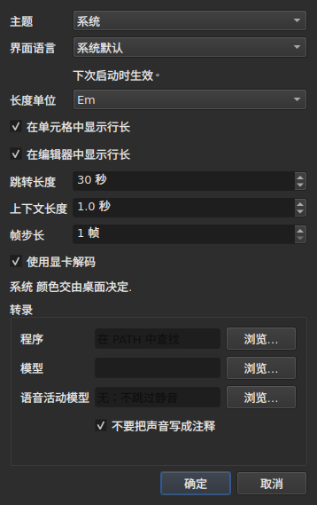

# 首选项

<!-- machine-translated -->
> 本页为机器翻译，尚未经过熟悉该语言的读者审校。

窗口会记住你用鼠标所作的设置——**它所在的位置**、**是否最大化**、**各列的宽度**、影片与表格之间**分隔条的位置**——以及**你工作的位置**，使 `Open…` 在正确的位置打开。这些都不通过对话框设置：你移动、拖动，它就被记住。

**有六项首选项有自己的对话框**，即 `编辑(E) ▸ 首选项…(E)`，而这就是标准：已经有操作手势的首选项不需要字段。主题没有，行长度的单位没有，显示行长度的两个复选框没有，播放器的跳转量和前导量也没有。见[主题](#主题)、[行长度](#行长度)和[播放器](#播放器)。

**界面语言在同一个对话框中，而且它是需要等待的那一项**：它在下次启动时生效，而不是立即生效。见[界面语言](#界面语言)。

**音量没有**：画面下方的栏和两个手势可以设置它，并且它会被记住。

**另有一项在使用它的地方设置**：`Insert Subtitles…` 放置各行的一侧是该对话框的一个字段，上一次的选择会被记住。见[插入、删除、合并、拆分、排序以及使字幕互不重叠](lines.md#记住所在的一侧)。

**两个搜索选项也是如此**：`Regular expression` 和 `Ignore case` 在对话框的两次打开之间保持勾选或未勾选，在会话之间也是如此。见[查找与替换](find-and-replace.md#两个选项)。

**`Adjust Durations…` 的设置同样如此**：阅读速度、它的两个方向，以及三个持续时间及其复选框——每一项都保留自己的值，不论是否勾选。见 [`Adjust Durations…`](operations.md#adjust-durations)。

**还有在 `Save As…` 中最后一次选择的编码**，连同其字节序标记。见[文件](#文件)。

**以及 `Correct Texts…` 向导和 `Spell-Check Settings…` 所设置的内容**：已勾选的任务及其代码、模式的复选框、换行设置、语言、检查的目标，以及输入时的下划线。见[更正文本…](correct-texts.md)和[检查拼写…](check-spelling.md#拼写检查设置)。**`Correct Texts…` 的目标和文档不会被记住。**

**不会被记住的内容**：最后打开的文件——见[记住的目录](#记住的目录)。

## 播放器

四个字段。**Seek length** 和 **Context length** 来自 Gaupol，取值也相同；**Frame step** 和 **Decode on the graphics card** 是 subedit 自己的：

| 字段 | 它设置什么 | 默认值 | 范围 |
| :---- | :----------- | ------: | :----- |
| `Seek length` | `Seek Backward` 和 `Seek Forward` 的跳转量 | 30 s | 1 s 到一小时 |
| `Context length` | `Seek Selection Start`、`Seek Selection End` 和 `Play Selection` 在选区之前的前导量 | 1 s | 0 到 60 s，精确到十分位 |
| `Frame step` | `Step Backward` 和 `Step Forward` 的步长，**以帧计**，也是微调边界的步长 | 1 帧 | 1 到 1000 帧 |
| `Decode on the graphics card` | 在机器有显卡时，让显卡解码影片；没有显卡时没有任何变化 | 勾选 | 勾选或不勾选 |

它们**立即**生效，无需重启，并在会话之间被记住，分别保存在 `video.seek-length`（以秒计）、`video.context-length-ms`（以毫秒计）、`video.step-frames`（以帧计）和 `video.hardware-decoding`（`true` 或 `false`）之下。**超出范围或不是数字的值**不会妨碍窗口打开：它会被忽略，保留默认值，并且窗口在打开时会说明这一点。**帧步长从不以毫秒计**：N 帧的步长始终是 N 帧，不论影片的帧率是多少——见[根据视频设定时间](timing.md#逐帧)。音量记录在 `video.volume` 中，范围 0 到 100，容错方式相同。

## 文件

```
~/.config/subedit/settings.conf
```

更确切地说，设置了该变量时，是 `$XDG_CONFIG_HOME/subedit/settings.conf`。它在**窗口关闭时写入**，在窗口打开时读取。被中断的程序——被杀死或因崩溃而停止——不会写入任何内容，下一次会话会找到上一次会话留下的内容。

该文件是文本，可以手动编辑。这是一种特性，而不是副作用：当设置它的界面恰恰是出了问题的那个时，这使得设置仍然可以更正。

### 两个区块，其中一个与命令行共用

文件分**两个区块**写入，每个区块之前有一行横幅注释：

| 区块 | 键 | 读取者 |
| :---- | :--- | :------ |
| `# Operation settings: shared by the window and the command line` | `duration-adjust.*` 和 `correction.*` 键 | 窗口**和** `subedit-cli` |
| `# Display preferences: the window's own` | 其余所有键——几何位置、列、主题、界面语言、搜索、拼写检查、编辑器、视频、最后的目录、写入编码 | 仅窗口 |

**`subedit-cli` 默认读取操作区块**：`Adjust Durations…` 和 `Correct Texts…` 在这里记住的内容，也是 [`subedit-cli adjust`](../subedit-cli/adjust.md) 以及 [`subedit-cli correct`](../subedit-cli/correct.md) 的一部分的起点，除非命令行的某个选项另有指定。**它从不读取显示首选项**。它的 [`config`](../subedit-cli/config.md) 命令会列出操作键、显示其值并更改它们——`subedit-cli config set duration-adjust.speed 12`——，窗口在下次打开时会看到这一更改。**窗口打开期间所作的更改，不会在窗口关闭后保留**：窗口会用它所持有的内容重写整个文件。`--no-config` 让命令行忽略该文件。见[设置文件](../subedit-cli/invocation.md#设置文件)。

读取器接受任意顺序的键，有无横幅均可：在两个区块出现之前写成的文件原样读取，并在下次关闭时以两个区块重写。

| 选项 | 它保存什么 | 默认值 |
| :----- | :------------ | :------ |
| `window.geometry` | `x,y,width,height`，以像素计；宽度和高度不为零 | 窗口自行决定大小 |
| `window.maximised` | `true` 或 `false` | `false` |
| `table.columns` | 四个宽度，以像素计，以逗号分隔——`#`、`Start`、`End`、`Duration`，隐藏的列也包括在内 | 表格自行决定大小 |
| `table.order` | 六列，**每列一次**，按表格显示的顺序：`number`、`start`、`end`、`duration`、`text`、`translation` | `number,start,end,duration,text,translation` |
| `table.hidden` | 被移除的列，取自 `number`、`start`、`end` 和 `duration`；为空表示没有 | 无 |
| `window.table-share` | 分给表格的高度份额，以百分比计，从 1 到 99 | 窗口一如既往地分配 |
| `file.directory` | 一个**绝对**目录路径 | 无：`Open…` 在程序启动的位置打开 |
| `general.theme` | `system`、`light` 或 `dark` | `system` |
| `interface.language` | `system`，或语言的名称，与其语言目录的命名相同：两到三个小写字母，之后可选地跟 `_` 和两个大写字母——`fr`、`pt_BR`；英语为 `en` | `system` |
| `edit.insert-placement` | `above` 或 `below` | `below` |
| `file.write-encoding` | ICU 能写入、且其转换器不会自己写入标记的编码的名称 | 无 |
| `file.write-bom` | `true` 或 `false` | `false` |
| `search.regex` | `true` 或 `false`——模式是正则表达式 | `false` |
| `search.ignore-case` | `true` 或 `false`——忽略大小写 | `true` |
| `duration-adjust.speed` | 阅读速度，每秒的字符数，严格为正；小数写得尽可能短（`15`、`12.5`） | `15` |
| `duration-adjust.lengthen` | `true` 或 `false`——延长过短而无法读完的字幕 | `true` |
| `duration-adjust.shorten` | `true` 或 `false`——缩短显示时间超过所需的字幕 | `false` |
| `duration-adjust.minimum-enabled` | `true` 或 `false`——要求最小持续时间 | `true` |
| `duration-adjust.minimum-ms` | 最小持续时间，以毫秒计，为非负整数 | `1500` |
| `duration-adjust.maximum-enabled` | `true` 或 `false`——要求最大持续时间 | `false` |
| `duration-adjust.maximum-ms` | 最大持续时间，以毫秒计，为非负整数 | `6000` |
| `duration-adjust.gap-enabled` | `true` 或 `false`——要求与下一条字幕之间的间隔 | `true` |
| `duration-adjust.gap-ms` | 间隔，以毫秒计，为非负整数 | `0` |
| `correction.mentions.enabled`, `correction.common-errors.enabled`, `correction.capitalization.enabled`, `correction.line-break.enabled` | `true` 或 `false`——该任务在 `Correct Texts…` 的第一页被勾选 | `false`、`true`、`true`、`false` |
| `correction.mentions.code`, `correction.common-errors.code`, `correction.capitalization.code`, `correction.line-break.code` | 该任务的模式代码：`Zyyy`，或 `Script[-language[-COUNTRY]]`——`Latn-en-US`；不可为空 | `Zyyy` |
| `correction.human`, `correction.ocr` | `true` 或 `false`——常见错误的类别 | `true`、`true` |
| `correction.sound-in-brackets`, `correction.sound-in-parentheses` | `true` 或 `false`——`Mentions` 页的两个复选框 | `false`、`false` |
| `correction.line-break.max-length` | 一行的最大长度，十进制；对话框将其限制在 1 到 1000 | `24` |
| `correction.line-break.max-lines` | 最大行数，整数；对话框将其限制在 1 到 100 | `3` |
| `correction.line-break.in-ems` | `true`：长度以 *em* 度量；`false`：以字符度量 | `true` |
| `correction.line-break.skip-on-length`, `correction.line-break.skip-on-lines` | `true` 或 `false`——要求两个跳过条件 | `true`、`true` |
| `correction.line-break.skip-max-length`, `correction.line-break.skip-max-lines` | 两个跳过阈值，以所选的单位计 | `24`、`3` |
| `correction.join-split.enabled` | `true` 或 `false`——`Join or Split Words` 任务被勾选 | `false` |
| `correction.join-split.join`, `correction.join-split.split` | `true` 或 `false`——连接、拆分 | `true`、`false` |
| `correction.join-split.language` | 区域设置代码——`fr`、`en_US`、`sr@Latn`——；为空：系统的语言 | 空 |
| `correction.remove-blank` | `true` 或 `false`——`Remove all blank subtitles` | `true` |
| `transcription.engine` | 引擎的名称：小写字母、数字、`.`、`-` 和 `_` | `whisper.cpp` |
| `transcription.executable`, `transcription.model`, `transcription.vad-model` | 绝对路径；为空：在 `PATH` 中查找引擎，且未设置模型，且不跳过静音 | 空 |
| `transcription.language` | 两个小写字母，ISO 639-1 代码；为空：自动检测语言 | 空 |
| `transcription.suppress-notes` | `true` 或 `false`——`Do not write sounds as notes` | `true` |
| `transcription.merge-gap-ms` | 同一句话中间隔小于此值的片段会被合并，单位为毫秒，非负整数 | `400` |
| `transcription.max-duration-ms` | 转录出的字幕在屏幕上停留的最长时间，单位为毫秒，1 到 3600000 | `7000` |
| `transcription.max-characters` | 转录出的字幕所含的最多字符数，1 到 1000 | `84` |
| `correction.activations` | 用户更改过的模式复选框，`<type>:<code>:<name>:<0\|1>`，以逗号分隔；**名称中的逗号或反斜杠前要加一个反斜杠**（`\,` 和 `\\`），无法读取的条目只会丢失它自己的设置——它会被报告，其他的则保留 | 空 |
| `spell-check.language` | 区域设置代码，例如 `fr_FR`；为空：系统的语言 | 空 |
| `spell-check.target` | `selection`、`current-project` 或 `all-projects` | `current-project` |
| `spell-check.document` | `main` 或 `translation` | `main` |
| `spell-check.inline` | `true` 或 `false`——在单元格编辑器中输入时，为未知单词加下划线 | `false` |
| `editor.length-unit` | `em` 或 `characters`——表格和编辑器所显示的行长度的单位 | `em` |
| `editor.show-lengths-cell` | `true` 或 `false`——文本单元格的每一行之后跟着它的长度 | `true` |
| `editor.show-lengths-edit` | `true` 或 `false`——单元格的编辑器在边栏中显示每一行的长度 | `true` |

**文件接受的比对话框更多**。读取器接受任何严格为正的速度和任何非负的持续时间；而 `Adjust
Durations…` 对话框把速度限制在每秒 1 到 99 个字符，把每个持续时间限制在 0 到 99 s。文件中超出这些范围的值，会在对话框打开时被拉回边界，并且在对话框被接受、窗口关闭后，文件也会保持这样。被取消的对话框不会改变所记住的任何内容。

**`file.write-encoding` 记住在 `Save As…` 中最后一次选择的编码，而且从不强加于某个文件**。已打开的文档带有自己的编码，对话框提议的就是这个：因为一项三周前的设置这样说，就用另一种编码重写它，会丢失读取时所保留的内容。这项设置所记住的，服务于没有文件的文档——刚刚创建的那个。

**这是有意的“不”，而不是疏忽**。总是以同一种编码交付、又用另一种编码打开继承来的文件的人，每个文件都要重新选择；对话框会向他们提议它，往返保证对每个人都成立。

**`file.write-bom` 保存同一编码的标记**，确实需要两行：编码的名称并没有说明它之前是否带有标记，正如 `--encoding` 并没有说出 `--bom` 所说的内容。两者一起读取，顺序不限，没有记住编码的 `file.write-bom` 不设置任何东西。

**分隔条保存的是份额，而不是高度**，这正是它有用的原因：窗口以另一种大小打开时，三个以像素计的高度就没有任何意义，而窗口常常以另一种大小打开。份额在任何地方都能重放。如果太小，它会**被拉回窗口所接受的值**——影片区域有最小高度。

**六列只有四个宽度**，这不是疏忽：它们是 `#`、`Start`、`End` 和 `Duration` 的宽度，不论表格的顺序如何，都按这个顺序，**隐藏的列保留自己的宽度**——再次显示时会找回它。最后显示的列占用其他列留下的空间，给它设定宽度也不会产生任何作用；因此文本和翻译的宽度不会被记住。

## 文件内容不符合预期时会怎样

配置是一种便利。**它的失败只损失这种便利，别无其他**：窗口无论如何都会打开。

| 情形 | 发生什么 |
| :--- | :----------- |
| 文件不存在 | 全部使用默认值，不作任何说明——这是第一次启动 |
| 文件存在但无法读取 | 全部使用默认值，并把原因写到错误流 |
| 某个选项缺失 | 使用它的默认值 |
| 某个键未知 | 被忽略，不作任何说明，并且不会出现在重写后的文件中 |
| 某个值无法读取 | 保留它的默认值，并在错误流中指出该选项 |

```console
$ subedit-gui film.srt
subedit-gui: /home/vous/.config/subedit/settings.conf: window.geometry: "plus tard" cannot be read, keeping the default
```

**消息只写到错误流，不会出现在别处**。启动时为一项无法读取的首选项弹出模态窗口，会为一个并不妨碍用户任何事的错误打断用户，而且是在用户尚未提出任何要求之前。

## 被注释掉的选项

重写后的文件包含**所有**已知的选项，保持默认值的那些以注释的形式写出：

```
#window.geometry = 0,0,1280,800
#window.maximised = false
#table.columns = 60,110,110,110
#table.order = number,start,end,duration,text,translation
#table.hidden = start,end
```

这不是矫揉造作。没有它，从未动过的选项就会一直停留在它被写入那天的值上，而**改进过的默认值永远不会到达任何人手中**。有了它，更改默认值就会改变所有没有覆盖它的人的行为——这正是默认值应该做的事。

要覆盖某个选项：去掉 `#` 并更改值。要回到默认值：删除该行，或者重新把它注释掉。

几何位置、宽度和被移除的列显示的是**形态**，而不是生效的值：几何位置和宽度的默认值是“窗口自行选择的内容”，无法用数字写出，而 `table.hidden` 的默认值是“无”，也无法读取。文件的头部也这样说明。至于 `table.order`，它确实显示了默认的顺序。

## 记住的目录

`Open…` 在**最后一次打开或保存的文件**所在的目录中打开，而不是在你取消的对话框所在的目录中打开：重要的是你工作的位置，而不是你看过的位置。

**最后一个文件本身则不会被记住**。记住它，就意味着在启动时重新打开一个没有人要求打开的文档。记住目录是为对话框*指路*；记住文件则会打开一个。

## 主题

`编辑(E) ▸ 首选项…(E)` 首先显示主题——一项没有操作手势的首选项——，位于[行长度](#行长度)之上。

| 值 | 它的作用 |
| :---- | :----------- |
| `System` | **什么也不做**——颜色保持桌面的配色 |
| `Light` | 设置浅色配色 |
| `Dark` | 设置深色配色 |

所选的主题**立即**生效，无需重启。

**“System”什么也不做，而这不是缺陷**。subedit 所基于的 Qt 版本，没有办法询问桌面它想要浅色还是深色，也无法在桌面改变主意时得到通知。与其编造一种我们不知道如何实现的读取方式，该工具提供了可以请求的两种主题，并把第三种交给工具包来决定——Gaupol 在相同条件下就是这样做的。

因此，在主题已经是深色的桌面上，`System` 得到深色窗口；在浅色桌面上，则得到浅色窗口。`Light` 和 `Dark` 会覆盖它，不论桌面是什么。

**异常的着色在两种配色中都保持可读**——见[表格](table.md#异常情况)。这不是假设：文本在每一种着色上的对比度，都由一项测试在两种背景上检查过。

## 转录

对话框的 **`Transcription`** 组保存 [`Transcribe Audio…`](video.md#转录音频) 所需的两项机器信息：引擎的**程序**（whisper.cpp，`whisper-cli`）以及它读取的**模型**。每一项都有一个 `Browse…` 按钮。程序留空时，会在 `PATH` 中查找；模型没有默认值。

在这些字段下方，**对话框会说明现有的情况**：是否找到引擎以及在哪里，是否找到 `ffmpeg`，以及模型的情况——未设置、未找到、不是模型、仅限英语，或多语言。有东西缺失时，它会附上指向[安装转录工具](../subedit-cli/install-transcription.md)的提示，那里说明了各项在哪里获得。这两个字段就是设置 `transcription.executable` 和 `transcription.model`。

第三个字段，“语音活动模型”，有自己的 `Browse…` 按钮，指定一个在引擎解码之前跳过静音的模型（适用于 whisper.cpp 的 Silero 模型）。有了它，第一条字幕从语音开始的地方开始，其余字幕随之而来，而不是从 0 起计的完整窗口。留空时不跳过静音。它是设置 `transcription.vad-model`，模型需要您自己提供，就像语音模型一样：参见[安装转录工具](../subedit-cli/install-transcription.md)。

复选框**“不要把声音写成注释”**就是设置 `transcription.suppress-notes`（默认勾选）：引擎被告知不要把声音写成 `(phone ringing)` 之类的注释。取消勾选即可保留它们，用于听障人士字幕。`Transcribe Audio…` 的对话框为单次转录提供同一个复选框。

## 界面语言

`编辑(E) ▸ 首选项…(E)` 在主题之下选择窗口的语言。

| 字段 | 取值 | 默认值 |
| :---- | :----- | :------ |
| `Interface language` | `System default`；`English`；然后是随程序安装的每种语言，以其自己的名称显示——`Français` | `System default` |

**它在下次启动时生效**，对话框在字段下方也这样说明：窗口是在构建时翻译的，正在运行的窗口保持它启动时所用的语言。这一选择保存在设置文件的 `interface.language` 下，并在窗口下次打开时读取。

| 选择 | 窗口启动时使用 |
| :----- | :------------------- |
| `System default` | 环境的语言，与做出任何选择之前一样——`LANGUAGE`、`LC_ALL`、`LC_MESSAGES`、`LANG`；见[语言](invocation.md#语言) |
| `English` | 英语，不论环境怎么说 |
| 某种已安装的语言 | 该语言，**不论环境怎么说**，包括 `LC_ALL=C`：在这里作出的选择是明确的选择 |

该列表包含语言目录已安装在 `<prefix>/share/subedit/locale` 下的语言；英语始终在其中，因为它是程序编写时使用的语言。每种语言以它自己的名称显示，没有任何语言目录翻译这个名称，这样读者就能找到自己所读的那一种。

**程序无法照办的值，只损失这一项选择：**

| 文件所写的内容 | 发生什么 |
| :----------------- | :----------- |
| 没有安装语言目录的语言名称——从另一台机器带来的文件 | 窗口跟随环境，不作任何说明；`Preferences…` 显示该语言，以其名称或代码表示，并保留它，除非另选其他语言 |
| 不是语言名称的内容——`French`、`fr_FR.UTF-8` | 使用默认的 `system`，并在错误流中指出该选项，与任何无法读取的值一样 |

```console
$ subedit-gui film.srt
subedit-gui: /home/vous/.config/subedit/settings.conf: interface.language: "French" cannot be read, keeping the default
```

**命令行从不读取它**：`subedit-cli` 只根据环境来选择语言，而 `subedit-cli config set interface.language fr` 会因其是显示首选项而被拒绝。

## 行长度




`编辑(E) ▸ 首选项…(E)` 还设置**表格和编辑器如何显示行的长度**——Gaupol 的标尺和边栏。

| 字段 | 它的作用 | 默认值 |
| :---- | :----------- | :------ |
| `Length unit` | 长度的单位：`Ems` 或 `Characters` | `Ems` |
| `Show line lengths in cells` | 文本单元格的每一行之后跟着它的长度 | 勾选 |
| `Show line lengths in the editor` | 单元格的编辑器在右侧边栏中显示每一行的长度 | 勾选 |

**两个复选框都未勾选时，`Length unit` 呈灰色**：没有要显示的长度，单位就什么也设置不了。这一选择**立即**作用于表格，之后打开的编辑器会遵循它。这三个值在会话之间被记住：`editor.length-unit`、`editor.show-lengths-cell` 和 `editor.show-lengths-edit`，见[文件](#文件)的表格。见[行的长度](table.md#行的长度)和[在编辑器中](editing.md#行的长度)。

**它不是向导的限制**。`Correct Texts…` 的单位——换行时的长度——是另一项单独的设置，位于它自己的向导中：你可以在表格中读取 em，而按字符换行。

## 无法设置的内容

**有九项被记住的设置是在对话框中选择的**——不计更正向导和拼写检查的设置，它们各有自己的设置——，并且每一项都在使用它的那个对话框中：主题和三项行长度设置，在这里；插入的一侧，在插入对话框中；两个搜索选项，在搜索对话框中；编码和字节序标记，在 `Save As…` 中；阅读速度、各持续时间和持续时间调整的间隔，在它自己的对话框中。没有别的了：诊断信息、播放器的音量，以及默认的保存格式——这个来自已打开的文件——都不能设置。

并且**属于某个文档的数字，不会在会话之间保留**：移动量、变换的两个标记点，对一个文件是对的，对下一个文件就是错的。对话框在每次启动时都会再次询问它们，这是有意为之。`Adjust Durations…` 的设置是个例外，与两个搜索选项的情形相同：阅读速度、最小持续时间或间隔，是方法的选择，而不是对某个文件的测量，因此会为此在会话之间保留。

本手册描述的是已有的功能：后续计划见[路线图](../../../../feuille-de-route.md)。
