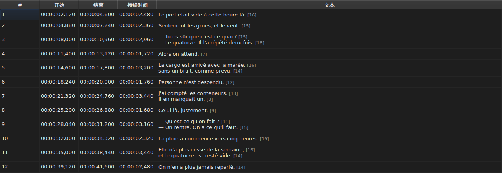
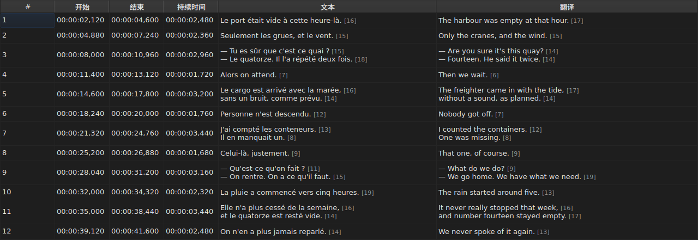
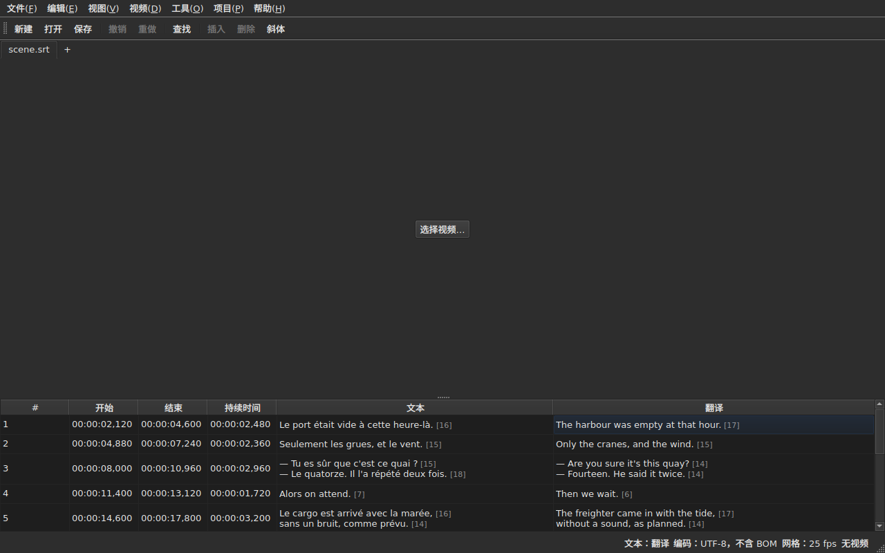

# 表格

<!-- machine-translated -->
> 本页为机器翻译，尚未经过熟悉该语言的读者审校。

窗口按行显示打开文件的字幕，每条字幕一行，共五列——项目带有翻译时为六列。

**本手册引用窗口标题时，一律采用英文窗口显示的形式**，对命令行亦是如此；简体中文窗口及其屏幕截图则以简体中文显示这些标题。

| 列 | 显示的内容 |
| :----- | :------------ |
| `#` | 字幕的序号，从 1 开始 |
| `Start` | 字幕出现的位置，`HH:MM:SS,mmm` |
| `End` | 字幕消失的位置 |
| `Duration` | `End − Start` |
| `Text` | 字幕的文本 |
| `Translation` | 字幕的翻译——**项目没有翻译时不显示** |




## 行的长度


**文本单元格的每一行后面都跟着它的长度**，即 `[N]`，字号更小、颜色更浅——`Text` 列和 `Translation` 列都是如此。Gaupol 就是这样做的。

| 计入什么 | 表格怎么做 |
| :---------- | :------------------ |
| **标签** | 不计入：`<i>Bonjour</i>` 的长度是 `[7]`，与 `Bonjour` 相同 |
| **取整** | 向下取整：12.9 em 的一行显示为 `[12]` |
| **空行** | 没有长度；空文本也没有 |
| **单位** | 默认为 *em*，也可以是字符——`编辑(E) ▸ 首选项…(E)` |
| **对于该列来说过长的行** | 会在数字**之前**被 `…` 截断，数字仍然可见 |

**这里的 *em* 是 Gaupol 的，不是排版学的**：小写字母表中每个字母值 0.55 em，以表格的字体计。因此以 *em* 计的长度取决于字体；以字符计的长度则数码位，一个带重音的字母算一个。

**表格不会标出过长的行。** 它显示数字，由眼睛把它与你自己设定的限制作比较——和 Gaupol 一样。它不是 `Correct Texts…` 向导的限制，那个向导有自己的设置。

**不想看到这些数字：** 在 `编辑(E) ▸ 首选项…(E)` 中取消勾选 `Show line lengths in cells`。参见[行长度](preferences.md#行长度)。

## 隐藏和移动列

**`视图(V) ▸ 列(C)`** 为每一列提供一个可勾选的条目，**`Text` 除外**：没有主文本，就没有可编辑的内容了。

| 条目 | 列 |
| :---- | :----- |
| `视图(V) ▸ 列(C) ▸ 序号(N)` | `#` |
| `视图(V) ▸ 列(C) ▸ 开始(S)` | `Start` |
| `视图(V) ▸ 列(C) ▸ 结束(E)` | `End` |
| `视图(V) ▸ 列(C) ▸ 持续时间(D)` | `Duration` |
| `视图(V) ▸ 列(C) ▸ 翻译(R)` | `Translation`——参见[翻译列](#翻译列) |

取消勾选一个条目会移除对应的列，再次勾选则按原来的宽度把它放回来。**这项设置适用于整个窗口**，包括所有标签页：只有一个表格，它的项目随标签页而变。

**当前单元格会离开被移除的列**：它移到同一行的 `Text` 中，选区不会移动。当前单元格若位于没有人看见的列中，那么按一下键就会盲目地编辑一个看不见的单元格。

**拖动列标题即可移动列**，任何一列都可以，`Text` 也包括在内。显示的最后一列占用其他列留下的空间。

**列的顺序和被移除的列会从一次会话保存到下一次会话**，连同宽度一起，保存在[设置文件](preferences.md)中——即 `table.order` 和 `table.hidden`。翻译列不在其中：它遵循自己的规则，每打开一份翻译就会恢复。

**序号不是文件的数据**，而是行的名次。因此插入或删除会给后面的所有行重新编号，而无需重写任何内容。

**小数分隔符遵循文件的格式**：SubRip 用逗号，其余八种格式用小数点。九种格式中，只有 SubRip 写逗号。

**跟随的是分隔符，而不是整个写法。** 表格总是写出小时，并且总是写三位小数；WebVTT 文件在不足一小时时省略小时，SubViewer 2 和两种 Sub Station Alpha 以百分之一秒计，MPL2 以十分之一秒计，TMPlayer 以秒计，MicroDVD 以帧计。宽度随格式变化的列，读起来比一个并非文件确切写法的列更让人费神。

因此，表格所保证的是**值和分隔符**，而不是小数位数。目标格式会取整的内容，会在保存时说明——参见[格式无法保留的内容](files.md#格式无法保留的内容写入前先告知)。

**持续时间（`Duration`）是计算出来的**，从不存储：输入持续时间会移动结束时间。结束时间早于开始时间的字幕，显示的是负的持续时间而不是零：这是文件的异常，把它隐藏起来就无从发现了。

**开始时间、结束时间、持续时间、文本和翻译都可以就地编辑**；序号不行。参见[编辑单元格](editing.md)。

**选区指明操作所作用的对象**——参见[操作](operations.md)。

**行的高度随它所承载的字幕而变**：两行的字幕占两行，三行的占三行。文本按将要写入的样子完整显示。

**仍然被截断的，是对该列来说过长的行**，它会以省略号结尾。加宽 `Text` 列或窗口可以完整显示它；打开单元格同样可以。文本的各行从不自动折行：只有真正的换行才构成一行，这样当你拖动列的边缘时，表格行的高度不会改变。

## 以帧表示的位置

**`视图(V) ▸ 以帧显示位置(F)`**——一个可勾选的条目，整个窗口共用一项设置——把 `Start` 和 `End` 列显示为**帧号**而不是时间码，并且**接受以帧号输入**。列标题会这样说明：`Start (frames)` 和 `End (frames)`。

| 变化的内容 | 不变的内容 |
| :----------- | :------------------- |
| `Start` 和 `End` 写出什么、接受什么 | `Duration` 列，它仍然是时间 |
| 这两列的标题 | 文档：不会修改任何内容，历史记录没有新条目，而且**文件写出的就是它原来写出的** |

**用来给帧计数的帧率**，按以下顺序确定：

1. **文件自己的帧率**，当文件以帧计数时——MicroDVD 只带有数字而没有帧率：**此时窗口显示的是其文件中的数字**，无论视频是什么；
2. **关联的视频所声明的帧率**；
3. **位置所画出的网格**，当位置画出了网格时。

条目的工具提示会说明保留了哪一个：*Positions are frame numbers, counted at 25 fps, the rate the video declares*。**三者都没有时，条目被禁用，其工具提示会说明原因**：文件不以帧计数，视频没有声明帧率，位置也不落在任何网格上。

- **数字是位置所落入的那一帧的编号**，取整到最近的一帧。**输入时，它给出该帧开始的时刻**，**只**从精确的比值取整一次（[ADR 0013](../../../../adr/0013-mise-a-l-echelle-exacte-des-positions.md)）：每秒 23.976 帧时，第 37 帧在 1543.04 ms 处开始，即 `00:00:01,543`。
- **只接受整数**——可带负号，因为开始时间可以早于影片。在帧模式下输入的时间码，或者不是数字的内容，会让单元格保持原样。
- **播放栏遵循同一项设置**：滑块两侧的位置和总时长，与 `Start` 和 `End` 一样写成帧号，在同一时刻——参见[播放栏](player.md#播放栏)。画面顶部绘制的时钟仍然是时间码。
- **这项设置不会从一次会话保存到下一次会话**：它是窗口的设置，不是文档的设置，一个手势就能重新打开它。

## 异常情况

位置前后不一致的字幕，会在其**时间列**上着色，鼠标悬停其上会说明哪里有问题。

| 颜色 | 报告什么 | 怎么办 |
| :--- | :-------------- | :--------- |
| 红色 | `ends before it starts` | 更正它的结束时间或开始时间 |
| 蓝色 | `starts before the previous one starts` | 把它放回顺序中的位置 |
| 琥珀色 | `starts before the previous one ends` | 调整它的定时 |


只有 `Start`、`End` 和 `Duration` 列会着色：异常只与时间有关，给文本着色会让人以为与文本有关。

**一条字幕可以带有多个异常**，工具提示会全部列出。着色的颜色是第一个要修复的异常的颜色：本身有问题的字幕，不管相邻的字幕怎么样都是有问题的；位置不对的字幕被放回原位，它的重叠也随之消失。

> 无序几乎总是优先于重叠，这并非偶然：在前一条开始之前开始，就是在它结束之前开始——除非前一条本身有问题。

**每次位置改变之后，标记都会重新计算**，无论改变来自编辑单元格、某项操作还是撤销。它说明的是文件现在的状态，而不是打开时的状态。

它不依赖任何帧网格：一旦手动更正了某个位置，它就离开了网格，基于网格的标记会报告用户的工作成果。

## 翻译列

一条字幕带有**两份文本，却只有一对位置**：翻译没有自己的定时，它附属于字幕的定时。表格在第六列 `Translation` 中显示它，位于 `Text` 的右侧。




**只有项目带有翻译时，才有这一列。** 没有翻译时，表格保持五列，窗口的行为就像翻译不存在一样——没有任何内容变灰或增加。`文件(F) ▸ 打开翻译…(T)` 会打开一份翻译：参见[打开翻译](files.md#打开翻译)。

**`View` 菜单中有一个条目可以显示或移除它**：

| 条目 | 作用 |
| :---- | :----------- |
| `视图(V) ▸ 列(C) ▸ 翻译(R)` | 勾选：显示该列；取消勾选：移除该列 |

**项目没有翻译时，该条目被禁用**——没有可显示的内容——并且在启动时是勾选的。**移除该列是用户的选择**：它在不同文件之间一直有效，直到再次勾选。移除该列并不会移除翻译：翻译仍保留在项目中，随该条目恢复显示。打开一个不带翻译的文件会移除该列。

**翻译的单元格与文本的单元格一样可以输入**——参见[编辑单元格](editing.md)。

### 操作所针对的文本

一行中有两份文本时，文本操作必须知道改写的是哪一份。**它是当前单元格所在列的那一份**：当前单元格在 `Translation` 列时是翻译，其他情况都是主文本——无论在时间列还是在 `Text` 列。

| 操作 | 针对什么 |
| :-------- | :-------------- |
| `Italic`、`Case`、`Dialogue`、`Remove Hearing-Impaired Mentions…` | 当前列的文本 |
| `Cut Texts`、`Copy Texts`、`Paste Texts` | 当前列的文本 |
| `Find and Replace…` | 当前列的文本——参见[查找与替换](find-and-replace.md#在哪种文本中) |
| 位置操作、插入、删除、合并、拆分 | **两份文本**：字幕是一个整体 |

**有两份文本时，状态栏会这样说明**，位于其他提示的左侧：

```text
Text: Translation
```

主文本则是 `Text: Main`。当该列没有显示时，它保持沉默：此时只有一份文本，没有必要说明。




**画面上绘制的线遵循同样的规则**：它是当前列的文本。参见[播放器](player.md#绘制的线)。

**没有任何内容变灰。** 无论当前列是什么，文本操作都保持可用，没有翻译列时，它们针对的是主文本，一如从前。

## 添加和删除行

`编辑(E) ▸ 插入字幕…` 和 `编辑(E) ▸ 删除字幕` 添加和删除行，`编辑(E) ▸ 合并字幕(M)` 和 `编辑(E) ▸ 拆分字幕(S)` 合并和拆分行；表格会自行重新编号。参见[插入、删除、合并和拆分行](lines.md)。

## 表格不做什么

**不存在按列排序的功能。** 显示的顺序就是文件的顺序，而且这是唯一对字幕有意义的顺序：一行的序号*就是*它在时间中的位置。
