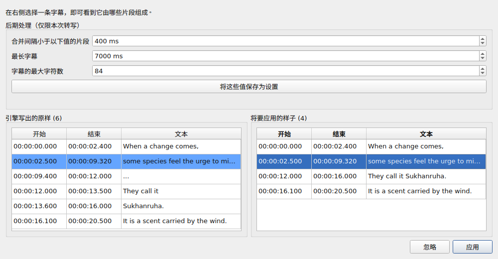
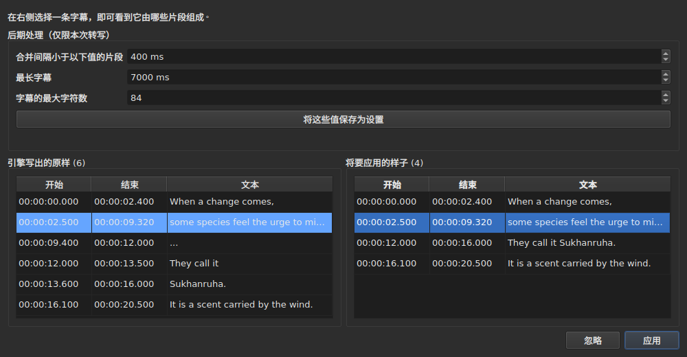

# 关联视频

<!-- machine-translated -->
> 本页为机器翻译，尚未经过熟悉该语言的读者审校。

**视频**菜单首先有三个命令，以及用来操控影片的各种操作——参见[播放器](player.md#在影片中跳转)。

| 命令 | 快捷键 | 作用 |
| :------ | :------- | :----------- |
| 选择视频… | 无 | 选择与文档配套的视频文件 |
| 转录音频… | 无 | 把影片的音频转录为字幕，并替换项目中的字幕——参见[转录音频](#转录音频) |
| 与音频同步… | 无 | 把项目的字幕移到其词句在影片音频中被说出的位置——参见[与音频同步](#与音频同步) |
| 播放 / 暂停 | `Ctrl+P` | 播放或停止视频——参见[播放器](player.md#播放与停止) |

关联视频是**打开的文档的属性**，而不是应用程序的设置：打开另一个字幕文件时，会从头开始。它不会写入任何文件，随窗口一起消失。

## 音轨

一部影片可以带有多条音轨——原声版、配音版、评论音轨。子菜单 **`视频(D) ▸ 音频(A) ▸ 语言(L)`** 把它们列出来，**每条音轨一个条目**，并**标出正在播放的那一条**：

| 文件提供的信息 | 条目显示的内容 |
| :------------------ | :------------------ |
| 语言和标题 | `1: fra — Original` |
| 只有语言 | `2: eng` |
| 只有标题 | `3: Commentary` |
| 两者都没有 | `1` |

编号是**音轨在影片中的位置**，按文件中的顺序逐条编号：两条音轨可能都写着 `eng`，而没有任何标签的文件也有第一条和第二条。

**选择一个条目就会播放那条音轨**。标记是播放器的回应，而不是单击的结果：它指出正在播放的音轨。

- **没有视频或没有音轨时，该子菜单被禁用**。只有一条音轨时，它仍然可用，并显示这条音轨，处于选中状态：它说明了影片的语言。紧挨着它的两个音量操作在任何情况下都保持可用：参见[音量](player.md#音量)。
- **音轨不会被记住**，无论是从一部视频到下一部，还是从一次会话到下一次：音轨编号属于它自己的文件，若沿用到下一部影片，就会选中那里恰好带有该编号的音轨。回到某个标签页时，会重新打开它的影片，并使用播放器自行选择的音轨。
- 没有快捷键：切换语言的机会很少，用菜单就够了。

## 选择视频

对话框在字幕文件所在的目录中打开，并按已识别的视频扩展名过滤：

    .avi .flv .m2ts .mkv .mov .mp4 .ogg .ogv .vob .webm

它也提供显示所有文件的选项。取消对话框不会改变任何内容。

所选文件**立即打开**：画面出现在窗口中，暂停在第一个时刻。参见[播放器](player.md)。

**将视频文件拖放到窗口上，效果相同**——参见[将文件拖放到窗口上](files.md#将文件拖放到窗口上)。

**视频属于当前标签页的项目**。每个标签页保留各自的视频；切换标签页就会切换影片。**回到某个标签页时，会从你离开的位置继续它的影片**，保持暂停，与任何一次打开相同。而在此期间为该项目选择的另一部影片，则从头开始。

## 自动建议

打开字幕文件时，**如果还没有选择视频**，窗口会在同一目录中查找：找一个视频文件，其不含扩展名的名称是我们文件名的前缀，并且以点号为界。

| 字幕文件 | 找到的视频 | 原因 |
| :------------ | :---------- | :-- |
| `film.fr.srt` | `film.mkv` | `film` 是 `film.fr` 的前缀 |
| `film.en.forced.srt` | `film.mkv` | 同理，无论有多少段 |
| `film.fr.srt` | `film.fr.mkv` 而不是 `film.mkv` | 名称最长者优先 |
| `film.fr.srt` | 无，如果 `film.mkv` **和** `film.mp4` 都在 | 两个候选无法区分 |
| `film.fr.srt` | 无，如果只有 `fil.mkv` | `fil` 并不止于一个点号 |

**建议不等于选择**。它可以被另一个建议取代——打开另一个文件、以另一个名称保存。而明确的选择则永远不会被覆盖：一旦使用过 `Select Video…`，自动建议就不会再出现在它的后面。

正因如此，这种猜测才是可以接受的：它可以被更正，而且更正之后会一直有效。

## 状态栏显示的内容

在状态栏的右侧，有一行说明文档与什么配套。它是三项中的最后一项：首先是读取文件时的[编码](files.md#状态栏中的编码)，接着是根据位置推断出的[帧网格](frame-grid.md)。

| 情形 | 显示内容 |
| :-------- | :-------------- |
| 已关联视频 | `Video: film.mkv` |
| ……并且 `ffprobe` 给出了它的帧率 | `Video: film.mkv, 24000/1001 fps` |
| 无 | `No video` |

**帧率跟随影片，而不是单独列出**。它们是同一个事实——这份文档与什么配套——再多一项提及，就会把它与[根据位置推断出的网格](frame-grid.md)置于同一等级，而后者是另一回事。

## 转录音频

**`Transcribe Audio…`** 把影片中的语音写成字幕。在打开影片之前它不可用：它转录的是**项目所用影片**的音频，而不是您另外挑选的文件——要转录音频文件，请在命令行中使用 [`transcribe`](../subedit-cli/transcribe.md)。

对话框要求给出四项内容，并说明能否开始：

- **音轨**，列出方式与 [`Audio`](#音轨) 菜单相同，带有文件所声明的语言和标题；
- **语言**，在一个**列表**中选择：首先是一个检测语言的条目“根据声音的前 30 秒检测”，然后是引擎为该模型提供的语言，以窗口语言写出名称，后面跟着代码——“法语 (fr)”。该列表就是引擎自己的列表：使用多语言模型时约有一百种；使用只支持英语的模型时只有一个条目，英语，无法更改，并有一行文字说明无论影片说的是什么语言，输出都将是英语。文件声明了语言且引擎提供该语言时，列表以所选音轨的语言为起点，在您没有自己选择之前会跟随音轨变化，并且**其下方的一行文字会说明它的来源**。文件没有为该音轨声明语言时，这一行会如此说明并发出警告：模型届时将根据声音的前三十秒检测语言，而**以音乐或静音开头的影片可能被当成另一种语言，其语音随后会被翻译成该语言**。如果您知道语言，请自己选择；
- **写成注释的声音**：一个复选框“不要把声音写成注释”，默认勾选。此时引擎被告知不要把声音写成 `(phone ringing)` 或 `[MUSIC PLAYING]` 之类的注释；在没有语音可写的地方它写出 `...`，而既没有字母也没有数字的片段会被后处理丢弃。取消勾选即可保留注释，用于听障人士字幕。对无法被如此告知的引擎，该复选框呈灰色并附有原因。它就是设置 `transcription.suppress-notes`，[首选项](preferences.md#转录)中也有它；
- **影片的一部分**，从一个时间到另一个时间——参见[先试一部分](#先试一部分)。两个字段都留空就是整部影片。

**它还会说明缺少什么。** 三行文字说明引擎、`ffmpeg` 和模型是否存在以及在哪里；其中有一项缺失时，`OK` 保持不可用，对话框会说明这一点，并指向[安装转录工具](../subedit-cli/install-transcription.md)。`Preferences…` 按钮会打开[首选项](preferences.md#转录)，程序和模型在那里设置——它们是关于这台机器的事实，而不是每次转录都要重新做的选择——首选项关闭后，对话框会重新检查。

语言会保存到下一次使用。引擎本身和字幕的限制属于[设置](preferences.md)（`transcription.*`）。

**项目已有字幕时，窗口会在替换之前先询问**，并说明将有多少条字幕被替换。它在工作之前询问，因此拒绝不会有任何代价。项目为空时无需询问。

工作**在后台**运行，有一个对话框和一个 `Cancel` 按钮；窗口在其周围仍可使用。**对话框会说明工作进行到哪里**，让您知道它还在运行，以及还要多久：

- **步骤**：先是“正在提取音频…”——此时对话框处于忙碌状态，没有数字，因为提取并不说明进行到哪里——然后是“正在转录音频…”，带有进度条；
- **剩余时间**，“约剩 38 分钟”：一开始没有，待引擎报告了足够的进度、可以外推时才显示，并按它从开始到最后一分钟的速度计算；精度是几分钟，不是承诺；
- **已用时间**，“已用 0:05:12”，即使其他内容都没有变化它也在走；
- **位置**，“0:12:30 / 0:50:00”：即引擎在影片中进行到哪里，在它产生第一段文本后即显示，并显示在它所对应的**最后一段文本的正上方**；
- **最后得到的文本**，让您看出工作是有意义的。

在处理器上用大模型处理长影片时，最初几分钟可能很长：引擎正在加载并处理最初几个三十秒的窗口。位置和最后的文本会早于引擎自己的百分比而变化，后者只按影片的 5 % 一步到来。

### 预览

**在您看到字幕之前，不会有任何东西替换项目的字幕。** 工作结束时——以及您取消它，或它在产生了一些内容之后失败时——会有一个窗口并排显示结果，分成两张表，每张都有**自己的开始和结束**：

- **左边是“引擎写出的原样”**：引擎返回的一切，按它切分的样子，没有任何后处理——即 [`--raw`](../subedit-cli/transcribe.md) 会写出的内容——，包括占位符（`...`）；
- **右边是“将要应用的样子”**：后处理之后的字幕，正是将进入项目的内容。它分三步进行，每一步都先处理完整个转录，下一步才开始：既没有字母也没有数字的片段（`...`）被丢弃；同一句话中相近的片段被合并；过长的被切分——**先在句末切（`. ? ! …`），再在逗号、分号或冒号处切，只有在没有可切的标点时才在句子中间切**。如果某个切分会留下小到无法阅读的字幕（几个字符、不到一秒），在有其他切分可选时会避开它。开启某个片段的字幕保留该片段的起点，结束该片段的字幕保留它的终点：词的时间只用于片段内部的切分。

表格上方，**“后期处理（仅限本次转写）”**包含后处理的三项限制：“合并间隔小于以下值的片段”、“最长字幕”和“字幕的最大字符数”——即设置 `transcription.merge-gap-ms`、`transcription.max-duration-ms` 和 `transcription.max-characters`。**修改其中任何一项都会立即重新生成右边的表**，无需引擎参与，您选中的字幕仍保持选中。您输入的值只对**本次转录**有效：无论应用还是忽略，应用程序的设置都保持原样。**“将这些值保存为设置”**会把这三个值交给应用程序的设置——即[首选项](preferences.md#转录)中的设置，并与它们一起保存——，窗口会说明这一点；关闭窗口本身并不会这样做。

两者不会逐行对齐，所以各有自己的时间。**在右边选择一条字幕，左边会高亮它由哪些片段组成**，并把左侧滚动到它们那里；一次一条字幕，且只有这个方向。两张表都不能编辑：没有任何设置能纠正的内容，之后在项目的表中编辑，与任何字幕一样。

两个按钮可关闭它。**“应用”**会把项目的字幕**作为一次操作**替换：一次 `Undo` 即可还原原有内容，包括翻译文本。**“忽略”**会丢弃结果，结果就此丢失。没有可应用的内容时，“应用”不可用。

**当运行被中止时**，窗口会这样说明——“部分结果：工作在 … 处停止”——并提供到此为止已得到的内容，可以应用或忽略，这样中止得很晚的长时间运行就不会在未经询问的情况下丢掉它的成果。这些片段没有带时间的词（引擎在最后才写出它们），后处理按片段自己的边界切分。失败首先会像任何失败一样在对话框中说明；取消则不会这样说明。

### 先试一部分

范围让您可以**在投入两小时之前，先用两分钟判断某个模型或语言**。“影片的一部分”字段接受一个开始和一个结束，各写成 `HH:MM:SS`，并逐位改写，如[移位对话框](operations.md#shift-positions)中所示（粘贴为 `2:00` 的时间会被整理成规范格式）；只填一个也可以（从那里到结尾，或从开头到那里）。只要某个字段不是时间，或结束不在开始之后，`OK` 就保持不可用，字段下方会有一行文字说明是哪一个。

- **字幕保留影片的时间**：在 2:10 说的内容，在结果中位于 `0:02:10`。
- **它像任何转录一样经过预览**，应用之后才替换项目的字幕；一次 `Undo` 即可还原。想在不动您工作的前提下试一个范围，请忽略预览，或先保存。

**它所需要的东西不随程序提供**：一个引擎（whisper.cpp）、一个模型，以及用于提取音频的 `ffmpeg`。请参阅[安装转录工具](../subedit-cli/install-transcription.md)。

## 与音频同步

**`Synchronize with Audio…`** 按影片的音频重新校准项目字幕的时间。适用于网上下载的 `.srt`：开头和结尾都有偏移，单靠一次平移无法纠正；每条字幕都会在所说的内容中被查找，并移到它被说出的位置。**只有开始和结束会改变**——文本、样式、字幕的数量和顺序都不会变。与 `Transcribe Audio…` 一样，在打开影片之前它不可用，它使用的是**项目所用影片**的音频；对应的命令行是 [`sync`](../subedit-cli/sync.md)。

字幕必须使用所说的语言：不会翻译任何内容。工作由负责转录的引擎完成——即[首选项](preferences.md#转录)中的那个，使用同样的程序、`ffmpeg` 和模型——并且**对话框会说明缺少什么**，与转录的对话框完全一样，指向[安装转录工具](../subedit-cli/install-transcription.md)，并带有一个 `Preferences…` 按钮。

对话框要求给出：

- **音轨**和**语言**，与转录相同；
- **影片的一部分**，从一个时间到另一个时间，两者都留空就是整部影片：只有**开始于**该范围内的字幕才会被查找和移动；
- **“仅所选字幕”**：一个复选框，没有选中任何字幕时不可用。它只查找所选字幕，范围是影片中从第一条所选字幕前一分钟开始、到最后一条后一分钟结束的部分，这样偏晚或偏早的文件仍在所听的范围之内；
- **“需听到的词”**，以百分比表示：字幕中必须被听到的词所占的比例，达到后才算找到该字幕，默认为 50 %——即设置 `alignment.min-match`；
- **“需检查的位移”**，以毫秒表示：字幕的位移与相邻字幕的位移相差多少以上就会被标记，默认为 2000 毫秒——即设置 `alignment.doubt-gap`。

最后三项会保存到下一次使用。工作**在后台**运行，使用与转录相同的对话框和 `Cancel` 按钮；失败或被您中止的运行不会改变任何内容。

### 结果

**在您看到字幕将移到哪里之前，什么都不会移动。** 工作结束时，一个窗口会为每一条被查找的字幕显示：它的序号、文本、**原先的开始、现在的开始、两者之间的位移**，以及用文字说明的**待检查**内容：

- **“在音频中未找到，保持原样”**：听到的词少于该框所要求的。字幕保留原有的时间——**绝不会凭空编造位置，也不会根据相邻字幕去猜**；
- **“只听到一部分”**：找到了，但听到的词不足其 80 %；
- **“位移与相邻字幕不一致”**：找到了，但它的位移与前后各两条字幕的位移中位数相差超过“需检查的位移”；
- **“已截短到下一条字幕的开始处”**和**“仍与下一条字幕重叠”**：会与下一条相冲突的字幕被截短到下一条开始的位置；仍与之重叠、截短也无法解决的字幕则保持原样并加以说明。

表格上方有一行文字说明结果——放置了多少条字幕、有多少条待检查、位移中位数和漂移——，而**“仅显示需检查的字幕”**只显示那些待检查的字幕。该表格不能编辑。

两个按钮可关闭它。**“应用”**会把开始和结束**作为一次操作**移动：一次 `Undo` 即可还原原有的时间。“取消”会让项目保持原样。没有任何内容会移动时，“应用”不可用。当一条字幕都没能找到时，窗口会在一个对话框中说明这一点，并且不显示可应用的内容：这几乎肯定是音频不对或语言不对。

## 没有影片时

窗口在本应显示画面的地方显示一个 **`Select Video…`** 按钮，而不是什么也不放。它与 `Video` 菜单中的是同一个命令，只是放在鼠标够得着的地方：一个无从下手的空缺，很难与故障区分开来。

影片一旦打开，按钮就消失，画面占据**全部**位置：表格在其上方留出的高度——即 [`window.table-share`](preferences.md) 在各次会话之间记住的那个高度——并且不小于画面的最小高度，必要时表格会让出空间。影片消失后，按钮回到同一个位置。

**只显示文件名，绝不显示路径**。长达两百个字符的路径会把栏中的其他内容全部挤出去；完整路径就是对话框中显示的那个。

## 不需要 `ffmpeg`

`subedit-gui` 向 `ffprobe`（随 `ffmpeg` 一起提供）只查询一件事：**容器所声明的帧率**。每部影片在关联时读取一次。

| 有 `ffprobe` 时 | 没有时 |
| :------------- | :------ |
| 状态栏在影片名称旁写出帧率 | 只写出名称 |
| 转换对话框在底部字段中提出影片的帧率 | 不提出任何建议，并像以前一样打开 |
| 对齐对话框以它打开 | 以项目的帧率打开 |

**其他功能都不依赖它，也没有任何操作会因此拒绝执行**。播放器根本不需要 `ffprobe`：它依靠 `libmpv`，那是一个构建依赖。影片的时长，即用来报告超出结尾的内容的那个时长，来自播放器，而不是 `ffprobe`。

**转录是唯一真正需要 `ffmpeg` 的功能**：它负责提取影片的音频。参见[安装转录工具](../subedit-cli/install-transcription.md)。

因此，这不是降级模式，而是从未安装过 `ffmpeg` 的机器上的**正常运行方式**：数据来自用户，有 `ffprobe` 时则由它提出建议。

读取到的帧率是**精确的有理数**——`24000/1001`，而不是 `23.976`。这正是保留 `ffprobe` 来回答这一问题的原因：播放器知道的同一个值是浮点数，而近似的帧率会使整个文件的时间略微偏离。
