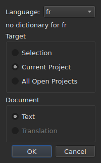
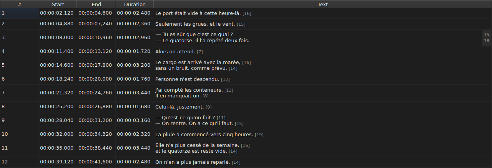
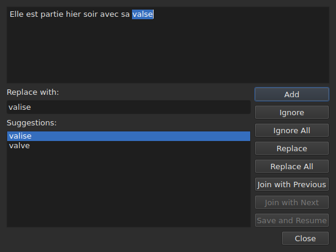

# Check Spelling…

`Tools ▸ Check Spelling…` goes through the words the dictionary does not know,
one at a time, on the model of Gaupol's spell checker. It has a companion,
`Tools ▸ Spell-Check Settings…`, which sets the language, the target and the document, and the underlining while typing.
Both rely on the system's dictionaries, through Enchant.

The label of the first is written `Chec&k Spelling…`: `C` is already
the accelerator of `Correct Texts…`, and `k` is free in the `Tools` menu.
Neither of the two has a shortcut.

**Both are disabled on a document with no subtitle**, like
[`Correct Texts…`](correct-texts.md): there is nothing to check. `Check Spelling…`
is also disabled with no dictionary for the language set, see
[Without a dictionary](#without-a-dictionary).

## Spell-Check Settings…




| Group | Choices | Default |
| :---- | :------ | :------ |
| `Language` | the language codes the system offers, and the one already chosen | the system's language, if it is among them |
| `Target` | `Selection`, `Current Project`, `All Open Projects` | `Current Project` |
| `Document` | `Text`, `Translation` | `Text` |
| `Check spelling while editing` | a check box, see [Underlining while typing](#underlining-while-typing) | unchecked |

`Selection` is disabled with no line chosen in the tab shown; `Translation`
is disabled as long as no open project carries a translation. A remembered
setting that is no longer available — an empty selection, an absent translation —
opens on `Current Project` or `Text`. `OK` keeps the settings, `Cancel` changes
nothing.

**This window does not depend on the dictionary**: it stays enabled as long as the
document has subtitles, even with no dictionary for the language set, and it is
the one that lets you leave a language that has none. The language for which no
dictionary exists stays editable and shows in the list, with, under
it, the sentence `no dictionary for` followed by its code.

**The four settings are remembered** from one session to the next, in the
settings file of `subedit` — see [The preferences](preferences.md) for its
location:

| Key | Values | Default |
| :-- | :----- | :------ |
| `spell-check.language` | a language code, such as `fr_FR`; empty: the system's language | empty |
| `spell-check.target` | `selection`, `current-project`, `all-projects` | `current-project` |
| `spell-check.document` | `main`, `translation` | `main` |
| `spell-check.inline` | `true` or `false` — underline unknown words in a cell's editor | `false` |

A value the key does not accept is ignored, the default applies, and the option
is named on the error stream when the window opens — see
[The preferences](preferences.md#what-happens-when-the-file-does-not-say-what-is-expected).

## Underlining while typing




The `Check spelling while editing` check box of `Spell-Check Settings…` underlines,
**with a red wavy line and while you type**, each unknown word in the editor of a
text cell — that of the `Text` column as well as that of the
`Translation` column. The underline follows the typing: it appears, moves and
disappears with the word. **It is unchecked by default**, as in Gaupol: without
it, nothing changes in the editor.

**The language is that of `Language:`**, in the same window, and the unknown words
are those `Check Spelling…` would find: same cases of colloquial English
(`goin'`, `we'd`, `1st`), same splitting into words. An underlined word is not corrected
from a menu: the check box only shows it.

**With no dictionary for the language set, the editor stays silent**: nothing is
underlined and nothing fails, and the window's `no dictionary for` sentence says
why. The check box applies to the editors opened after it; an editor already
open keeps what it had.

## The walk through




The window shows the text of the subtitle where it stopped, the unknown word
selected in it. **At each unknown word, the project's tab comes back and the
subtitle's line is selected in the table.** The walk goes subtitle
after subtitle, then project after project when the target designates several.

Under the text: the `Replace with:` box, filled with the first suggestion, and the
`Suggestions:` list. Choosing a suggestion copies it into the box; typing in the
box renews the list.

| Button | What it does |
| :----- | :----------- |
| `Add` | adds the word to the user's personal dictionary and moves on to the next |
| `Ignore` | leaves this word and moves on to the next |
| `Ignore All` | leaves this word, and all its other occurrences during this walk |
| `Replace` | replaces the word with the content of `Replace with:`; disabled as long as the box is empty |
| `Replace All` | does the same for its other occurrences; disabled as long as the box is empty |
| `Join with Previous` | joins the word to the word before it; disabled if there is none, or if they are not separated by a space |
| `Join with Next` | joins the word to the word after it, under the same conditions |
| `Save and Resume` | keeps the text as the text area carries it, and resumes reading **this text from its start** |
| `Close` | closes the window |

**The text area is editable.** As soon as you type in it, only `Save and Resume`
stays enabled: the other gestures act on the chosen word, which is no longer
that of the text.

**The walk ends by itself** when there is no unknown word left: the
buttons are disabled, the text empties. A target with no unknown word at all
shows no window.

### Closing in the middle

`Close`, or the window's cross, **applies what has been done**, like the end
of the walk: the texts already left, **and** the gestures — replace,
replace all, join — already made on the current text. It is a departure from
Gaupol, which loses the current text. What does not count is what remains of the walk, nor
the touch-ups typed in the text area that `Save and Resume` has not
committed.

**A single history entry per project touched**, whatever the number of
replacements: `Undo` undoes all the corrections of that project at once.
The menu names it `Undo: correcting texts`. The status bar then gives the
count:

```text
Edited 2 and removed 0 subtitles
```

**The list of replacements** — what the user replaced, and with what —
is written on closing to `spell-check/<language>.repl`, under the configuration
directory of `subedit`, and not in Gaupol's, which is never read.
It then counts among the spell checker's suggestions, here as in
[`Correct Texts…`](correct-texts.md#join-or-split-words--rejoining-and-splitting-by-the-spell-checker).
If it cannot be written, an error box says so, `Could not save the
replacements for` followed by the language and the reason, without cancelling the
corrections.

## Without a dictionary

When the language set — the system's, if none has been chosen — has no
dictionary, **`Check Spelling…` is disabled**, and its tooltip as well as the status
bar, when the entry is hovered, say why:

```text
no dictionary for fr
```

`Spell-Check Settings…` remains, to choose a language that has one. A window
built without any dictionary provider says the same thing and checks
nothing.

## The messages

| Message | Where | What triggers it |
| :------ | :---- | :--------------- |
| `no dictionary for fr` | tooltip and status bar | no dictionary for the language set |
| `Nothing to check.` | status bar | the target designates no text — an empty selection, for example |
| `Edited N and removed M subtitles` | status bar | at the end or on closing; `M` stays at `0` |
| `Could not save the replacements for fr: …` | error box | the list of replacements was not written |

## An example

An open file carries `Elle est partie hier soir avec sa valse`. The French
dictionary is there: `Tools ▸ Check Spelling…` stops on `valse`, selects the
line in the table, and proposes `valise`, already in `Replace with:`. `Replace`
then `Close`: the line becomes `Elle est partie hier soir avec sa valise`, and the
status bar says:

```text
Edited 1 and removed 0 subtitles
```
