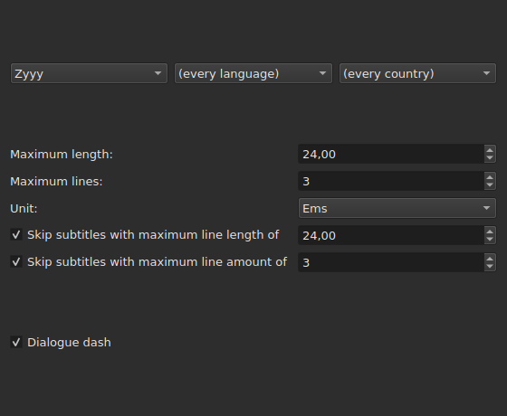
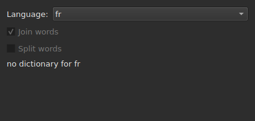
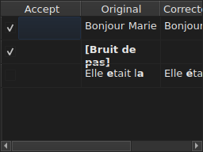

# Correct Texts…

`Tools ▸ Correct Texts…` opens a multi-page assistant, on the model of
Gaupol's: a page of target and tasks, one page per checked task,
a progress page, and a confirmation page that proposes the
changes without ever imposing them.

**Disabled on an empty document**: there is nothing to correct.

**The command line does the same thing** for all the tasks: [`subedit-cli correct`](../subedit-cli/correct.md), with the
same patterns and the same counts — and in characters where the window measures in ems.
**It reads four of this assistant's remembered settings** by default — the two classes of
common errors (`Human`, `OCR`), `Remove all blank subtitles` and the maximum number of lines of
`Line Break` — and takes everything else (the tasks, their code, the line length, the language,
the pattern boxes) from its own line. See
[Two blocks, one shared with the command line](preferences.md#two-blocks-one-shared-with-the-command-line)
and [`subedit-cli config`](../subedit-cli/config.md).

## Tasks and Target — the first page

| Group | Choices | Default |
| :---- | :------ | :------ |
| `Target` | `Selection`, `Current Project`, `All Open Projects` | `Current Project` |
| `Document` | `Text`, `Translation` | `Text` |
| `Tasks` | `Mentions`, `Join or Split Words`, `Common Errors`, `Capitalization`, `Line Break` — to check, one or more | `Common Errors` and `Capitalization` checked, the three others not |

`Selection` is disabled with no line chosen in the tab shown; `Translation`
is disabled as long as no open project carries a translation.

**The target and the document are not remembered**: the assistant always reopens
on `Current Project` and `Text`. The checked tasks, for their part, are remembered.

**What each target designates**:

| Target | Acts on |
| :----- | :------ |
| `Selection` | the lines chosen in the tab shown |
| `Current Project` | the whole file of the tab shown |
| `All Open Projects` | the whole file of each open tab |

**`All Open Projects` on `Translation` skips the projects without a translation**:
a project that carries none has nothing to propose in an empty column, and
the assistant does not count it.

**The task pages follow, in Gaupol's order — `Mentions`,
`Join or Split Words`, `Common Errors`, `Capitalization`, `Line Break` — never the one in which the boxes
were checked.** An unchecked task has no page; its remembered
settings do not change for all that. **No task page carries its own
“active” box**: it is the one of this first page, and it alone, that
decides whether the task runs.

## The task pages

Each of the four pattern pages — all except `Join or Split Words`, which has none — carries the same base: three cascading
drop-down menus — script, language, country — to choose the code of the patterns to
apply, then the list of the patterns of that code, one to check per name. **The
three menus offer only what the pattern catalogue actually
carries** — those shipped with the program and those a user has
dropped there (see [Dropped patterns](#dropped-patterns)) — never a list
of languages or countries read elsewhere. `Zyyy` (“any script”) is the starting
code of `Common Errors`, which gives the patterns valid everywhere. **The three
other types have patterns only under a script**: their page opens on the
first one the catalogue offers, `Latn` with the shipped patterns, and not on `Zyyy`.

**Each pattern's description is the tool tip of its box.** Names and descriptions follow the
language of the window for the patterns shipped with the program; a pattern of your own is shown as
its file writes it ([Language](invocation.md#language)).

**An unchecked pattern stays unchecked until it is checked again**, including when
changing code then coming back to it, and that choice is remembered from one opening
of the assistant to the next. Checked again, it simply finds its original
setting, and the remembered choice disappears.

| Page | What it adds to the base |
| :--- | :----------------------- |
| `Mentions` | two check boxes, `Sound in brackets` and `Sound in parentheses`, unchecked by default |
| `Common Errors` | two check boxes, `Human` and `OCR`, checked by default |
| `Capitalization` | nothing more |
| `Line Break` | a maximum length (`24`, by default), a maximum number of lines (`3`), a unit — `Characters` or `Ems`, `Ems` by default —, and two skip conditions, described below |

**The two boxes of `Mentions` name no compiled pattern**: they
drive a scan of the text in the core, the one
[`Remove Hearing-Impaired Mentions…`](operations.md#remove-hearing-impaired-mentions)
already does in a direct gesture. One **or** the other checked is enough to launch it. **The page's list of patterns does not repeat them**: those two names appear there only once, as check boxes.

**`Common Errors` filters by class**: a pattern that carries both classes
applies as soon as one of the two boxes is checked; the three other pages do not
know this distinction.

### Line Break — the unit and the skip




| Setting | What it does | Default |
| :------ | :----------- | :------ |
| `Maximum length` | the length of a line, in the chosen unit; from `1` to `1000` | `24` |
| `Maximum lines` | the number of lines aimed at; from `1` to `100` | `3` |
| `Unit` | `Characters` counts characters; `Ems` measures the width with the window's font, where an average lower-case letter is worth `0.55` — Gaupol's unit | `Ems` |
| `Skip subtitles with maximum line length of` | leaves as it is a subtitle whose longest line fits within this length, in the chosen unit | checked, `24` |
| `Skip subtitles with maximum line amount of` | leaves as it is a subtitle whose number of lines fits within this number | checked, `3` |

**The skip has its own thresholds**, distinct from the limits aimed at: that is
Gaupol's rule. A subtitle is left as it is if it fits within **all the
thresholds whose box is checked**; otherwise it is broken, and the breaking is
kept only if it brings the subtitle closer to a threshold it exceeded — less
length, or fewer lines. No box checked: every subtitle is broken,
whether it already fits or not.

**Changing the unit changes what is proposed**: the length of each line is
measured at each computation, in the page's unit at that moment, and nothing
remains of a previous measurement. A text of twenty-nine characters, half
of them narrow letters, exceeds `24` in `Characters` and fits it easily
in `Ems`.

**The seven settings are remembered** from one session to the next, unit included.

### Join or Split Words — rejoining and splitting by the spell checker




A separate page, between `Mentions` and `Common Errors`, to repair what
text recognition software does to spaces. It has no list of
patterns: it relies on the system's dictionaries, through Enchant.

| Setting | What it does | Default |
| :------ | :----------- | :------ |
| `Language` | the dictionary's language; the codes the system offers, and the one already chosen | the system's language, if it is among them |
| `Join words` | joins a misspelt word to the neighbouring word | checked |
| `Split words` | cuts a misspelt word in two | unchecked |

**Joining**: a misspelt word is joined to the word before it or the one
after it **if, and only if, only one of the two directions gives a correctly
spelt word**. When both give one, or neither, nothing is done.
`bon jour` becomes `bonjour`; two spaces in a row are first brought down to
one, but a text where nothing is joined is given back as it was, spaces
included.

**Splitting**: a misspelt word is cut if, among the spell checker's
suggestions, **only one** is that word with a space in it — the same
letters, in the same order. Two suggestions of that sort, or none: nothing
is done. A word whose initial alone is a capital (`Bonjourtous`) is
never split: it is often a name, and dictionaries do not have those.

**The user's list of replacements** (`spell-check/<language>.repl`,
in the program's configuration directory) counts among the spell checker's
suggestions; the assistant reads it and does not write it.

**With no dictionary for the chosen language, the page stays and is greyed out**: the
two boxes are disabled and the page says `no dictionary for` followed by the code of
the language. The language stays editable — a dictionary for another one may be
there — and the task, checked or not on the first page, then does nothing and
reports no error.

**The language, the two boxes and the box of the first page are remembered** from one
opening of the assistant to the next.

### Dropped patterns

A pattern a user has dropped into their own pattern directory
is added to those shipped with the program, in the same catalogue and under the
same menus — nothing tells them apart once loaded.

| Patterns | Where |
| :------- | :---- |
| shipped | `<prefix>/share/subedit/patterns`, beside `<prefix>/bin` |
| the user's | `$XDG_DATA_HOME/subedit/patterns`, or `~/.local/share/subedit/patterns` if the variable is not set or is not an absolute path |

**The format is Gaupol's, read as is**: one `<Code>.<type>` file per script,
language and country — `Latn-en.common-error` —, its activation `.conf` beside it. The types
are `common-error`, `capitalization`, `hearing-impaired` and `line-break`. The shipped
files serve as a model. **Patterns are read once, at launch**: a file
dropped while the window is open is seen only at the next launch.

## Progress

Once `Next` is pressed from the last checked task page (or from the
first page if no task is checked), the assistant computes the proposed
corrections on a background thread, an indeterminate progress bar on
screen. Once the computation is finished, the confirmation page opens by itself.

**`Cancel` at this step abandons the computation without interrupting it**: nothing
is applied, but the assistant waits, before closing, for the computation in
progress to finish — a wait bounded by the time limit the pattern
engine imposes on each search.

**`Back` at this step goes back to the previous page without waiting**: the computation
finishes in the background and its result is discarded — the assistant does not jump
by itself to the confirmation. `Next` starts a new computation.

## Confirmation — the last page




One line per text the assistant would change — never a line for a
text a task left as it is.

| Column | What it shows |
| :----- | :------------ |
| `Accept` | a check box, checked by default: the correction will be applied or not |
| `Original` | the text as it is, the part that would change **in bold** |
| `Corrected Text` | the proposed text, the changed part in bold, **editable** — touching it up changes what will be written, without changing the `Accept` box |

**The change is marked in bold, never in colour**: the same diff reads
in both palettes without depending on any tint.

**A line whose proposal is a removal** — the subtitle would have no
text left — shows the `Corrected Text` column empty, and its whole `Original` in
bold.

| Button | What it does |
| :----- | :----------- |
| `Mark All` | checks `Accept` on all lines |
| `Unmark All` | unchecks `Accept` on all lines |
| `Preview` | puts the built-in player on the subtitle of the chosen line, if the project has a film — nothing if it has none |
| `Finish` | applies the checked lines and closes the assistant |

`Remove all blank subtitles`, checked by default, removes the subtitles
a correction would leave with no text at all rather than keeping them empty.

**A pattern the computation could not apply is named under the table**, with
the reason:

```text
Not applied: some pattern (will not compile)
```

A pattern named this way is named **once per reason**, whatever the number of
texts or projects it failed on: the screen does not say which.

| Reason | What triggers it |
| :----- | :--------------- |
| `cannot be translated` | the expression uses what the translation of Python's syntax refuses |
| `will not compile` | the engine refuses the expression |
| `has an invalid replacement` | the replacement does not read as Python reads it |
| `timed out` | a search exceeded the time the engine grants it on a text |
| `never settled` | `Repeat` was still changing the text after a hundred passes |
| `grew the text too long` | the text exceeded 16,384 bytes while the pattern was working on it |

**A pattern that fails on a text leaves it as it was before it**: a replacement
half done is worth less than no replacement. The other patterns apply.

**A line of a pattern file that cannot be read is named in the same
place**, by its file, its line and the reason — at each opening of the
assistant, since the patterns are read only once, at launch:

```text
Could not be read: Zyyy.common-error, line 8 (malformed line)
```

| Reason | What triggers it |
| :----- | :--------------- |
| `directory cannot be read` | the directory of the shipped patterns could not be walked through |
| `file cannot be read` | a pattern file could not be read |
| `malformed line` | a line that is neither a header, nor a comment, nor `Key=Value` |
| `field outside any pattern` | a `Key=Value` before the first pattern header |
| `unknown field` | a key this type of pattern has no use for — the pattern is kept |
| `missing field` | a key without which this type of pattern can do nothing — the pattern is discarded |
| `invalid value` | a value the key does not accept — the pattern is discarded |
| `malformed activation` | a `<pattern>` element of a `.conf` that names nothing |

The other patterns, those that were read and applied correctly, are not
concerned.

## What undo says, and what `Cancel` never does

**`Finish` makes one history entry per project touched**, never one per
correction: `Undo` undoes at once all the corrections accepted on that
project, each with the text it had. The menu names it
`Undo: correcting texts`.

The status bar gives the count, the texts changed first, the subtitles
removed next:

```text
Edited 3 and removed 1 subtitles
```

**`Cancel`, on any page, applies nothing and remembers nothing** — neither
the settings chosen during this opening, nor the slightest correction. The
next opening of the assistant starts again from the settings of before.

## An example

An open file carries two spaces between two words of a line and a
mention in brackets with no other text. `Tools ▸ Correct Texts…`,
`Common Errors` already checked, `Next` up to the confirmation: the line with the two spaces
shows `Bonjour  Marie` on the left, `Bonjour Marie` on the right, the correction in
bold and already accepted. `Finish` applies it, and the status bar says:

```text
Edited 1 and removed 0 subtitles
```
