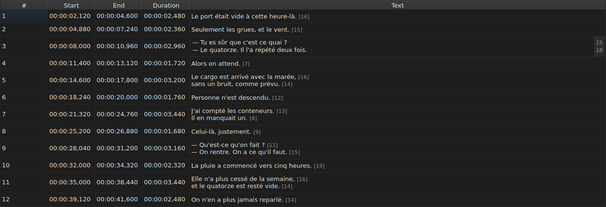
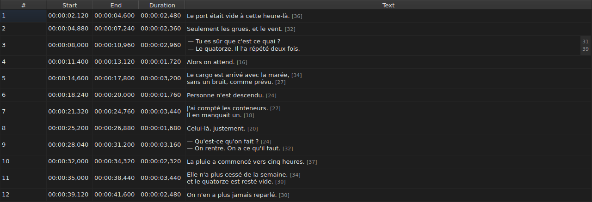

# Editing a cell

Four columns are edited in place: `Start`, `End`, `Duration` and `Text` — five
with the `Translation` column, when the project has a translation. `#` cannot
be edited — the number is the rank of the line, not data of the file.

**Opening a cell's editor:** double-click it, or select it
and press `F2`.

## The text

**The translation is edited like the text**, with the same multi-line field and the
same rules; only the cell changes, and the main text stays as it
was. A commit that changes nothing does nothing, for one as for the
other — see [below](#a-commit-that-changes-nothing-does-nothing).

The editor is a **multi-line** field, and it opens at the subtitle's height:
a two-line subtitle is typed in it as it will be written, its two lines
readable and without a scroll bar. A `Shift+Enter` that adds one enlarges
the editor; the table's row adjusts on commit.

| Key | Effect |
| :-- | :----- |
| `Enter` | commits and closes the editor |
| `Shift+Enter` | inserts a line break in the text |
| `Esc` | closes the editor; the cell keeps what it had |
| `Tab` | commits and moves to the next cell |

Clicking elsewhere commits too: losing the focus is worth an `Enter`.

**Eleven gestures without a dialog commit likewise** before computing their target:
`Italic`, `Case ▸ …`, `Dialogue`, `Merge Subtitles`, `Split Subtitle`,
`Cut Texts`, `Paste Texts`, `Copy Texts`, `Remove Subtitles`, `Undo` and `Redo`.
Launched from the menu, the toolbar or a window shortcut, they
take the text as the editor has just committed it, as after a click
elsewhere. `Ctrl+X`, `Ctrl+C` and `Ctrl+V` nevertheless stay with the editor as long
as it is open — see [Cutting, copying and pasting](clipboard.md): it is then the
menu that launches `Cut Texts`, `Copy Texts` and `Paste Texts`.

`Undo` and `Redo` read the history and not the document: see
[Undo and redo](undo.md). A gesture that opens a dialog does not
need this rule, since the dialog takes the focus as it opens, which
already commits the input.

### The tags are those of the file

The text shown and typed is **that of the file, tags included**: an
`<i>…</i>` of a SubRip is written that way, and an `{\i1}…{\i0}` of an Advanced SSA
too. Nothing is translated for display — the table of
[`Italic`](operations.md#italic) says what each format writes.

For italics, there is therefore nothing to know: `Ctrl+I` sets the right tag
for the open document, and a format that carries none — TMPlayer, LRC —
disables the entry rather than leaving you to search. Bold and underline are
typed, as in Gaupol.

**And the tags do not follow text operations**: putting a subtitle
in lower case does not turn its `<I>` into `<i>`, and a dialogue dash is
set before the text and not before an opening tag. See
[`Case` and `Dialogue`](operations.md#case-and-dialogue).

## The length of lines

**The text editor shows, in a margin on the right, the length of each
line**, aligned with the first row of that line. The margin is as wide
as the largest number, updates **as you type**, and follows scrolling.
An empty text shows nothing. The lengths are those of the table — without the
tags, rounded down, in the unit set — and are removed with the
`Show line lengths in the editor` check box of `Edit ▸ Preferences…`. See
[Line lengths](preferences.md#line-lengths).

## The start and the end

The editor is a one-line field, **constrained to the shape of a timestamp**:
it refuses while typing what could never be one.

The accepted forms are those that reading a file already accepts:

| Element | What passes |
| :------ | :---------- |
| fields | `MM:SS` or `HH:MM:SS`, one or two digits each |
| decimals | one to three, after a comma or a point, or none |
| sign | a leading `-`, for a position before the start of the video |
| bounds | minutes and seconds below 60 |

`00:01:02,500`, `1:02.5` and `-0:01,000` are therefore three valid inputs.

**An input that reading refuses leaves the cell unchanged.** That is the case
of `00:70:00,000`, whose shape is right but whose minutes are out of
bounds: the editor closes and nothing has moved. No position is invented
— getting a position wrong is silent, nothing on screen tells a
badly timed subtitle from a well timed one.

Changing a start or an end updates the `Duration` at once.

## The duration

**Typing a duration moves the end, and never the start**: the end becomes
`Start + Duration`. Moving the start would move the whole subtitle, which
is the job of [`Shift Positions…`](operations.md), and the `Start` column can
already be typed into.

The duration is typed **in the shape of a timestamp**, the one the column
displays, and the forms of the table above apply — with one difference:

| Element | Start, end | Duration |
| :------ | :--------- | :------- |
| shape | that of a timestamp | the same |
| leading `-` sign | accepted | **refused while typing** |

`0:02.5` and `00:00:02,500` are therefore two valid inputs of a duration of two
and a half seconds; `-0:01,000` cannot be typed. A zero duration is accepted:
the subtitle then disappears at the instant it appears.

**An end that goes over the next subtitle is allowed.** The
overlap is tinted in the table, with its tooltip — see
[The table](table.md#the-anomalies) — a notice, not a refusal: it may be what
you wanted. The [list of diagnostics](files.md#the-diagnostics-of-a-read)
carries it too, and removes it when you have corrected it.

**An end typed beyond the end of the film is not reported**, unlike
an operation of the `Tools` menu that would push it there — see
[The operations](operations.md#beyond-the-end-of-the-film). A cell already shows
the value you have just typed.

An unreadable input leaves the cell unchanged, as for a position, and
a duration identical to the one displayed does not enter the history.

## A commit that changes nothing does nothing

Open a cell, type nothing, press `Enter`: nothing happens.
No modification is recorded, and the file is still considered identical to
the one on disk.

The comparison is on the **position**, not on the string: typing `0:01.0`
in a cell that displays `00:00:01,000` designates the same instant, and
therefore changes nothing either.

## What becomes of an edited cell

It **can be undone** — one cell, one entry. See
[Undo and redo](undo.md).

It **is saved**, and closing the window without having done so asks for
confirmation. See [Opening and saving](files.md).
