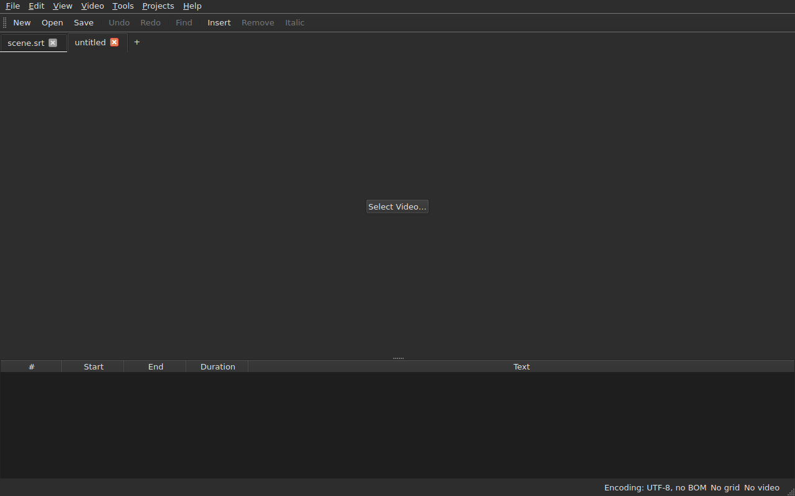
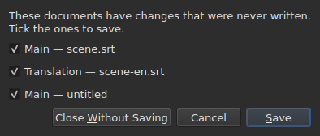
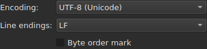
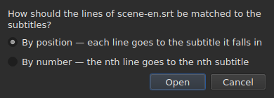
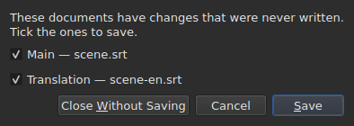

# Opening and saving

The **File** menu carries the three commands, two for the tabs, and three
more for the translation; the **Projects** menu acts on all tabs at once.

| Command | Shortcut | What it does |
| :------ | :------- | :----------- |
| New Project | `Ctrl+N` | an empty project, in a new tab — also the `+` button after the last tab |
| Open… | `Ctrl+O` | chooses a file and opens it in a new tab — or in place of a blank project |
| Open Translation… | — | chooses a translation file and aligns it on the main file of the current tab |
| Save | `Ctrl+S` | rewrites the open file |
| Save As… | `Ctrl+Shift+S` | chooses a path and a format, then writes |
| Save Translation | — | rewrites the translation's file |
| Save Translation As… | — | chooses a path and a format for the translation, then writes |
| Close | `Ctrl+W` | closes the current tab — disabled if there is only one |

`New Project`, `Open…` and `Save` are also in the
[toolbar](index.md#the-toolbar), under the words `New`, `Open` and
`Save`. **The three entries of the
translation are not in the bar**: they only serve those who have a
translation, and the bar is everyone's.

## Several projects, in tabs

**Each open project has its tab**, above the picture and the table:
its label is the file's name, or `untitled` for a project that has none
yet. Clicking a tab switches to it; `Ctrl+PageDown` and `Ctrl+PageUp` do
the same, without the mouse, and go back to the first tab after the last.
**The `+` button, just after the last tab**, opens an empty project in a
new tab, like `New Project`.




**`Open…` never touches them.** Opening a file no longer replaces what the
window was showing: it arrives in a new tab, beside it, and the tab you were
looking at before keeps everything it had — its history, its selection, its
associated video. That is also why opening no longer asks anything: there is
nothing to lose, since there is nothing to replace.

**One exception: the blank project gives up its place.** Launched without a file, or
after `New Project`, the window shows an `untitled` project with nothing in it.
A file opened — through `Open…` as through a drop — **then takes its tab,
at the same place in the bar**, rather than opening another one beside a
useless project. A project is blank when it has **no file, no subtitle,
nothing to undo or redo, no film, and has never been modified**: any
one of these things is enough for it to keep its tab. A blank project that is not
the current tab is not touched.

**A file already open is not opened a second time.** `Open…` on a
file another tab already holds gives the focus back to that tab, and says so
in the status bar:

```text
premier.srt: already open
```

**Each tab is a whole project, independent of the others**: its
history, its selection, its associated video and what its last read
encountered are shown only when that tab is the current one, and do not
change while another one is. **One exception, and it is in ADR
0033**: the video player is unique for the whole window — a single mpv
process — and its film changes with the tab; **each tab remembers where its film
was**, and resumes it there, paused, when you come back to it. The clipboard, for its part, belongs to the window: copying
in one tab and pasting in another is what you open two for.

**`Close` closes the current tab**, asking if needed
[the question of unsaved changes](#unsaved-changes) —
that of this tab alone, the others not being concerned. **Disabled when there
is only one tab**: the window always keeps at least one, and closing it
would be closing the window — which the system's button already does.

**Each tab also carries a cross**, which closes **its** project, with the same
question. The cross of a tab that is not the current one closes that one, and
the tab you are looking at stays displayed; if that project has changes, its
tab comes to the front for the time of the question. **No cross when only
one tab is left**, for the same reason `Close` is disabled.

**A tab says it is modified**: a star follows its name, `premier.srt*`,
as long as one of its documents differs from its file — as the window title
says of the project you are looking at. It goes away on saving.

## The Projects menu

Two commands act on all projects at once.

| Command | Shortcut | What it does |
| :------ | :------- | :----------- |
| Save All | `Ctrl+Shift+L` | writes each modified document, tab by tab |
| Close All | `Ctrl+Shift+W` | closes all projects — that is, the window |

**`Save All` goes in the order of the tabs**, the main document before the translation.
A document that has a file is rewritten there **without its tab coming to the front**;
**a document that has none opens `Save As…`, one at a time**, on its tab —
the only case where `Save All` changes tab, so that the box shows which
project it is about. **Cancelling a `Save As…`, or a
save that fails, stops the rest**: the following projects are not
touched, and a box says what was written.

```text
Save All stopped: 1 of 3 documents saved
```

When everything is written, the status bar says so — `2 documents saved`, or
`Nothing to save` when nothing was modified. If a `Save As…` brought
a tab to the front, the window then goes back to the one where the command was
launched.

**`Close All` and the window's cross are one and the same thing**: the window
always keeps a project, and closing them all is closing it. They therefore ask
**a single question for all projects**, the same as with
[two modified documents](#closing-with-two-modified-documents), with one check box
per modified document of each tab:




**`Cancel` closes nothing**, and leaves nothing written. `Save` writes the
checked documents like `Save All`: behind their tab, except a document with no
name, whose tab comes to the front for its `Save As…`. With a single document
modified across all projects, it is the simple question we have always
had, asked on its tab. `Save All As…` does not exist: it is a sequence of
`Save As…`, which `Save All` already asks, one at a time, for the documents with no name.

## Opening

The dialog filters **the nine formats read**, one entry each, and a first
entry that shows them all. The format is then recognised **by the content, not by
the extension**: a `.txt` that contains SubRip opens, and the filter decides
nothing — it only hides files.

| Filter entry | Extension |
| :----------- | :-------- |
| `SubRip` | `.srt` |
| `WebVTT` | `.vtt` |
| `SubViewer 2` | `.sub` |
| `Sub Station Alpha` | `.ssa` |
| `Advanced SSA` | `.ass` |
| `MicroDVD` | `.sub` |
| `MPL2` | `.txt` |
| `TMPlayer` | `.txt` |
| `LRC` | `.lrc` |

**Two extensions designate two formats each** — `.sub` is SubViewer 2 and
MicroDVD, `.txt` is MPL2 and TMPlayer. It has no consequence on opening,
since the content decides; on saving, it is the **name** of
the chosen entry that gives the format, never its pattern.

**An unreadable file opens nothing.** Missing, refused by the system, written
in an encoding under which its bytes do not decode, or of no known
format: a modal **names the cause**, no tab is opened, and those that
were do not move.

| Message | What happened |
| :------ | :------------ |
| `does not exist` | the path designates no file |
| `cannot be opened: permission denied` | the system refuses to open it |
| `cannot be read` | the system refused for another reason |
| `cannot be decoded in the chosen encoding` | the bytes do not read in the encoding retained |
| `is in no format this tool knows` | no format recognises the content |
| `holds nothing recognisable as a subtitle` | the format is recognised, but nothing in it is a subtitle |

The message is preceded by the path: `notes.txt: is in no format this tool knows`.
These are the words of the command line, and it is no accident — both
surfaces read a file by the same recipe.

### Dropping files on the window

**Dropping files anywhere on the window opens them**, from the
file manager: the table, the tab bar, the
`Select Video…` button, and **the film's picture itself**, playing as well as stopped.
The picture is a separate window drawn by the player, which nothing guaranteed
would pass a drop on; this was checked by hand on a real desktop,
in a Wayland session. `subedit-gui` is launched there under X11 to be able to show
the film, so that the drop goes through the X11 protocol — that of an
X11 session, where it has not been tried separately.

- **Each subtitle file opens its tab**, in the order they were
  dropped — exactly like `Open…`. A file **already open** is not
  read again: its tab comes to the front, and the status bar says so
  (`premier.srt: already open`).
- **A dropped video is associated with the current tab**, as by
  `Select Video…`. Dropped with subtitles, it goes to the last tab
  they opened, whatever the order of the drop. A video is recognised by
  its extension — the same list as the one that proposes a film beside the
  file.
- **Two videos or more at once are not opened**: a project watches a
  single film. The subtitles of the same drop, for their part, open.
- **A file that does not open does not stop the others.** A single box then says
  what could not be done, one line per file, with the words
  of `Open…`:

  ```text
  /films/notes.txt: is in no format this tool knows
  /films/absent.srt: does not exist
  ```

Only local files are taken: a link dragged from a browser
designates nothing the window can read.

Opening from the command line still works: `subedit-gui film.srt`.
There, the same reason is written on the error stream, and the window opens
empty — see [Invocation](invocation.md#when-opening-fails).

## The diagnostics of a read

A real file is rarely perfect, and reading recovers rather than
giving up: a missing number, a line that goes nowhere, mixed line
endings. **What it encountered fits in a button of the status bar**
— `2 diagnostics`, to the left of what the bar already says about the document —, and **the list opens with a click
in a floating window** above the button. No line of the window is taken for it:
the table keeps its full height, whether reading had something to say or not. The list
closes with a click elsewhere or with `Esc`.

```
a SubRip block without its number, settled by the reader: 5
```

**Each line counts**: what was encountered, what was done about it, and
how many times. A badly made file encounters hundreds, and knowing
how many of each sort is what lets you act; the line number of each occurrence in the
file, for its part, is read on the command line, at verbosity level `-vvv`. The
button counts these lines — one per sort —, not the occurrences.

**The guessed encoding appears there too**, once: it was proposed by weighing the
bytes, before a single line of the file existed.

```
an encoding nothing declared, settled by the reader: 1
```

It is displayed only when the encoding was **guessed and is not
UTF-8** — a UTF-8 file read as such is not an event, and saying so at
each opening would put a button in the status bar of every ordinary
document. A file that carries a byte order mark does not trigger it
either: it declared its encoding, nothing was guessed.

**The same list also counts what is wrong in the subtitles themselves**: a
subtitle that starts before the previous one has ended, an end before its
start, a start before that of the subtitle above. The table tints them, but
a tint is found by scrolling, and in a file of two thousand lines
one is easily missed; here the sorts are all together, **one per
line and with their number**, in the words of the `inspect` report:

```
subtitle starts before the previous one ends: 12
subtitle starts before the previous one starts: 3
```

**A click on one leads to the first subtitle concerned**, selected in the
table. These lines **follow the corrections** — sorting or correcting a duration
removes some, or lowers their number —, without closing the list you are
reading. A subtitle can be counted twice: starting before the end of the
previous one and before its start are two findings, corrected in two
ways. To name them one by one, `subedit-cli inspect --detail`.

The button **does not appear** when there is nothing to report, neither in the read nor
in the subtitles, and **it follows the tab**: each project keeps the
diagnostics of its own read, and the button shows those of the project displayed.

## The encoding in the status bar

**The status bar always gives the encoding of the open document**, to the left of what
it says about the [frame grid](frame-grid.md) and the
[associated video](video.md):

| Situation | What is written |
| :-------- | :-------------- |
| the file was read as UTF-8, without a mark | `Encoding: UTF-8, no BOM` |
| … with a mark | `Encoding: UTF-8, BOM` |
| a file in Latin-1 | `Encoding: ISO-8859-1, no BOM` |

**The diagnostic and this line do not answer the same question**, and that is
why both exist. The diagnostic says what reading **did** — it
guessed, and you may want to check; it is therefore displayed only when there
was a guess. The status bar says what the document **is**,
permanently, including for a file that declares its encoding itself and about
which reading has nothing to tell.

**Where the answer comes from does not appear there.** `inspect` gives it — `detected`,
`from its byte order mark`, `as asked for` — because a report has room to
say it; a status bar line does not, and the list of diagnostics already carries it when it
matters.

## Saving

`Save` rewrites the open file **in its original form**: its format, its
encoding, its line endings, its byte order mark and its header. A
file opened then saved without modification does not move by one byte — see
the exact guarantee below.

Writing is **atomic**: it goes through a temporary file renamed
over it. A save interrupted at any moment leaves the previous version
intact.

Saving a document that has never been on disk amounts to `Save As…`.

**A write that fails says so and loses nothing**: a full disk, a
read-only file, a missing directory — or **a character the file's encoding
cannot write**, an `ł` in a Latin-1 file. The message is
then `holds a character the chosen encoding cannot write`, and nothing is
written: replacing the character with a `?` would lose text before the eyes of whoever
has just typed it. The message names the file and the reason, the window keeps
its modifications, and the title's mark remains.

## Save as

`Save As…` asks for a path, a format, **and the shape of the bytes written**:
the encoding, the line endings, the byte order mark. The document **then lives
there**: the title changes, `Save` targets the new file and writes in the
chosen shape, and the original file stays as it was.

**The nine formats are offered**, and the entry selected when the box
opens is **the document's**. Saving under another name without touching the
filter therefore does not change the format.




**The images show only the bottom of the box**, not the list of files
above: that depends on the machine — its directories, its dates, its
side shortcuts —, so its photograph would never be the same twice.
This strip is, and it is where everything happens.

| Field | What it offers | Default |
| :---- | :------------- | :------ |
| `Encoding` | fourteen encodings a subtitle file carries in practice, plus `Other…` | **that of the file read** |
| `Other…` | a field to type any encoding ICU can write, **with completion** — `cp1257`, `EUC-KR` | — |
| `Line endings` | `LF`, `CRLF` or `CR` | those of the file read |
| `Byte order mark` | the mark, **disabled for an encoding that carries none** | that of the file read |

**The defaults are those of the file read, and that is a guarantee rather than a
convenience**: a file opened then saved again without touching these three
fields gives back the same bytes.

**The list is short, and it is not a ceiling.** ICU knows two hundred
and twenty-one; what the menu offers is what a subtitle file carries
in practice, because a menu of two hundred entries helps nobody. `Other…`
opens the rest.

**The field completes over the two hundred and twenty-one**, so there is no need to
know the exact name: typing `1252` proposes `windows-1252`, typing `koi`
proposes `KOI8-R` and `KOI8-U`. Completion is on what the name **contains**
and not on what it starts with — the canonical name of Windows Western is
`windows-1252`, and `cp1252` is the one people have in mind. Both can
also be written in full without completion: ICU accepts its own aliases.

**A name nobody knows writes nothing.** Typing `klingon-1` does not
fall back on UTF-8: nothing is written, and the message says so.

**Neither does a name that does not state its byte order.** `UTF-16` and `UTF-32` are
names ICU knows, whose converter writes **its own mark**: the
`Byte order mark` check box would then stop deciding anything. Both
are refused, and the message points to `UTF-16LE` or `UTF-16BE`, which write
the same bytes under the control of the check box. It is the same refusal, in the
same words, as that of the command line.

**A character the chosen encoding cannot write stops the save**
— an `ł` in Latin-1. The message is
`holds a character the chosen encoding cannot write`, the window keeps its
modifications, and the target file is not touched.

**The document does not move either**: it stays on its file, in its
format and its encoding, and the next `Save` rewrites the one that was opened.
A save that did not take place changes nothing at all — neither on disk,
nor in the window.

Changing format changes what the table shows — the decimal separator follows the
format, a comma for SubRip, a point for WebVTT, and **the tags are rewritten
in the vocabulary of the target format**: an `<i>` becomes `{\i1}` in Sub
Station Alpha, `{Y:i}` in MicroDVD, `/` at the head of a line in MPL2. The document
**has become** that file, so the table shows what the file carries.

**It is not a command, and `Ctrl+Z` does not undo it.** A document whose
format said LRC and whose texts still said `<i>` would be an
incoherent document; there is no half to undo.

## What a format will not carry, said before writing

**A modal warns, and you can still answer no.** It lists what the
target format will not hold, item by item, in the words the command
line writes afterwards:

```
ends are not carried by LRC, line breaks were joined in 2 subtitles, 1 tag dropped
```

| Button | Effect |
| :----- | :----- |
| `Save` | writes all the same, the loss accepted |
| `Cancel` | writes nothing; the document does not move, neither file nor format |

`Cancel` is the default button: an Enter key pressed without reading keeps the
file as it is.

**Nothing is asked when nothing is lost.** A box that announced “nothing
will be lost” would teach you to dismiss the one that matters.

What can be announced:

| Item | When |
| :--- | :--- |
| the ends | the target format carries none — TMPlayer, LRC |
| the line breaks | the target format carries none — LRC |
| the tags | a tag of the source has no equivalent in the target, or the pivot does not know it |
| the header | the file read carried one, and it does not cross over |
| the declared fields | the order of the SSA columns, the shape of the TMPlayer time |
| the precision | the target format counts more coarsely — MPL2's tenth, TMPlayer's second |

**What belongs to the other format is left aside.** A WebVTT file
carries cue identifiers and placement settings; SubRip carries display
coordinates. Writing in the other format ignores them rather than
translating them at random — they are not lost for all that, they are simply
not written.

## The round-trip guarantee

It has two halves, and both are needed:

- **faithful byte for byte** on a file already in the layout that
  `subedit` writes — Gaupol's, final empty line included —, and **whatever
  its encoding**: a file in CP1252 or in UTF-16 is rewritten in
  its own, mark included;
- **idempotent** otherwise: the first save normalises the layout,
  none afterwards touches anything any more.

Concretely, a file whose last block is not followed by an empty line
gains one, once. It is the only change a save without
modification can produce.

## Opening a translation

`File ▸ Open Translation…` sets a **second file** beside the main one.
The entry is disabled as long as there is no subtitle to give the lines of
the translation to.

**Two questions, one after the other.** The file chooser, that of
`Open…` — same filter, same starting folder, the encoding recognised as for the
main file — then **the alignment method**:




| Method | What it does |
| :----- | :----------- |
| `By position` (default) | each line goes to the subtitle where its middle falls |
| `By number` | the nth line goes to the nth subtitle, without looking at the positions |

**Position is the default**, because a single missing line in the middle makes
*all* the following ones slide by number, while by position a single
subtitle stays without a translation.

**What is done, what is written:**

- the texts of the attached lines enter the `Translation` column, which
  appears;
- **a line that finds no subtitle gives birth to one**, with **the
  positions of that line** — by either method;
- **nothing is sorted**, neither the file nor the document: the lines are walked through
  in time order, and the count of those that were not in it is given;
- **a translation already open is replaced**, all its texts erased first.

**What happened is said.** When each line has found its subtitle and
none is left alone, the status bar writes it; otherwise **a box to close**,
as for any gesture that has something to say:

```text
translation: 3 lines attached
translation: 2 lines attached; 1 subtitle left without a translation
translation: 3 lines attached; 1 subtitle born of a line; 2 lines out of order
```

The items are written only if they are not zero: the lines attached, the
subtitles born of a line, those no line reached, the lines out
of order. A file with no line at all says so
(`translation: the file holds no line`) rather than blaming the
subtitles for it.

**A shifted translation is recognised, and reopened shifted.** A translation timed two
seconds too late aligns on the wrong subtitles without anything telling it apart from a
correct attachment. When opening **by position** is not clean, the window looks for
**a constant shift**: the gaps between the start of each line and that of the subtitles
around it give candidates, grouped to the ten milliseconds, and **each
is judged by the very attachment of the opening**. If a single shift makes the opening
clean, the box says so after its count and **offers to reopen shifted**:

```text
translation: 4 subtitles born of a line; 4 subtitles left without a translation
the lines sit 2.000 s later than the subtitles; moved back, 4 lines would attach instead of 0
```

`Yes` undoes the opening and redoes it with the lines brought back by that shift; `No`, the
default answer, leaves the opening as it is. **The result is a single history
entry**: undoing it gives everything back, as for any opening.

**Nothing is proposed when the shift is not constant** — a drift, a shift that
touches only part of the file —, when two shifts would make the opening equally
clean, or when none makes it clean: the sentence then does not say there is one. Nor
by number, where the positions are not looked at. There is **no command line** for
it.

**Opening a translation is a single history entry**, `Undo: opening a translation`,
and undoing it gives everything back: the texts, the born subtitles removed,
the translation's file detached — the column goes away with it. To open it by
the other method, you undo first.

**The translation just opened is not modified**: nothing has been typed, and
closing it does not offer to save it. If subtitles were born, it is the
main document that is modified.

**A modified translation is offered for saving before being
replaced**, with the three outcomes of the section on
[unsaved changes](#unsaved-changes).

| Message | What happened |
| :------ | :------------ |
| `the file is already open as the main document` | the chosen file is the main document itself, however its path is written |
| `does not exist`, `cannot be decoded in the chosen encoding`, … | the same causes as for `Open…` |

The message is preceded by the path, and **nothing changes**: the window keeps its
history and its modifications.

**The problems reading encountered**, if any — a repaired line,
an ignored field —, go into the list of diagnostics, that of
[the last read](#the-diagnostics-of-a-read).

**What the translation does not keep**: the **per-subtitle** settings of its
file — an SSA style, the position of a WebVTT subtitle. A subtitle
carries only one set, that of the main document; they are neither read back nor rewritten.

## Saving the translation

**Each document is saved separately**, in its file, its format, its
encoding and its line endings: a translation in `.ass` under a main file in
`.srt`, in Windows-1252 under a main file in UTF-8, comes back as it is.

| Entry | What it does |
| :---- | :----------- |
| `Save Translation` | rewrites the translation's file — the one it comes from |
| `Save Translation As…` | the chooser of `Save As…`, opened on the file **of the translation**, with its format and its encoding |

Both are **disabled as long as the project has no translation**.
`Save Translation As…` is `Save As…` on the other document: same fields, same
[loss warning](#what-a-format-will-not-carry-said-before-writing), which
counts **what the file written would lose** — the tags of the main text
are not those of the translation, and a format that writes no italics
complains about it only if the translation has some.

**Each document has its own modified state.** Saving the main document leaves the
translation modified, and the reverse; **the window title is modified if either of the
two is**, and it has only one asterisk.

**Nothing of one touches the other**: saving the translation does not write the
main document, and changes neither its file, nor its format, nor its texts.

## Closing with two modified documents

Closing the current tab, or the window, while **two documents** or more
differ from their files asks **a single question**, one check box per
document:




| Button | What happens |
| :----- | :----------- |
| `Save` | writes the documents whose check box is checked, then goes ahead — disabled when none is |
| `Close Without Saving` | loses both, whatever the check boxes |
| `Cancel` | nothing happens; the window stays as it was |

**Unchecking a document means losing it**: `Save` writes the others and goes
ahead. **If a save fails, the action does not go on.** Closing the
box without answering is worth `Cancel`.

**With a single modified document, the question is the one we have always had**,
described below, and the sentence says which: `The translation has changes that were never written.`
or `The document has …`.

**A file gone from the disk counts as modified**, and the list says so —
`(file is gone from the disk)`: what the window holds is then **the only
copy**, and closing without writing would destroy it. With a single document in that case,
the sentence is `The document is no longer where it was read from.`

## Unsaved changes

Closing the window, the current tab, or opening a translation that would replace
the one already there, while the document differs from the one on disk **asks for
confirmation**, with three outcomes:

| Answer | What happens |
| :----- | :----------- |
| `Save` | the document is written, then the action goes on |
| `Discard` | the modifications are lost, and the action goes on |
| `Cancel` | nothing happens; the window stays as it was |

Closing the box without answering is worth `Cancel`.

**If the save fails**, the action does not go on: the work is neither
written nor lost.
