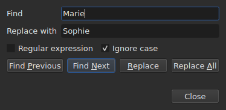
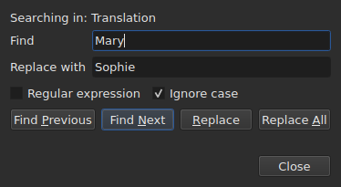

# Find and replace

`Edit ▸ Find and Replace…`, or `Ctrl+F`, opens the search dialog.




**The dialog is not modal**: it stays open while you look at the table,
edit a cell, search again. `Close` closes it; reopening it
gives it back as you left it, pattern and replacement included.

| Field | What it carries |
| :---- | :-------------- |
| `Find` | the pattern searched for |
| `Replace with` | what replaces it |
| `Regular expression` | the pattern is a regular expression rather than plain text |
| `Ignore case` | “marie” finds “Marie” |
| `All open projects` | the search goes through all the tabs — [see below](#in-all-open-projects) |

The entry is disabled on an empty document: there is nothing to search.

## The four gestures

| Button | What it does |
| :----- | :----------- |
| `Find Previous` | finds the previous match, and the table goes to it |
| `Find Next` | finds the next one — it is the button `Enter` presses |
| `Replace` | replaces the match found, then finds the next one |
| `Replace All` | replaces all those of the target |

All four are disabled as long as `Find` is empty.

**The table goes to the match** by selecting its line. Having reached the
last one, `Find Next` starts again from the first; `Find Previous` does the same in
the other direction.

**`Replace` with no match found searches first**: the first press
shows what is going to be replaced, the next one replaces it. That is what
Gaupol does.

## What the search covers

**The selection, or the whole document if nothing is selected** — the rule of the
`Tools` menu. See [The operations](operations.md#what-they-act-on).

**The target is taken at the first gesture and kept** as long as the search
goes on: `Find Next` selects the line of a match, and that
selection does not shrink the target. **Selecting other lines yourself
changes the target** for the next gesture.

The search covers the text of the subtitles; neither the positions nor the number
are searched.

### In all open projects

The **`All open projects`** check box widens the scope to every tab. **Disabled with
a single project open** — there is nothing to widen —, it becomes enabled as soon as a
second tab opens, and unchecks itself when only one is left.

**Checked, the selection no longer counts**: each project is searched in full,
in **the targeted document** — that of the current column, the main one or the
translation, as for a single project.

- **`Find Next` and `Find Previous` go from tab to tab, in the order of the
  tabs.** The project shown first; when it has no more matches, the
  next one, whose tab the window displays and whose line it selects.
- **The round ends where it started**: when the search goes past the last
  tab to come back to the first — or the reverse going up —, the dialog's
  line says so, rather than starting again without a word:

  ```text
  Search wrapped around
  ```

  The step after is an ordinary step, and the line clears.
- **`Replace` replaces where the search is**, then moves on to the next
  match, which may be in another tab.
- **`Replace All` goes through all the projects**, and **makes one history entry
  per project touched**: undoing in a tab undoes only what that tab
  received. The count says how many projects changed, not only how many
  replacements:

  ```text
  replaced 4 matches in 3 projects
  ```

  A project where the pattern is absent is not touched, and has nothing to undo.
  **No tab comes to the front**: each project receives its replacements
  behind its tab, which takes its asterisk, and the tab the gesture
  started from stays shown, with its film.

### In which text

**With a translation, the search covers only one of the two texts: that of
the column of the current cell** — the translation if the current cell is
in the `Translation` column, the main text everywhere else. It is the
rule of all text operations, and there is no extra setting:
see [The text the operations target](table.md#the-text-the-operations-target).

**The dialog says which text it searches in**, on a line above
`Find`, and changes it when the current column changes — even while open:




| The current cell is in | The line says |
| :--------------------- | :------------ |
| the `Translation` column | `Searching in: Translation` |
| any other column | `Searching in: Main` |
| — the project has no translation, or the column is removed | nothing: the line is not there |

**Replacing writes into that text, and into it alone.** `Replace` and `Replace
All` on the translation leave the main text as it was, and
the reverse; `Undo` gives back what they wrote. **The tags are those of the format
of that text's file**: a translation in Advanced SSA is read with its
`{\i1}`, even when the main text is a SubRip. `Replace with` is written there
in the same tags.

**The table stays in the column where it was.** `Find Next` selects the line
of a match without moving the current cell from one column to the other:
a search started in the translation goes on in the translation.

**Searching both texts at once does not exist**: each match
would be a pair (subtitle, text), and the table going to it would have
no clear place to go. You search in one, then change column.

**What starts again from scratch**:

| Gesture | What is forgotten |
| :------ | :---------------- |
| changing `Find`, `Replace with` or an option | the current match, and the status line |
| selecting other lines yourself | the target and the match |
| moving the current cell from one text to the other — from `Text` to `Translation`, or the reverse | the match: it is a place in a text |
| opening another file | the target and the match; the dialog stays open, pattern included |

## The text searched is the visible text

**Tags are not text.** Searching for `<i>` finds nothing, and searching for
`Bonjour` finds a `<i>Bon</i>jour` cut by a tag.

**The replacement is made in the file's text, without breaking the tags**:

| Text | Searched → put in its place | What is written |
| :--- | :-------------------------- | :-------------- |
| `<i>Bonjour</i>` | `Bonjour` → `Salut` | `<i>Salut</i>` |
| `<i>Bon</i>jour` | `Bonjour` → `Salut` | `<i>Salut</i>` |
| `<i>Bonjour</i> Marie` | `Bonjour Marie` → `Salut Sophie` | `<i>Salut Sophie</i>` |

A tag that cuts a word encompasses the whole word, and any style that touches the
match covers the replacement. **The tags the match does not
touch stay where they are**, even one that cuts another word of the same
subtitle: replacing `Marie` in `<i>Bon</i>jour Marie` gives
`<i>Bon</i>jour Sophie`. A word is made of letters and digits — a non-breaking
space or a quotation mark is not part of it. **`Replace with` is read in the tags of the
targeted text**: typing `<b>Salut</b>` there in a SubRip makes the word bold.

## The two options

| Option | Default | What it changes |
| :----- | :------ | :-------------- |
| `Regular expression` | unchecked | `.` no longer searches for a dot but for any character |
| `Ignore case` | checked | case does not count, accented letters included: `élise` finds `Élise` |

These are Gaupol's defaults. **Both are remembered** from one opening to
the next and from one session to the next, in the `search.regex` and
`search.ignore-case` options of the [preferences file](preferences.md#the-file).

### A regular expression

The pattern is read by ICU. As in Gaupol, `.` crosses a line break, and `^`
and `$` apply at the start and end **of each line** of a subtitle:
replacing `^` with `- ` puts a dash before each line.

In `Replace with`, and only for a regular expression:

| Written | What it puts |
| :------ | :----------- |
| `$1` to `$9` | the group of that number; an absent group puts nothing |
| `$0` | the whole match |
| `\n` | a line break |
| `\$`, `\\` | a `$`, a backslash |
| `\` followed by any other character | that character: `\t` puts a `t` |

**`\1` is not a group**, and puts a `1`. That is Gaupol's syntax, which reads
its expressions in Python; the one here is ICU's, which reads the pattern.

## What the dialog says

Under the buttons, a line says what the search could not do, or what a
`Replace All` did:

| Situation | What is shown |
| :-------- | :------------ |
| no match in the target | `"Sophie" not found` |
| a regular expression that does not read | `not a regular expression (U_REGEX_MISMATCHED_PAREN)` |
| `Replace All` replaced | `replaced 3 matches` |
| `Replace All` found the pattern, but the replacement changes no text | `nothing to change` |

**A search that finds nothing touches nothing**: the selection stays where
it was, and nothing enters the history.

**`not found` and `nothing to change` do not say the same thing.** `not found`
says the pattern is nowhere in the target. `nothing to change` says it
is there, but the replacement leaves each text as it was — replacing
`Marie` with `Marie`, for example. In both cases nothing enters
the history. The number of `replaced N matches` counts the matches of the
subtitles whose text changed.

## What the undo action says about it

| Gesture | What `Undo` reads |
| :------ | :---------------- |
| `Replace` | `Undo: replacing` — one per replacement |
| `Replace All` | `Undo: replacing all` — **a single entry**, whatever the number of matches |

See [Undo and redo](undo.md).
