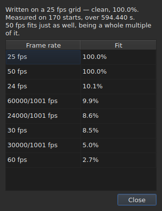

# The frame grid

A subtitle file **does not declare** the frame rate against
which its positions were computed: SubRip has no header, that of
WebVTT is free text. The window **deduces** it from the positions themselves,
on opening, and shows it in two places that do not answer the same
question.

| Surface | What it gives |
| :------ | :------------ |
| the status bar | **the answer**, permanently and without being asked |
| `Tools ▸ Frame Rate Analysis…` | **the reasoning**, when you want to see it |

## What the status bar shows

On the right, between what it says about the
[encoding](files.md#the-encoding-in-the-status-bar) of the file read and what
it says about the [associated video](video.md#what-the-status-bar-shows):

| Situation | What is written |
| :-------- | :-------------- |
| the positions are on a grid | `Grid: 24 fps` |
| only some of them | `Grid: 29.97 fps (partial)` |
| no known grid fits | `No grid` |

**`No grid` names no frame rate, and that is intended.** The set of
candidates is closed — the eight the conversion dialog offers — and
reporting the least wrong of them would be giving a wrong answer where
“I don't know” is the right one.

**`No grid` has two causes, and they are not the same answer.** Either no
grid fits, or the file has too few subtitles for anything to be said
about it — two starts always look perfectly aligned, and that proves
nothing. The status bar says the same thing about both;
**the analysis tells them apart**, and gives in the first case by how much the
best candidate fails.

The line **updates after each operation**. Aligning a file on another
frame rate changes the grid, and the status bar must not go on
announcing the old one.

### A document counted in frames has no grid, it has a frame rate

**MicroDVD is the only one of the nine that counts in frames.** Each of its lines
carries two frame numbers and nothing else, and the file **does not say** at
what frame rate to read them. The same place of the status bar then writes:

| Situation | What is written |
| :-------- | :-------------- |
| the document is counted in frames | `Frames: 24000/1001 fps` |

**This is not the grid, and the grid would be circular here.** The positions
of a MicroDVD document were computed *from* its frames at that very
frame rate; deducing a grid from them would give back that number, that is, a datum
dressed up as a measurement.

**Where it comes from is said once**, by the read, in the
[list of diagnostics](files.md#the-diagnostics-of-a-read):
`counts in frames and states no rate; it was read at ("24000/1001")`. The status
bar's line, for its part, says what is, permanently.

**Getting the frame rate wrong moves the whole file**, and the
[`Convert Frame Rate…`](operations.md#convert-frame-rate) dialog is where you correct it:
it opens on the reading frame rate and says that it is that one.

## What the analysis shows

`Tools ▸ Frame Rate Analysis…` **modifies nothing.** It opens on a summary and
the ranking of the eight candidates with their score.




The summary gives the answer, then what qualifies it — each sentence appearing
only if it has something to say:

| What can be read there | When |
| :--------------------- | :--- |
| over how many starts, and over what span | always |
| by how much the file is offset from its grid | its positions are on it up to a constant |
| that another frame rate fits just as well | it is a whole multiple of the one retained |
| that the span does not allow two frame rates to be told apart | the file is too short to separate them |
| how many starts leave the grid, **and in how many runs** | the file is partial |

**The number of runs is what tells apart two stories** that the
percentage alone confuses. Many runs of a single start are positions
corrected by hand, one by one. A few long runs are a re-timed
section, or a file assembled from two others.

**The full ranking is shown rather than a single answer.** A file that
fits 25 at a hundred per cent and 50 at a hundred per cent says something that a
verdict alone would hide.

## When the conversion was wrong

A file that falls on no grid is sometimes a file that was **converted at the wrong
frame rate**: it is then on a very real grid, but shifted by a ratio that is that of
none of the eight. When the deduction returns `none` or `partial`, the analysis searches **among the
fifty-six ordered pairs of the eight standard frame rates** — that is the set, closed — for the one
whose conversion puts the positions back on a grid. Each ratio is applied to the positions, and
**it is the deduction itself that judges the result**: the confidence is what it would say, never an
invented number. Two pairs that make the same ratio, such as 30 to 25 and 60 to 50, are a single
conversion.

The sentence is added to the summary:

```text
converting from 24 to 25 fps puts the positions on a 24 fps grid: 99.9%, against 11.8% as they are and 14.9% for the next best conversion
```

It gives the conversion, the grid the positions would fall on and how well they fall on it,
**then the gap with the positions as they are and with the best of the other
conversions.** A `Convert Frame Rate…` button closes the analysis and opens [the conversion
dialog](operations.md#convert-frame-rate) **filled with the pair found** — nothing is applied
as long as the dialog is not accepted, and cancelling is enough to go back. The video, open beside it,
lets you judge on the picture whether the answer is the right one.

**When two pairs are equally good, none is proposed, and the sentence says so:**

```text
converting from 30 to 25 fps and converting from 25 to 24 fps fit equally well (99.7% and 99.6%), so none is proposed
```

This is the ordinary case rather than the exception: a grid at 28.8 frames per second goes back
on 24 as well as on 30, and a file whose times are all doubled stays on the 25 grid.
The gesture that has a single repair is converting a file **already** at the target frame rate. For
a tie, the video decides: you open `Convert Frame Rate…` yourself on one of the two pairs.

**Nothing is said** about a file already on a grid, a file too short for a verdict
to be worth anything, nor a file that no conversion of the set puts back on a grid — a drift, a
ratio outside the eight frame rates, positions without structure.

## What the table does not show

**No line of the table is marked because of the grid**, ever.

As soon as you correct a position by hand, it stops being aligned. An
automatic marking would therefore report the user's work as an
anomaly, on a file they are precisely correcting. The deduction
speaks of the **document**, and the analysis is the only exception — because you
opened it for that.

The table's marks, for their part, concern what does not hold together: an end
before its start, an overlap, a broken order. See [The table](table.md).
