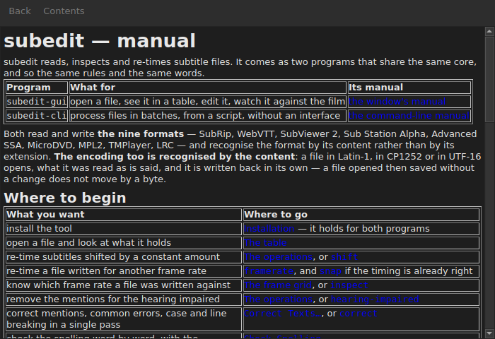

# The manual in the window

`Help ▸ Manual`, or `F1`, opens **this very manual** in a window of its own.




## What it opens, and why not an address

**The manual installed beside the program**, not a page on the Internet.

An address would describe the version under development, not the one at hand.
A user reading the manual of a version they do not have is worse served than a
user with no manual at all — which is why the window reads the files laid down
by the installation, under `<prefix>/share/subedit/manual`. See
[Installation](../subedit-cli/installation.md).

It opens on the [home page](../index.md), the one that says where to start.

## Navigating

| What you do | What happens |
| :---------- | :----------- |
| click a link of the manual | the page opens in the same window |
| click a link that targets a section | the page opens, and the window scrolls down to it |
| click a link that targets only a section | the window scrolls down to it, without changing page |
| `Back` | goes back to the previous page; disabled on the first one |
| `Contents` | goes back to the home page; disabled when you are there |

The window **is not modal**: it stays open while you work, which is the whole
point of having the manual at hand. Choosing the entry again does not create a
second window, it brings this one to the front.

## What it cannot open, and it says so

The manual sometimes refers to the **roadmap** or to an **architecture
decision**. Those are documents of the repository, not of the package: they are
not installed, and the window says so in plain words rather than leaving the
click without effect.

```
../../feuille-de-route.md is not part of the installed manual;
it lives in the project's repository.
```

They can be read on the repository, whose address is in `Help ▸ About subedit`.

## When the entry is disabled

**`Help ▸ Manual` is disabled when there is no manual beside the program.** Two
cases, and neither is a fault:

| Case | Why |
| :--- | :-- |
| the binary is run from its build tree | nothing was installed there, so there is nothing to read |
| the installation is partial | the manual was removed, or was never copied |

Hovering over the entry says which of the two: “No manual is installed beside
this program”.

A missing page while the manual is there — a file deleted by hand — does not
close the window: it names the file it could not read and keeps on screen what
it was showing.

## Where the manual is looked for

**Beside the executable**, in `../share/subedit/manual` — the layout every
installation produces, whatever the prefix. That is what lets an installation
under `~/.local` find its manual as well as a package installed under `/usr`.
