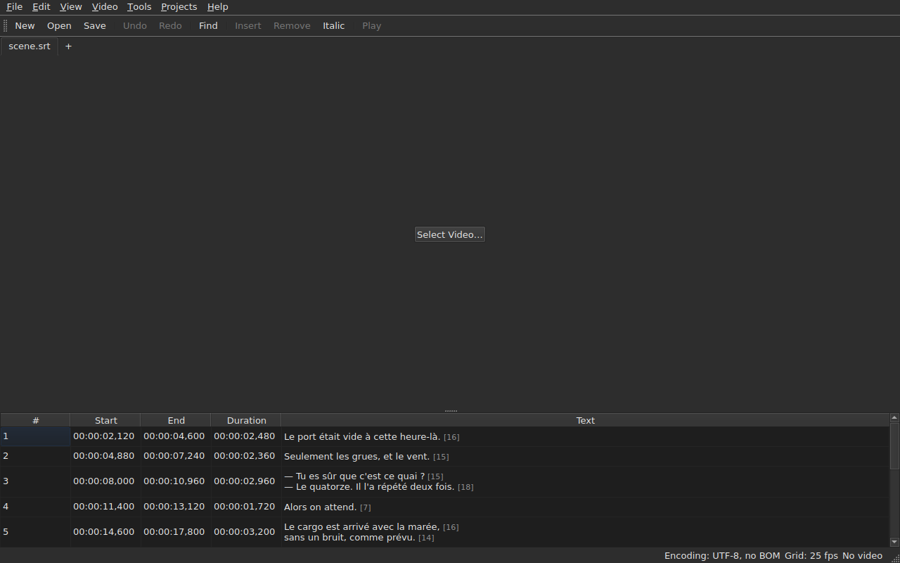

# subedit-gui — manual

The window of subedit: open a subtitle file and see it in a table. For the
other program and to know where to start, see [the manual](../index.md).

> **Current state.** The window **opens several files, one tab each**, whatever
> their encoding — through `Open…` or by dropping them on it —, **displays**,
> **edits its cells**, **inserts and removes lines**,
> **undoes**, **saves — choosing the encoding, the line endings and the
> byte order mark** —, and **marks the subtitles whose positions
> do not hold together**. It **merges and splits** lines, **cuts,
> copies and pastes** texts, and **finds and replaces** in the visible text
> without breaking the tags, in one project or in all. It **opens a translation
> beside the main file**, aligned by position or by number, in one more column,
> and saves it separately. The `Tools` menu carries sixteen operations and two spelling entries —
> shift, transform, convert the frame rate, adjust durations,
> **append a file, split the project in two**, put in
> italics, add dialogue dashes, change the case in four ways,
> remove hearing-impaired mentions, **correct texts through a
> multi-page assistant**, **check spelling word by word**, align on a frame rate, bring back onto
> the grid — and the grid analysis, which modifies nothing. The `Projects` menu
> **saves and closes everything** in one gesture. It **associates a video
> with the document**, chosen or guessed, and **plays it in the window**, the current
> line drawn on the picture; it **sets a start, an end or a
> subtitle from the film's position**, **steps frame by frame** and **nudges an edge by one frame**. The playback bar **seeks, sets the
> volume and the position**, the table **follows playback** without undoing a manual scroll, positions
> can be shown **in frames**, and the `Video` menu **chooses the audio track**. Two detections
> **propose without ever applying**: a translation shifted by a constant amount, which can be **reopened
> shifted**, and the frame rate conversion that puts a file back on a grid. It **remembers its geometry, the order, width and presence of its
> columns, and its settings** from one
> session to the next, and comes **light or dark** as you choose. `Help ▸ Manual`
> opens **this manual** in a window. This manual describes what exists, never
> what is planned; what comes next is in the
> [roadmap](../../feuille-de-route.md).

> **The images of this manual are generated, the prose is not.** The examples of
> `subedit-cli` are generated by running the command; the screenshots
> are generated by building the real window and photographing it — `make
> manual` does both. An image therefore cannot describe an interface that
> no longer exists, and an interface that changes shows in the repository's
> diff. What remains without a safety net is the text around them, whose
> accuracy rests on review.

**Each screen is shown twice, under the two palettes the application
sets** — `Light` and `Dark`, the ones
[the preferences](preferences.md#the-theme) offer. Under a desktop whose
theme governs, `System` gives one or the other according to what the desktop chose.

## The menus

`File`, `Edit`, `View`, `Video`, `Tools`, `Projects`, `Help` — in the order in
which you use them: the document, what you do to it, how you look at it, what
goes with it, what examines it, what applies to all open projects, what
explains it.

`View` carries a submenu, `Columns`, one checkable entry per column except `Text`
— see [The table](table.md#hiding-and-moving-columns) — and a setting, `Positions in Frames`, which shows
`Start` and `End` as frame numbers — see [Positions in frames](table.md#positions-in-frames).

`Projects` carries two entries, `Save All` and `Close All` — see
[The Projects menu](files.md#the-projects-menu).

`Edit` carries five blocks, each under a separator: undoing; the
clipboard — cut, copy, paste texts; `Find and Replace…`;
inserting, removing, merging and splitting lines; finally
`Preferences…`. Undoing is what you do *to* an edit, moving a text
neither adds nor removes a line, the four of the next block change the number of
lines, and setting the theme is not an edit at all.

**Keys are named as the menu displays them**, in English like the rest
of the interface: `Ins`, `Del`, `Ctrl+Shift+Z`. A key you press and
that no menu names keeps its English name: `Enter`, `Esc`, `Shift`.

`Help` carries two entries, in the order the menu shows them. `Manual`, or
`F1`, opens this manual in a window — see
[The manual in the window](help.md). `About subedit` gives the version and the
licence.

## The toolbar

Under the menus, a bar carries **the most frequent gestures**, in groups.
Each button reads a short word; the menu keeps the whole entry, and the
shortcut is the same.

| Button | Menu entry | Shortcut |
| :----- | :--------- | :------- |
| New | File ▸ New Project | `Ctrl+N` |
| Open | File ▸ Open… | `Ctrl+O` |
| Save | File ▸ Save | `Ctrl+S` |
| Undo | Edit ▸ Undo | `Ctrl+Z` |
| Redo | Edit ▸ Redo | `Ctrl+Shift+Z` |
| Find | Edit ▸ Find and Replace… | `Ctrl+F` |
| Insert | Edit ▸ Insert Subtitles… | `Ins` |
| Remove | Edit ▸ Remove Subtitles | `Del` |
| Italic | Tools ▸ Italic | `Ctrl+I` |

**A disabled button is disabled for the same reason as its entry**: `Undo` with
nothing to undo, `Remove` with no line chosen. The translation's entries
and the operations of the `Tools` menu, except `Italic`, stay in their
menus: they are used less often, or not by everyone.

## Sections

| Section | Contents |
| :------ | :------- |
| [Installation](../subedit-cli/installation.md) | build and install — the page applies to both programs |
| [Invocation](invocation.md) | launching the window, arguments, exit codes |
| [Opening and saving](files.md) | the commands, the tabs, the `Projects` menu, dropping files, the translation and reopening it shifted, the diagnostics, the encoding in the status bar, the round trip, closing |
| [The table](table.md) | what each column shows, hiding and moving them, positions in frames, the translation column and the text the operations target |
| [Editing a cell](editing.md) | which cells can be edited, and how |
| [Cutting, copying and pasting texts](clipboard.md) | the three entries, what travels, the lines added, the translated tags |
| [Find and replace](find-and-replace.md) | the dialog, the four gestures, the two options, what the search covers, in all open projects |
| [Inserting, removing, merging and splitting lines](lines.md) | the four entries, their shortcuts, where the new lines go |
| [Undo and redo](undo.md) | the history, the two actions, the modification mark |
| [The frame grid](frame-grid.md) | the frame rate deduced from the positions, the analysis, and the conversion that puts a file back on a grid |
| [The operations](operations.md) | shift, transform, convert, adjust durations, append a file, split the project, put in italics, the case, the dashes, remove mentions, align, bring back onto the grid, and what goes past the end of the film |
| [Correct Texts…](correct-texts.md) | the correction assistant: the target and the tasks, each task page, the progress, the confirmation |
| [Check Spelling…](check-spelling.md) | the spell check: its settings, the walk through, closing in the middle, the absence of a dictionary |
| [The associated video](video.md) | choosing a video, the automatic proposal, the audio track, the status bar, `ffmpeg` |
| [The player](player.md) | the video view, the playback bar, playing, moving, the volume, the table that follows, the drawn line |
| [Timing from the video](timing.md) | setting the start or end of a subtitle, inserting, selecting from the film's position, stepping frame by frame, nudging an edge |
| [The preferences](preferences.md) | the theme, the preferences file, its options, and what becomes of an unreadable value |
| [The manual in the window](help.md) | `Help ▸ Manual`, what it opens and how to navigate in it |
