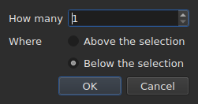

# Insérer, supprimer, fusionner, scinder, trier et rendre disjointes des lignes

Huit entrées du menu `Edit`, sous un séparateur qui les sépare de
`Find and Replace…`. Quatre ont en commun de changer le nombre de lignes, là où
couper, copier et coller, plus haut, déplacent des textes ; `Sort Subtitles` ne
change que **l'ordre** des lignes, `Join Repeated Subtitles` refait un seul
sous-titre des morceaux d'un même texte qui se suivent, et `Make Ranges Disjoint…`
les redécoupe là où elles se chevauchent.

| Entrée | Raccourci | Ce qu'elle fait |
| :----- | :-------- | :-------------- |
| `Insert Subtitles…` | `Ins` | ouvre un dialogue, puis pose des lignes vierges |
| `Remove Subtitles` | `Del` | retire la sélection, sans rien demander |
| `Merge Subtitles` | aucun | fait une seule ligne d'un bloc de lignes voisines |
| `Split Subtitle` | aucun | coupe une ligne en deux au milieu de sa durée |
| `Join Repeated Subtitles` | aucun | fait un seul sous-titre des morceaux d'un même texte qui se suivent |
| `Sort Subtitles` | aucun | remet les lignes dans l'ordre de leur début, sur tout le projet |
| `Make Ranges Disjoint…` | aucun | découpe les lignes qui se chevauchent pour que plus aucune plage n'en chevauche une autre |
| `Repair Subtitles…` | aucun | enchaîne les trois entrées qui précèdent — fusion des répétés, tri, découpage des plages — d'un coup |

Les huit entrent dans l'historique : `Ctrl+Z` les défait comme le reste.

## Insérer

| Champ | Ce qu'il vaut | Défaut |
| :---- | :------------ | :----- |
| `How many` | un entier de 1 à 99 999 | `1` |
| `Where` | `Above the selection` ou `Below the selection` | le dernier choix, `Below` au premier lancement |

`OK` pose les lignes, `Cancel` ne pose rien.

### Où elles vont

**Au dernier sélectionné**, et non au premier. Sélectionner les lignes 1 et 3
puis insérer en dessous pose la nouvelle ligne en position 4 — pas en
position 2. C'est ce que Gaupol fait depuis vingt ans, et c'est ce que la main
attend après avoir balayé du haut vers le bas.

`Above the selection` la pose juste avant cette même ligne.

### Combien de temps elles durent

Une ligne vierge n'a pas de texte, mais elle a des positions. Elles se déduisent
de la place disponible :

| Situation | Début | Durée |
| :-------- | :---- | :---- |
| entre deux sous-titres | la fin de celui d'avant | la place jusqu'au suivant, partagée en parts égales |
| après le dernier | la fin du dernier | trois secondes chacune |
| en tête d'un fichier | l'origine | la place jusqu'au premier, partagée |
| dans un fichier vide | l'origine | trois secondes chacune |

Quand le fichier se chevauche à l'endroit choisi, il n'y a **pas de place à
partager** : les lignes reçoivent une durée nulle, ce que la table montre, plutôt
qu'une durée inventée qui passerait par-dessus la voisine.

### Le document vide

**Aucune sélection n'est exigée**, et c'est la seule façon de commencer un
fichier neuf : les lignes vont à l'index zéro. Le choix du côté est alors éteint
dans le dialogue — il n'y a pas de sélection à situer.

Dès que le document porte une ligne, l'entrée `Insert Subtitles…` **s'éteint tant
que rien n'est sélectionné** : sans sélection, l'index serait deviné.

### Après coup

Les lignes posées sont **sélectionnées**, et la table s'y rend. Appuyer sur
`Ins` une seconde fois insère donc à la suite, sans avoir à cliquer entre les
deux.

### Le côté est retenu

`Above` ou `Below` est retenu **d'une insertion à la suivante, et d'une session à
la suivante** : c'est l'option `edit.insert-placement` du
[fichier de préférences](preferences.md#le-fichier). On n'insère pas une fois,
on insère dix lignes de suite, toujours du même côté.

## Supprimer

`Remove Subtitles`, ou `Del`, retire les lignes sélectionnées — y compris une
sélection discontinue, chaque ligne revenant à sa place si l'on annule.

**Aucune confirmation n'est demandée**, et ce n'est pas une négligence :
l'opération se défait par `Ctrl+Z`. Une modale devant un geste annulable
coûterait un clic à chaque fois pour épargner un `Ctrl+Z` de temps en temps.

**L'entrée est éteinte quand rien n'est sélectionné.** Ailleurs dans la fenêtre,
« rien de sélectionné » veut dire « tout le fichier » — c'est ce qui rend un
décalage utilisable sans sélectionner quatre mille lignes. Ici, cette lecture
viderait un document d'un `Del` malheureux, donc elle n'est pas offerte.

Après le retrait, **la ligne qui a pris la place de la première retirée est
sélectionnée** — ou la dernière restante, si le retrait a emporté la fin du
fichier. Appuyer sur `Del` plusieurs fois de suite retire donc les lignes une
à une.

Un fichier entièrement vidé laisse la fenêtre utilisable : `Insert Subtitles…`
se rallume, puisqu'un document vide s'insère sans sélection.

## Fusionner

`Merge Subtitles` fait **une seule ligne** des lignes sélectionnées :

| Ce que la ligne fusionnée reçoit | D'où il vient |
| :------------------------------- | :------------ |
| son début | le début de la première |
| sa fin | la fin de la dernière |
| son texte | les textes de toutes, dans l'ordre, un saut de ligne entre deux |
| sa traduction | les traductions, recollées de la même façon |
| ce que le format porte en plus — un style, une couche, des coordonnées | la première |

**Un texte vide ne laisse pas de ligne vide** : fusionner `Un.`, une ligne sans
texte et `Trois.` donne deux lignes de texte, pas trois.

Les lignes fusionnées disparaissent, et la ligne qui les remplace prend la place
de la première.

**L'entrée est éteinte** tant que la sélection n'est pas **un bloc d'au moins
deux lignes voisines**. Une ligne seule n'a rien avec quoi fusionner ; les lignes
1 et 3 sans la 2 non plus, puisque le résultat passerait par-dessus la 2 et la
recouvrirait.

Après la fusion, **la ligne fusionnée est sélectionnée** : `Split Subtitle` est
prêt à la couper de nouveau.

## Scinder

`Split Subtitle` coupe la ligne sélectionnée **au milieu de sa durée**, à la
milliseconde près :

| Moitié | Début | Fin | Texte |
| :----- | :---- | :-- | :---- |
| la première | le début d'origine | le milieu | **tout** le texte, et la traduction |
| la seconde | le milieu | la fin d'origine | vide |

**Le texte n'est pas coupé à son saut de ligne.** Ce serait juste pour un
sous-titre de deux lignes et faux pour un sous-titre d'une ligne ou de trois ;
tout le texte reste à la première moitié, et on déplace soi-même ce qui doit
passer à la seconde.

La première moitié garde ce que le format portait en plus du texte ; la seconde
naît comme une ligne insérée, sans rien.

**L'entrée est éteinte** tant que la sélection ne compte pas **exactement une
ligne**. Rien de sélectionné ne veut pas dire « tout le fichier » ici.

Après la scission, **les deux moitiés sont sélectionnées** — c'est ce que Gaupol
fait après toute insertion, et `Merge Subtitles` est alors prêt à défaire le
geste.

## Trier

`Sort Subtitles` remet **tout le projet** dans l'ordre des débuts. Jamais la
sélection : un ordre est une propriété du document, et trier la moitié d'un
fichier ne veut rien dire. Le tri est **stable** : deux sous-titres qui
commencent ensemble gardent l'ordre que le fichier leur donnait.

**Une barre passe dans la barre d'état pendant le tri, et le curseur devient un
sablier** : sur un long fichier, la fenêtre reste un moment sans répondre — la
table se recompose ligne par ligne —, et sans cela on ne sait pas si quelque
chose est en cours. La barre n'indique pas de fraction, le tri n'en rend pas,
et elle s'en va avec lui.

La barre d'état dit combien de lignes ont changé de place — `3 subtitles moved`
— ou, quand tout était en ordre, `already in order`. **Un projet déjà en ordre
n'entre pas dans l'historique** : une opération qui ne change rien n'est pas
une opération à défaire. L'entrée est éteinte pour un projet d'un sous-titre.

Un fichier **avec quelque chose à corriger à l'ouverture** le propose de lui-même,
[dans une seule boîte](#à-louverture-une-seule-boîte) : voir plus bas. Les sous-titres
mal placés sont aussi [comptés avec les diagnostics](fichiers.md#les-diagnostics-dune-lecture),
pour qu'on les trouve sans faire défiler la table.

En ligne de commande, [`sort`](../subedit-cli/sort.md) fait de même sur des
fichiers, et `--sort` le fait au passage sur
[`convert`](../subedit-cli/convert.md#trier-à-lécriture),
[`append`](../subedit-cli/append.md#trier-le-résultat) et
[`split-file`](../subedit-cli/split-file.md#couper-dans-lordre-du-temps).

## Fusionner les sous-titres répétés

`Join Repeated Subtitles` fait **un seul sous-titre** des sous-titres qui montrent la
même chose à la suite : un texte découpé en morceaux qui se suivent, comme le
laissent certains outils de segmentation. Il agit sur **tout le projet**.

**Un répété** a le même texte, la même traduction et les mêmes réglages de format
(un style, une position, des réglages de cue) qu'un autre, **et commence au plus
tard quand celui-ci finit**. Une suite de répétés devient celui qui commence le
premier, avec la plus grande fin de la suite ; les autres disparaissent. `Alpha
[1, 2]`, `Alpha [2, 4]` et `Alpha [4, 6]` donnent `Alpha [1, 6]`.

- **L'ordre du fichier n'y change rien, et n'en change pas** : le sous-titre gardé
  est celui qui commence le premier, où que les autres se trouvent.
- **Rien n'est joint par erreur** : un autre texte, d'autres réglages, un écart
  entre deux morceaux, un sous-titre sans texte ou dont la fin précède le début
  restent séparés.
- La barre d'état dit ce qui a été fait — `2 repeated subtitles joined`, ou
  `no repeated subtitles`.

**À faire avant le tri et le découpage**, qui lisent mieux une suite propre : un
texte en trois morceaux, plus un autre texte sur toute la plage, donné hors
d'ordre, se trie et se découpe en lignes qui basculent d'un morceau à l'autre ; joint
d'abord, il se range et se fusionne proprement. La boîte d'ouverture, plus bas, fait
les trois dans cet ordre.

## Rendre les plages disjointes

`Make Ranges Disjoint…` coupe les sous-titres qui se chevauchent pour que **plus
aucune plage `[début, fin]` n'en chevauche une autre**. Il agit sur **tout le
projet**, jamais sur la sélection : un groupe de sous-titres qui se chevauchent
se coupe là où ils se chevauchent, et la moitié d'un groupe ne veut rien dire.

**Rien n'est raccourci ni prolongé.** À chaque instant, la fenêtre montre les
mêmes textes qu'avant. Ce qui change, c'est le découpage de la ligne de temps :
elle est coupée à chaque début et chaque fin d'un groupe ; un intervalle couvert
par un seul sous-titre reste ce sous-titre ; un intervalle couvert par plusieurs
devient **un** sous-titre dont les lignes sont les leurs, **le plus tôt en ligne 1**.
`A [0, 5]` et `B [3, 8]` donnent `[0, 3] A`, `[3, 5] A / B`, `[5, 8] B`.

Le dialogue demande trois réglages, retenus d'une fois à la suivante :

| Champ | Ce qu'il vaut | Défaut |
| :---- | :------------ | :----- |
| `Shortest interval kept` | de 0 à 10 000 ms : un intervalle plus court est repris par un voisin | `80 ms` (environ deux images) |
| `Most lines in a subtitle` | de 0 à 10 ; `No limit` à 0 | `2` |
| `Put a dash before each subtitle's text` | un tiret devant ce que chaque sous-titre apporte à un sous-titre fusionné | décoché |

`OK` découpe, `Cancel` ne fait rien. **Les lignes écrites sont sélectionnées**
ensuite, et la barre d'état dit ce qui a été fait : `2 subtitles split, 1 merged`.
Un second passage ne change rien et le dit : `already disjoint`.

- **Une ligne n'est jamais dupliquée.** Deux sous-titres de même texte donnent une
  seule ligne là où ils se recouvrent, et deux morceaux voisins qui montrent la
  même chose ne font qu'un sous-titre. Le texte d'un sous-titre coupé en plusieurs
  morceaux est, sinon, répété dans chacun : c'est ce qui est à l'écran à cet instant.
- **Un intervalle très court est repris par un voisin** : celui dont les lignes
  contiennent déjà les siennes, sinon le plus long, étend sa plage pour le couvrir.
  Un sous-titre entier plus court que le seuil n'est jamais repris.
- **Plus de lignes que la limite : des fenêtres.** Trois lignes sur trois secondes
  deviennent deux moitiés, les deux premières lignes puis les deux dernières ;
  quatre lignes, trois tiers, et ainsi de suite. Rien n'est tronqué.
- La traduction suit les mêmes coupes ; le style et la position du premier
  sous-titre qui couvre sont gardés.

**Ce qui n'a pas pu être fait en entier est dit dans une boîte à fermer**, non dans
la barre d'état : des fenêtres, des intervalles repris, des sous-titres trop courts
laissés entiers, des styles qui diffèrent, des sous-titres dont la fin précède le
début (laissés où ils sont).

**L'entrée est refusée, avec la raison, quand les sous-titres ne sont pas dans
l'ordre de leur début** : les groupes sont des suites de voisins, et le noyau ne
trie jamais de lui-même. `Sort Subtitles` d'abord — ou la boîte d'ouverture, qui
fait les deux dans cet ordre.

### Tout d'un coup : `Repair Subtitles…`

`Repair Subtitles…` fait les trois entrées qui précèdent **l'une après l'autre**, dans le seul ordre qui marche : les
répétés sont joints, les sous-titres mis dans l'ordre de leur début, puis les plages rendues disjointes. C'est l'entrée
d'un fichier mal segmenté, mal ordonné et qui se chevauche, quand on sait qu'on veut les trois. Le dialogue demande les
réglages du découpage (les mêmes que `Make Ranges Disjoint…`, retenus d'une fois à la suite) et dit qu'il joint et trie
d'abord. La barre d'état — ou la boîte à fermer, quand quelque chose n'a pas pu être fait en entier — rend **un seul compte**
des trois : `2 repeated subtitles joined; already in order; 2 subtitles split, 1 merged`. Chaque correction est son
entrée d'historique : `Ctrl+Z` les défait une à une. En ligne de commande : [`repair`](../subedit-cli/repair.md).

### À l'ouverture, une seule boîte

Un fichier qui s'ouvre avec quelque chose qu'on sait corriger **le propose dans
une seule boîte**, `Problems found in this file`, plutôt que d'en ouvrir une par
problème. Chaque problème trouvé est une ligne avec sa case, cochée :

- `Join the repeated subtitles` — des sous-titres en répètent un autre qu'ils
  touchent, avec leur nombre ;
- `Sort the subtitles` — les sous-titres ne sont pas dans l'ordre de leur début,
  avec leur nombre ;
- `Make the ranges disjoint` — des sous-titres commencent avant la fin du précédent,
  comptés **une fois le fichier en ordre**, puisque c'est là qu'on les corrige.

**Chaque problème est compté là où il est corrigé**, sur une copie à laquelle les
corrections qui le précèdent ont déjà été faites : un texte coupé en morceaux est la
cause de certains désordres, et le joindre d'abord peut n'en laisser aucun — la boîte
n'offre alors pas le tri.

Un problème qu'on n'a pas trouvé n'a pas de ligne. Décocher le tri **grise et
décoche** l'autre case : les plages ne se rendent disjointes que dans l'ordre.
`Fix` applique ce qui est coché — la fusion, puis le tri, puis le découpage, avec les
réglages du dernier `Make Ranges Disjoint…` — et en rend **un seul compte** ;
`Keep as is` ne touche à rien. **Rien n'est fait sans un oui**, chaque correction
est une entrée d'historique, et un fichier sans rien à corriger n'est l'objet
d'aucune question.

En ligne de commande, [`disjoint`](../subedit-cli/disjoint.md) fait de même sur des fichiers, et `--disjoint`
le fait au passage sur [`convert`](../subedit-cli/convert.md#rendre-les-plages-disjointes),
[`append`](../subedit-cli/append.md#rendre-les-plages-disjointes) et
[`split-file`](../subedit-cli/split-file.md#rendre-les-plages-disjointes).

### Pourquoi pas les raccourcis de Gaupol

Gaupol fusionne par `M` et scinde par `S`. Une lettre seule serait prise à la
table avant d'arriver dans une cellule en cours d'édition, et `Ctrl+S`
enregistre déjà : les deux entrées se prennent par le menu.

## Ce que l'action d'annulation en dit

**Une entrée d'historique par geste.** Fusionner cinq lignes se défait d'un seul
`Ctrl+Z`, et rend les cinq lignes telles qu'elles étaient — positions, textes et
tout ce que le format portait.

| Opération | Ce que `Undo` lit |
| :-------- | :---------------- |
| une insertion | `Undo: inserting` |
| une suppression | `Undo: removing` |
| une fusion | `Undo: merging` |
| une scission | `Undo: splitting` |
| une fusion de répétés | `Undo: joining repeated subtitles` |
| un découpage des plages | `Undo: making the ranges disjoint` |

Une correction proposée à l'ouverture est une entrée d'historique par correction : la fusion, le tri, puis le découpage, se défont l'un après l'autre.

Voir [Annuler et rétablir](annulation.md).

## Les raccourcis pendant qu'une cellule est ouverte

`Ins` et `Del` appartiennent au champ de saisie tant qu'un éditeur de cellule
est ouvert : la touche de suppression y efface un caractère, et non un
sous-titre. Fermer l'éditeur — `Entrée` ou `Échap` — leur rend leur sens. Lancé
par le menu, `Remove Subtitles` valide d'abord la saisie, comme les autres
gestes de [Éditer une cellule](edition.md).

Ce manuel nomme les touches comme le menu les affiche — voir
[Les menus](index.md#les-menus).
