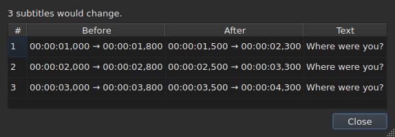
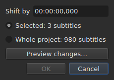
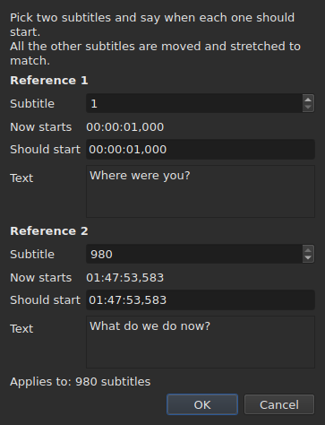
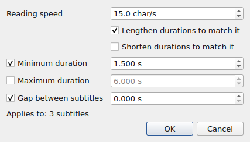
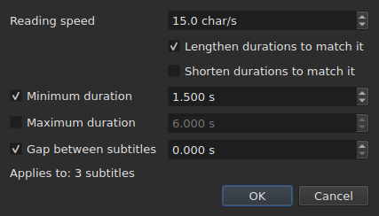
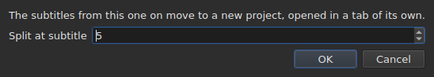

# The operations

The **Tools** menu carries sixteen operations, an analysis and two spelling entries. Each of the
sixteen is undone with a `Ctrl+Z`; the analysis modifies nothing. `Check Spelling…` is undone too, and `Spell-Check Settings…` touches no text.

| Entry | Dialog | What it does |
| :---- | :----- | :----------- |
| `Shift Positions…` | yes | shifts the target by a duration |
| `Transform Positions…` | yes | corrects the target from two markers |
| `Convert Frame Rate…` | yes | re-times the target from one frame rate to another |
| `Adjust Durations…` | yes | moves the ends to hold a reading speed, durations and a gap |
| `Append File…` | a file chooser | appends a file at the end of the project |
| `Split Project…` | yes | cuts the project in two, the rest goes into a new tab |
| `Italic` | **no** | puts the target in italics, or takes it out |
| `Dialogue` | **no** | puts a dialogue dash at the head of each line, or removes it |
| `Case ▸ Title Case` | **no** | each word takes a capital |
| `Case ▸ Sentence case` | **no** | the first letter of the text, and it alone |
| `Case ▸ UPPER CASE` | **no** | everything in capitals |
| `Case ▸ lower case` | **no** | everything in lower case |
| `Remove Hearing-Impaired Mentions…` | yes, without settings | removes hearing-impaired mentions |
| `Correct Texts…` | yes, a multi-page assistant | proposes corrections — mentions, joining and splitting words, common errors, capitals, line breaking — and applies them once accepted, see [Correct Texts…](correct-texts.md) |
| `Check Spelling…` | yes, a word-by-word walk | goes through the words unknown to the dictionary and applies what was corrected, see [Check Spelling…](check-spelling.md) |
| `Spell-Check Settings…` | yes | chooses the language, the target and the document of the check, and the underlining while typing, see [Check Spelling…](check-spelling.md#spell-check-settings) |
| `Snap to Frame Rate…` | yes | puts each timestamp back on the nearest frame |
| `Shift Whole File onto Grid (…)` | **no** | brings the whole file back onto its grid |
| `Frame Rate Analysis…` | yes, without settings | **modifies nothing** — see [The frame grid](frame-grid.md) |

**What an operation did is said in an information box that must be
closed, except for `Italic`, `Case` and `Dialogue`**: those three open no
dialog, and their report — “nothing to change” included — is displayed
in the status bar, with nothing to close. `Split Project…` also gives its own
in the status bar: its result is already in front of you, in the new tab. The messages are quoted in the
section of each operation.

Inserting, removing, merging and splitting lines are not here but in the
`Edit` menu, because they change the number of lines. See
[Inserting, removing, merging and splitting lines](lines.md).

## What they act on

**The selected lines, or the whole file if none is.** It is the same
rule for all, and the dialogs, when there is one, recall it in plain
words:

```
Applies to: 4 subtitles
```

Selecting all the lines amounts to the same as selecting none.

**When only part of the lines is selected, the dialog asks
what to act on.** Two choices are displayed, with their count, and **the selection
is the one checked**:

```
(•) Selected: 2 subtitles
( ) Whole project: 4 subtitles
```

Checking `Whole project` widens the operation to the whole file without first
having to change the selection. When there is nothing to choose — nothing
selected, or everything —, the `Applies to:` line above stays alone.

The dialogs of `Shift Positions…`, `Transform Positions…`,
`Convert Frame Rate…`, `Adjust Durations…`, `Snap to Frame Rate…` and
`Remove Hearing-Impaired Mentions…` offer this choice.

### Seeing before applying

`Shift Positions…`, `Transform Positions…`, `Convert Frame Rate…`,
`Adjust Durations…` and `Snap to Frame Rate…` carry a **`Preview changes…`** button.
It opens a small window that says how many subtitles the operation
would change **with what is typed at that moment, on the checked target**, and
lists the first twelve: their number, their position before, their position
after, and the first line of their text. **Nothing is applied**: closing the
window goes back to the dialog, where you can change a value and look
again.




It opens large enough to show all the columns, and can be resized
by hand.

If the operation would change nothing, the window says so (`Nothing would change.`).
As long as what is typed does not define an operation — an unreadable duration, two
markers on the same subtitle —, the preview is empty for the same reason the
`OK` button is greyed out. `Remove Hearing-Impaired Mentions…` has no preview: what
it changes is text, and the report it gives afterwards
says so.

**With a translation, which text?** Position and structure operations
act on the whole subtitle — its two texts follow. Those that
rewrite a text — `Italic`, `Case`, `Dialogue`,
`Remove Hearing-Impaired Mentions…` — target **the text of the column of the current cell**: the
translation in its column, the main text elsewhere. The other stays intact, and
the status bar says which one is targeted. See [The table](table.md#the-text-the-operations-target).

**One exception, and its label carries it**: `Shift Whole File onto Grid`
ignores the selection. A grid is a property of the document, and half a
document has no grid of its own; the entry therefore says so in its name rather than
in this manual alone.

**`Append File…` ignores the selection too**, for another reason: it is
not a target it rewrites, it is an end it pushes back. See its
[own section](#append-file). **So does `Split Project…`**: it cuts where it is
told to. See [its own](#split-project).

**`Correct Texts…` chooses its target on its own page**, rather than following
the current selection: the selection, the current project or all open
projects. See [Correct Texts…](correct-texts.md). **`Check Spelling…` chooses it in
`Spell-Check Settings…`**, and remembers it: see [Check Spelling…](check-spelling.md).

**The two grid operations do not speak of the same thing as the grid.**
An operation acts on the selection; the analysis and the status bar speak of the
**whole document**. Aligning five lines out of a hundred and seventy-six does change those
five — the table shows it — without either of them moving, which
reads like a missed refresh. It is not one: they have nothing to
say. See [`Snap to Frame Rate…`](#snap-to-frame-rate) and
[The frame grid](frame-grid.md).

### What “nothing selected” means, entry by entry

The rule applies to the `Tools` menu and to the search. The entries of the
`Edit` menu that touch the lines or empty them read it differently — otherwise an
unlucky `Del` or `Ctrl+X` would empty the document.

| Entry | Without a selection | What it requires |
| :---- | :------------------ | :--------------- |
| the operations of the `Tools` menu | the whole file | a non-empty document |
| `Shift Whole File onto Grid` | the whole file, **always** | a grid found |
| `Find and Replace…` | the whole file | a non-empty document |
| `Cut Texts`, `Copy Texts`, `Paste Texts` | **disabled** | at least one line selected |
| `Remove Subtitles` | **disabled** | at least one line selected |
| `Merge Subtitles` | **disabled** | a block of at least two neighbouring lines |
| `Split Subtitle` | **disabled** | exactly one line |
| `Insert Subtitles…` | disabled, except on an empty document | a line to place them against |

Each page gives the reason: [the clipboard](clipboard.md#what-they-act-on),
[the lines](lines.md), [the search](find-and-replace.md#what-the-search-covers).

The entries are **disabled on an empty file**: there would be nothing to
shift. `Italic` has a second condition, which its section describes: the open
format must be able to write a style. Case and dashes have none — a
text is a text in all nine formats.

## `Shift Positions…`

Moves the target by a duration, forwards or backwards. Both bounds of
each subtitle move by the same amount: none stays on screen longer or shorter
than before.

The duration is written **like a timestamp, sign included** — `00:00:02,500` moves forward,
`-0:01,250` moves back. The accepted forms are those of a position cell.




| Refusal | Why |
| :------ | :-- |
| an unreadable duration | the button stays disabled; nothing is shifted at random |
| a shift of zero | there is no operation to record |
| a subtitle would go before the start of the video | **no file can carry such a position** |

The third case names the culprit — “subtitle 1 would start before the origin” —
and it is the one to look at to see by how much you were wrong. Nothing
is applied.

## `Transform Positions…`

The correction of a file timed against another cut. You say where **two**
subtitles really start, and everything else follows, proportionally.

The dialog asks twice for the same thing: a subtitle number, and the
position where its start belongs. For each marker, it shows **what that
number designates** — its text (`Text`) and the time at which it starts
**now** (`Now starts`), as plain labels — and they follow the number
as you change it. The text keeps **three lines of room** whatever the
subtitle says: a longer one, or a long address, scrolls inside it, and
the dialog keeps its size as the marker changes. **A single field is to be typed per marker:
`Should start`**, the time at which this subtitle must start. There is no need to search the table for which line is `980`.

`Should start` is **proposed at the current value**: as long as you do not
touch it, the marker says “this subtitle is already where it must be”. You only
change what you want to change. The second marker is pre-filled on the last
subtitle of the file — two distant markers give a safer correction
than two neighbouring ones.




**Both markers land exactly where they were asked.** It is not
an approximation: the computation is made so that it is true.

| Refusal | Why |
| :------ | :-- |
| two markers on the same subtitle | they define no correction |
| an unreadable position | same reason as for the shift |

A number outside the file cannot be typed: the field is bounded by the
number of subtitles.

## `Convert Frame Rate…`

Re-times the target when the positions were computed against one frame
rate and must be against another.

Both lists offer the eight standard frame rates.

> **Getting the input frame rate wrong shifts the whole file without reporting
> anything.** It is the worst failure mode of this operation, and that is why
> the dialog says where the values it proposes come from rather than
> setting them silently.

### The two sources, and what they answer

The dialog carries up to two more lines, each appearing when it has
something to say:

| Line | What it says | What it pre-fills |
| :--- | :----------- | :---------------- |
| `The positions say` | the [frame grid](frame-grid.md) deduced from the file's positions | `Timed against` |
| `The video declares` | the frame rate the container announces, for example `24000/1001` | `Should play at` |
| `The file was read at` | the frame rate at which a file **counted in frames** was read | `Timed against` |

**Each proposal goes to the field it answers.** The grid says what the
file was *written* against — that is the top list. What the container announces is
the frame rate at which the film *runs*, and so the one at which the subtitles
must arrive — that is the bottom list.

**Only a clean grid pre-fills the input.** A partial grid is a
clue the deduction itself qualifies as partial, and this field decides an
operation on the whole file. The [status bar](frame-grid.md) and the analysis
carry that case; this one does not.

**A file counted in frames replaces the grid rather than adding to it.**
MicroDVD carries frame numbers, and the document's positions were
computed from them at the reading frame rate: a grid deduced from those positions
can only find that number again. `The positions say` therefore disappears, and
`The file was read at` takes its place — it is the same choice
[the status bar](frame-grid.md#a-document-counted-in-frames-has-no-grid-it-has-a-frame-rate) makes.

**That is how you change the frame rate of a MicroDVD.** Setting the frame rate read
as input and the true one as output recomputes each position from the file's
frames — without reading anything again, and the operation is undone like the
others.

### A disagreement is not a contradiction

Both lines can be displayed together and announce different numbers.
**It is not an error to arbitrate**: the film runs at one frame rate, the
file was written on another grid. A file at 24 for a film at 25 is
exactly the case alignment — `snap` on the command line — exists to
handle.

Nothing is therefore chosen in the user's place: both lists stay
editable, and that is deliberate. A source that imposes itself forbids cross-checking.

The lines do not appear when there is nothing to say: no video
associated, no `ffprobe`, or no clean grid. The dialog is then the one
described above, and **no operation refuses for all that** — the
frame rate comes from the user. See
[The associated video](video.md#ffmpeg-is-not-required).

A frame rate the film announces but that is not one of the eight standard ones
is **displayed without being chosen**: knowing the film runs at an
unusual frame rate is the information, and there is nothing to convert it to here.

Converting a frame rate into itself changes nothing: the button stays disabled.

## `Adjust Durations…`

Lengthens or shortens the duration of the target's subtitles **by moving their
end, never their start**. Moving the start would move the subtitle, which is
the job of [`Shift Positions…`](#shift-positions).





### The four constraints

| Field | What it asks for | Values | Default |
| :---- | :--------------- | :----- | :------ |
| `Reading speed` | the time needed to read the text | from 1 to 99 characters per second, to the tenth | 15 char/s |
| `Lengthen durations to match it` | lengthen what is too short to be read | checked or not | checked |
| `Shorten durations to match it` | shorten what stays displayed longer than needed | checked or not | unchecked |
| `Minimum duration` | a floor duration | from 0 to 99 s, to the millisecond | checked, 1.5 s |
| `Maximum duration` | a ceiling duration | from 0 to 99 s, to the millisecond | unchecked, 6 s |
| `Gap between subtitles` | the gap to leave before the next subtitle | from 0 to 99 s, to the millisecond | checked, 0 s |

These are Gaupol's default values.

**An unchecked constraint is absent**: its field is greyed out and not read.
A constraint checked at zero is worth zero — a gap of 0 s forbids a
subtitle from overlapping the next one. The reading speed is read only if
`Lengthen` or `Shorten` is checked.

**When everything is unchecked, `OK` is disabled**: there is nothing to ask for.

The dialog reopens on the values of the last adjustment, **and keeps them from one
session to the next** — like the two search options. **An unchecked box
keeps its value**: unchecking `Minimum duration` after setting 2 s does not bring back
1.5 s, and checking it again finds 2 s. The nine settings are in the
[preferences file](preferences.md#the-file), under `duration-adjust.`.

**The command line shares them.** [`subedit-cli adjust`](../subedit-cli/adjust.md) reads the
same nine settings by default, so a speed set here is the speed it uses, unless its own options
say otherwise; [`subedit-cli config`](../subedit-cli/config.md) shows and changes them. See
[Two blocks, one shared with the command line](preferences.md#two-blocks-one-shared-with-the-command-line).

### In what order, and which one wins

Each subtitle of the target goes through the four constraints **in this order**, and
each sets the end in turn:

| Rank | Constraint | What it sets |
| ---: | :--------- | :----------- |
| 1 | reading speed | `end = start + length ÷ speed`, if the subtitle is too short (`Lengthen`) or too long (`Shorten`) |
| 2 | minimum duration | `end = start + minimum`, if the duration is shorter |
| 3 | maximum duration | `end = start + maximum`, if the duration is longer |
| 4 | gap | `end = next start − gap`, if the end is too close to it — never before the start |

**The last one applied wins.** The gap comes last and can bring a
duration back below the minimum just set: two subtitles on screen at the same
time are a fault the viewer sees, a slightly short subtitle is
not.

**The length of the text is counted without tags**, in characters, line breaks
included: `<i>été</i>` counts three characters. The reading speed speaks of
what the viewer reads.

**The next one is the next subtitle of the file**, whether it is in the target or
not. **The last subtitle of the file has no next one**: the gap does not
constrain it.

### What no end can satisfy is said

Once the adjustment is done, the window says how many ends moved, and **what
could not be held** — a constraint appears only if it was
sacrificed for at least one subtitle:

```text
adjusted the durations of 12 subtitles; could not satisfy the reading speed in 9 subtitles, the minimum duration in 4 subtitles
```

The three possible mentions are `the reading speed`, `the minimum duration` and
`the gap`. **The maximum duration is always held**: it comes after the speed
and the minimum, and only the gap follows it, which can only shorten. A minimum
larger than the maximum yields to it, and it is the minimum that is counted. The gap
is sacrificed only when the next one starts before the start of the subtitle
itself.

The count covers the whole target, **including the subtitles whose end did
not move**: a subtitle already set against its next one and too short for the
minimum is counted. When no end moves, the window says so —
`no duration to adjust` — and nothing enters the history.

## `Append File…`

Appends a file at the end of the open project. **Nothing is inserted between the
two**: the chosen file is shifted by the end of the last subtitle of the
project, exactly as Gaupol does.

**Disabled on an empty document**: there would be no end to shift from. A
file chooser opens, with no encoding to choose — like `Open…`.

**The appended file goes through conversion**, in the words of `Save As…` and of
[pasting from another format](clipboard.md#tags-of-another-format-are-translated):
its tags are translated into the project's format, and what that format cannot
write is said:

```text
appended 12 subtitles; Advanced SSA into SubRip: 1 tag dropped
```

**What the appended file carried does not survive whole.** Its positions
follow, tags included; its header, its format-specific fields — style
name, margins — and what a tag cannot become in the project's format do
not follow, and say so. **It has no translation**: a translation stays
specific to the document that received it, and the appended file arrives alone.

**Selected afterwards**, like the lines a paste wrote beyond
the end. When nothing is lost, the count is displayed in the status bar rather
than in a box to close — the same rule as
[opening a translation](files.md#opening-a-translation).

**A single history entry**, whatever the number of subtitles
appended: `Ctrl+Z` removes them all at once.

**A file already open can be appended to itself**: nothing forbids it, as
in Gaupol.

**On the command line**, [`append`](../subedit-cli/append.md) does the same thing for several files at
once, in a single result.

## `Split Project…`

Cuts the project in two: **the exact inverse of `Append File…`**. A box
asks from which subtitle to cut — from the second to the last, numbered
as in the table — and opens on the current line.

**The table shows where you cut before you cut**: each number the
box takes selects its line. `Cancel` gives back the previous selection.




**Disabled under two subtitles**: a cut wants a subtitle on each
side.

**The rest is copied into a new project, opened in a new tab, and
removed from the original project.** The new project is **shifted by minus the end of the
last subtitle that stayed**: splitting then appending gives back the starting project.
Its two texts, main and translation, follow their subtitles, and it
keeps the format and encoding of the original — **without a path**: no file
holds it yet. Its tab is therefore written `untitled*` from its birth, and
closing it without saving asks the question asked for everything that is not
written.

**The status bar says how many subtitles left**, with no box to
close — the new tab already shows the result:

```text
split 12 subtitles into a new project
```

**A single history entry**, in the original project:
`Undo: splitting the project` gives it back its rest. The new project has a history
of its own, empty; undoing does not touch it, and it stays open.

**Refused when no file could write the result.** If the two
halves overlap at the cut, the shift would bring a subtitle before
the start of the video — a negative position, which no format writes. The box
that refuses **names the subtitle** and suggests cutting elsewhere:

```text
Cannot split at subtitle 3: subtitle 3 would fall before the start of the video. Cut somewhere else.
```

Arriving exactly at the start is allowed: zero is a position.

**On the command line**, [`split-file`](../subedit-cli/split-file.md) cuts a file the same way, into two
named files.

## `Snap to Frame Rate…`

Puts **each timestamp** — start and end — on the nearest frame of the
chosen frame rate. A single list, and that is the whole difference with
conversion: a conversion needs two frame rates because it scales the
file from one to the other; an alignment only needs the
grid to land on.

| | `Convert Frame Rate…` | `Snap to Frame Rate…` |
| :--- | :-------------------- | :-------------------- |
| movement | proportional to time — **several seconds** over a feature film | half a frame at most, **everywhere** |
| for which file | a file whose **timing is wrong** | a file whose timing is **right** and whose grid is wrong |

**The use case**, spelled out: a film at 25 frames per second,
subtitles written on a grid at 24, lines already roughly in their
place to within a few milliseconds. There is nothing to re-time — only to
put the timestamps back on the right frames.

The list **opens on what the video declares**, and not on what the
positions say: the intent is to join the film's grid, and the
deduction names the one being left. Without a video or without `ffprobe`, it opens
on the project's frame rate.

Aligning a file on the grid it already occupies does not change it, and it is not
an error: the operation applies, moves nothing, and is undone like
any other.

**Aligning part of the file says so, once done.** A notice is displayed
when the selection does not cover everything and the document is still read on another
grid:

```
5 of 176 subtitles aligned to 25 fps; the document is still read on a 24 fps grid
```

It links the gesture to its effect, and it explains why the status bar and
the analysis did not move: they speak of the document, the operation acted on
five lines. Nothing is prevented — aligning part of a file can be
intended.

**It is almost always unintended, and that is measured.** Over the eight grid
files of the repository, aligning the whole file brings the deduced frame rate to the
target and its concentration to 100 %; aligning five lines never moves the
deduced frame rate and **lowers** the concentration in seven cases out of eight — the
aligned lines have left the grid the rest of the file lives on. The eighth is
50 to 25, where the target grid divides the file's and where the positions were
already on it.

The notice is not displayed when the selection covers the whole file, when
no grid is deduced, or when the document is now read on the
requested frame rate — that is when the alignment did what it was asked.

## `Shift Whole File onto Grid`

Shifts **the whole file** by the amount that puts its positions back on the grid
they left. A file whose positions are on a grid up to a
constant has been shifted, and that constant can be measured.

**The menu entry carries the amount and the scope** —
`Shift Whole File onto Grid (+0.001 s)`. There is no dialog:
the operation takes no option, and an entry that is going to move a whole
file must say by how much, and that it will do so in full, before being chosen.
It is the only operation of the menu that ignores the selection.

**It is disabled when no grid has been found.** There is then nothing to
join, and a phase measured on noise would move the file at random.
“Nothing to join” and “join by zero” do not say the same thing: the
second stays offered, because a file already on its grid is a
normal case of it.

**This is not `Snap to Frame Rate…`.** This entry shifts everything by the same amount
and preserves the relative timing **exactly**; alignment moves each
position independently and absorbs in passing those that had been corrected by
hand. On a clean file both give the same result; on a
partial file, not — and the [detail of the analysis](frame-grid.md) says which of the
two you have in front of you.

## `Italic`

Puts the target in italics by writing the tags of the **open format**, or
removes them if it is already in italics. No dialog: the operation has no setting, and
it is undone with a `Ctrl+Z` like the others.

| Action | Shortcut | Where |
| :----- | :------- | :---- |
| Italic | `Ctrl+I` | **Tools** menu, toolbar |

It is the only operation of the `Tools` menu that has a button in the
[toolbar](index.md#the-toolbar).

### What it writes, format by format

The text of a subtitle is that of its file, tags included — see
[Editing a cell](editing.md). Each format has its own, and that is what
this entry spares you from knowing:

| Format | What is written |
| :----- | :-------------- |
| SubRip, WebVTT, SubViewer 2 | `<i>text</i>` |
| Sub Station Alpha, Advanced SSA | `{\i1}text{\i0}` |
| MicroDVD | `{Y:i}text` — the tag runs to the end of the subtitle, there is nothing to close |
| MPL2 | `/` at the head of **each** line, the marker applying only to its own |
| TMPlayer, LRC | nothing: these two formats write no style |

**The entry is disabled for a TMPlayer and an LRC, not hidden.** An absent
entry teaches nothing; a greyed-out entry answers “why can't
I?”.

**The format read is that of the targeted text.** With a translation, the main text
can be in SubRip and the translation in Advanced SSA: `Italic` writes `<i>` in
the first and `{\i1}` in the second. The entry is likewise disabled when the
targeted text is in a format that writes no style, even if the other one does.

### Which way it goes

A single entry for both directions, and it is the target that decides:

- **a single subtitle out of italics is enough** for the whole target to go into italics;
- the target comes out of them only when it is **entirely** in them.

That is Gaupol's rule, and it is the only one that makes a single button
usable: a mixed selection goes as one block rather than being inverted
line by line, and pressing twice gives it back as it was.

The report says what was done, in the direction it was done:

```
2 subtitles put in italics
2 subtitles taken out of italics
```

**An empty line never gains tags** — an `<i></i>` around nothing would
show in the table. A target that contains only such lines therefore changes nothing, and
says so: “nothing to change”. No entry then enters the history.

### What it does not touch

**The other tags stay exactly where they are**: a colour, a
font, an Advanced SSA `{\pos(x,y)}` go through the operation without moving.
Only italic tags are set and removed.

A tag that says several things at once is not taken away whole:
`{\b1\i1}` becomes `{\b1}`, and `{Y:bi}` becomes `{Y:b}`. The bold stays, and the
text really comes out of italics.

## `Case` and `Dialogue`

Two transformations of the **visible text**, and the tags are not touched: a
subtitle put in lower case keeps its `<I>` as it is, and a dash is set
before the text, not before an opening tag. **No tag changes
place**: `<i>bon</i>jour` in capitals gives `<i>BON</i>JOUR`, where
[a replacement](find-and-replace.md#the-text-searched-is-the-visible-text) would have
extended the italics to the whole word.

| Entry | Shortcut | What it does |
| :---- | :------- | :----------- |
| Case ▸ Title Case | — | `bonjour marie` becomes `Bonjour Marie` |
| Case ▸ Sentence case | — | `BONJOUR MARIE` becomes `Bonjour marie` |
| Case ▸ UPPER CASE | — | everything in capitals |
| Case ▸ lower case | — | everything in lower case |
| Dialogue | — | adds or removes the dashes |

### What case does not touch

**What precedes the first letter or the first digit is left as it is.**
A dialogue dash, an opening quotation mark, a parenthesis survive:
`- bonjour` put in sentence case gives `- Bonjour`, and not `- bonjour` with a
capitalised dash, which would make no sense.

**Sentence case puts the rest back in lower case.** `BONJOUR MARIE` becomes
`Bonjour marie`: that is what Gaupol does, and it is what lets you tone down a
subtitle typed in capitals.

**Accents and non-Latin alphabets are handled properly.** `éléonore`
gives `ÉLÉONORE`, and an apostrophe does not cut a word: `l'été` put in title
case gives `L'été` and not `L'Été`. A letter that changes length keeps its
tags around it: `fi <i>x</i>` in capitals gives `FI <i>X</i>`.

**Case does not depend on the system's language.** It follows the rules common
to all languages: `istanbul` in capitals gives `ISTANBUL`, whether the machine
is set to French or to Turkish.

### Which way `Dialogue` goes

A single entry for both directions, and it is the target that decides:

- **a single line without a dash is enough** for the whole target to gain one;
- the target loses them only when **all** its lines have one.

Pressing twice gives the target back as it was. It is the rule of
[`Italic`](#italic), and the only one that makes a single button usable.

**Three dashes are recognised** — the keyboard's hyphen and the typographer's two
dashes, `–` and `—` — and it is the hyphen that is written.
Extra spaces after the dash disappear. An empty line gains
none.

### What they say

```
2 subtitles recased
2 subtitles dashed
2 subtitles undashed
```

And when nothing changes — a target already in the requested case — “nothing to
change”, without putting anything in the history.

## `Remove Hearing-Impaired Mentions…`

Removes the mentions intended for deaf or hard-of-hearing viewers — the
descriptions of sounds in brackets. **Parentheses stay**: they also serve for
whispered lines, and it is `Correct Texts…` that removes them, through its `Sound in parentheses` check box.
**Nothing else**: song lyrics
between hash signs and the speaker's name before a colon are removed only through
[`Correct Texts…`](correct-texts.md), `Mentions` page.

The dialog asks nothing: the operation has no setting, and the dialog only serves to
confirm and to recall what it acts on.

**It is the only one of the `Tools` menu that makes lines disappear**, and the only one
in the whole program that makes them disappear without being asked to. A
subtitle that was *only* a mention has no text left once cleaned, and a
subtitle with no text has no reason to be: it is removed from the file. The others
are rewritten without their mention.

**The format's tags do not count as text**: `<i>[SOUPIR]</i>` of a
SubRip and `{\i1}[SOUPIR]{\i0}` of an Advanced SSA are removed alike.
An `<i>` in a TMPlayer or an LRC, which write no tag, is text.

**Targeted at the translation, it removes no line.** A translation the
rule empties — a text that was only a mention — is **emptied** and the subtitle
stays: it has a main text, which the operation did not target, and removing it would
destroy it. The report counts it as cleaned:

```text
1 subtitle cleaned, 0 removed
```

The tags read are those of the translation's format, which may not be that
of the main file.

The report says both:

```
1 subtitle cleaned, 1 removed
```

**When nothing bites, nothing happens** — and the dialog says so: “no mention
to remove”. No entry enters the history, because an operation that
changes nothing is not an operation to undo.

**Undoing puts everything back**, the removed subtitles as well as the rewritten
texts, each with the text it had. A subtitle the rule emptied
is never rewritten before being removed, precisely so that it comes back
whole.

> **The selection is lost on this occasion**: removing lines changes the
> structure of the table, which is rebuilt. All the other operations of the
> `Tools` menu keep it, `Italic`, `Case` and `Dialogue` included. The four
> structure entries of the `Edit` menu — insert, remove, merge, split —
> change the structure too, and give back a selection in place of the one
> they took away — see
> [Inserting, removing, merging and splitting lines](lines.md).

A purely numeric reference — “See [1] the note” — is not a mention
and stays as it is.

## Beyond the end of the film

When a video is open, an operation that **pushes subtitles past the
end of the film** reports it, once done:

```
shifting leaves 3 subtitles past the end of the video, by 4.200 s at most
```

The sentence names the operation — `shifting`, `transforming`,
`converting the frame rate`, `adjusting durations`,
`aligning on the frame rate` —, how many subtitles go past, and by how much
the furthest one goes. `Shift Whole File onto Grid` is a shift, and is named
`shifting`.

| What is counted | What is not |
| :-------------- | :---------- |
| what the operation has just touched, that is, the target | a subtitle nobody moved |
| a subtitle that ends **after** the end | a subtitle that ends exactly with it |

**It is a warning, and nothing else.** Nothing is refused, nothing is
corrected: a subtitle that falls after the end credits may be
exactly what you wanted, and a refusal that is wrong costs more than a
warning you ignore. The operation is in the history, and `Undo`
undoes it like any other.

**A single box per operation.** `Adjust Durations…` and `Align` already have
something to say — what an adjustment could not hold, what a partial
alignment left aside. When they also push a subtitle past the end,
the box carries both sentences, one under the other, that of the operation
first:

```
adjusted the durations of 2 subtitles
adjusting durations leaves 1 subtitle past the end of the video, by 1.000 s at most
```

The message does not appear if no video is open: the duration comes from the
player, and without a film there is no end to go past. Only the five operations
named above are concerned — `Adjust Durations…` included, which can
lengthen an end beyond the film. All the others are not: those of the
`Tools` menu that rewrite a text, and in the `Edit` menu insertion,
merging, splitting, pasting, replacing and edited cells — an
end typed by hand beyond the film is not reported.
