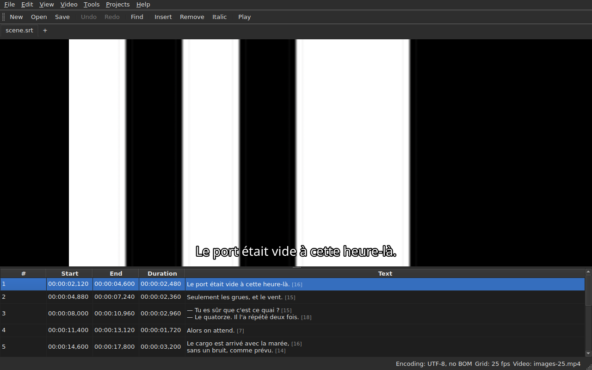

# The player

The associated video is watched **in the window**, with the current line
drawn over it. That is what lets you check on the film the result
of a shift, a transformation or a frame rate conversion.

See [The associated video](video.md) for how to associate a film; this
page describes what happens once it is.

## The video view

| Situation | What the window shows |
| :-------- | :-------------------- |
| a video is associated and opens | the picture takes the top, the table below |
| no video associated | no picture, the table takes the whole window |
| the video does not open | no picture, a message, and the window stays usable |

The split between the picture and the table **moves with the mouse**. The picture does
not go below 180 pixels high. Enlarging the window gives the space gained
to the table, not to the picture: what you lack when editing is lines.

Under the picture, **a playback bar**: where the film is, how long it lasts,
play and pause, and the volume. See [The playback bar](#the-playback-bar).

## Playing and stopping

| Command | Shortcut | What it does |
| :------ | :------- | :----------- |
| `Video ▸ Play / Pause` | `Ctrl+P` | plays if playback is stopped, stops it otherwise |

The command is **disabled as long as no video is open**. A video that
has just been associated is opened **stopped**: opening a film is not
watching it.

`Ctrl+P` where Gaupol has a plain `P`: a single-letter shortcut at
window scope is taken before the widget that has the focus sees it,
so a `P` would be swallowed on its way to a cell editor. Nothing
prints here, the combination is free.

## The playback bar

Under the picture, from left to right — the three buttons are **icons**, those of the desktop theme when it has them, those of Qt's style otherwise:

| Element | What it does |
| :------ | :----------- |
| the two step buttons | move the film back, forward **by one frame step** — see [Frame by frame](timing.md#frame-by-frame) |
| play / pause | plays or stops, like `Ctrl+P` — the button shows **what it will do**: a triangle when stopped, two bars when playing; the tooltip says it in plain words |
| the position | `HH:MM:SS,mmm`, written as the table writes a position — **as a frame number** when [`View ▸ Positions in Frames`](table.md#positions-in-frames) is checked |
| the slider | **reads and moves**: you drag the handle, click in the groove, use the arrows |
| the duration | the one the video declares, written like the position |
| the volume | from 0 to 100, see [The volume](#the-volume) |
| table following | pressed as long as the table follows playback, and brings it back to the line playing when you press it — see [The table follows playback](#the-table-follows-playback) |

**The slider does not hand over at every pixel.** Dragging the handle asks for dozens of
positions per second, and each one costs a decoded frame: the first position goes out right
away, the following ones wait a twentieth of a second, and **the last position asked for is
always the one reached** — at the latest when you release the handle. The picture therefore does not
lag behind the hand, and does not start drawing a path nobody is looking at.

**The slider moves by itself during playback**, and that does not count as a gesture:
only what you do moves the film. While you hold the handle, playback does not take it back.

## The timecode

**The position is written on the picture**, at the top left, on a translucent background that makes it
readable on any scene. It is drawn by the window, in its font, and asks
nothing of the player but the position it already gives; it updates with each gesture,
without waiting for the next round of tracking.

## Moving through the film

In the **Video** menu, **Gaupol's gestures**, under its names. All are **disabled with no video**, like
playback; the three that act on the selection are also disabled as long as nothing is selected.

| Command | Shortcut | What it does |
| :------ | :------- | :----------- |
| `Video ▸ Play Selection` | `Ctrl+Shift+P` | plays from **a little before the start** of the selection **to the end of its last subtitle**, and stops on the picture |
| `Video ▸ Seek Previous` | `Ctrl+Left` | puts playback at the start of the last subtitle **ended** before the position |
| `Video ▸ Seek Next` | `Ctrl+Right` | puts playback at the start of the first subtitle that **starts** after the position |
| `Video ▸ Seek Backward` | `Ctrl+Shift+Left` | goes back by one jump — thirty seconds by default |
| `Video ▸ Seek Forward` | `Ctrl+Shift+Right` | goes forward by one jump |
| `Video ▸ Seek Selection Start` | `Ctrl+Up` | puts playback at the start of the selection, **the lead before it** |
| `Video ▸ Seek Selection End` | `Ctrl+Down` | puts playback at the end of the selection, **the lead before it** |

**The shortcuts are Gaupol's**, except one: `Play Selection` is `O` there, and a
bare letter is taken by the window before the cell being edited sees it — typing an
`o` in a text would start the film. `Ctrl+P` is playback's answer, `Ctrl+Shift+P` that of
the selection. The keyboard arrows stay with the cell editor when it is
open: `Ctrl+Left` moves the cursor there by one word, not playback.

- **The jump** is 30 seconds, and can be set from 1 second to one hour — see
  [The preferences](preferences.md#the-player). It goes past neither the start of the film nor its end.
- **The lead** is one second: you watch a little **before** the subtitle, to see it coming.
  It can be set from 0 to 60 seconds, and playback does not go below zero.
- **A neighbour that does not exist** — nothing before the first subtitle, nothing after the last — does
  nothing, and says nothing: playback stays where it is.
- **Each gesture shows at once**: the bar, the timecode and the drawn line are
  up to date when it finishes, without waiting for the next round.

## The volume

The volume is that of the **player**, from 0 to 100, and not that of the system. It is set with the slider of
the bar, or by two gestures, in the `Video ▸ Audio` submenu, in steps of five:

| Command | Shortcut | What it does |
| :------ | :------- | :----------- |
| `Video ▸ Audio ▸ Volume Down` | `Ctrl+-` | lowers the volume by five |
| `Video ▸ Audio ▸ Volume Up` | `Ctrl++` or `Ctrl+=` | raises it by five — the second for keyboards where the plus needs the shift key |

**It is remembered from one session to the next**, and given to each video you open. A value outside
0 to 100 in the settings file does not break the opening: it is ignored, and the window says so.
**The audio track, on the other hand, is not remembered** — a track number is that of its file; see
[The audio track](video.md#the-audio-track).

## Selection and playback

Both go both ways.

| What you do | What happens |
| :---------- | :----------- |
| select a line | playback moves **to the start of that subtitle** |
| extend the selection downwards | nothing more: it is the first line of the selection that counts |
| playback moves on | the **current line** follows the subtitle on screen, **tinted**, and the table **centres** it — see [The table follows playback](#the-table-follows-playback) |

The current line and the selection are two distinct things. Playback
moves the first and **never touches the second**: the selection is what
an operation applies to, and a film playing in a corner has no business
rewriting the user's target line after line.

The tint follows this same rule: it is a marker, not a selection. **An
anomaly wins over it** — a line that carries both keeps the colour of
its fault, a fault being there to be repaired when a line shown is so only
for the duration of a line of dialogue. See [The table](table.md).

### The table follows playback

**The table centres the line playing** — in the middle of what it shows, not at the edge where it would be enough to
make it visible. It does so **when the line changes**, not at every tick of the tracking: a line of dialogue lasts
seconds, and re-centring every tenth of a second would be scrolling to no purpose.

**A manual scroll suspends the tracking.** The wheel, the scroll bar and a click in the table
suspend it: the table stays where you put it, while the current line, the drawn line and the bar
keep following the film. The tracking button — **the icon of the lines of a table, one marked with an arrow**, on the right of the playback
bar; its tooltip says “Follow playback” — **is pressed as long as the table follows** and then pops up.

**Tracking resumes on a player gesture**: playback started, a jump, a step, a marker set, an
insertion at the position, or a move of the bar — the table then centres at once on the
line playing, even if it was already the same one. **Or on demand**: pressing the button restores it, and
releasing it suspends it. There is no timer: what resumes the tracking is always a gesture.

Switching to another tab resumes tracking on that tab's film.

**An edit in progress is not interrupted.** As long as a cell editor
is open, the current line stays where it is; the line drawn on
the picture, for its part, keeps following, since it bothers nobody.

## The drawn line

What is displayed on the picture comes from the **open document**, never from a file:
**what you see on the picture is what you have just typed**, without going through the
disk. The text appears centred, at the bottom of the picture, and disappears between two
subtitles.

**With a translation, the line is that of the targeted text**: the translation when
the current cell is in the `Translation` column, the main text
everywhere else. It is the rule of all text operations — see [The
text the operations target](table.md#the-text-the-operations-target) —
and **there is no setting**: moving from one column to the other changes what
the picture shows, at most a tenth of a second later. Without a translation, or
with the column removed, nothing changes: it is the main text.

A subtitle the translation has not yet caught up with shows **nothing** as long
as the current column is the translation: it is not the main text that
takes its place.

**The format's tags are understood, never drawn as they are.** The model carries the
text as the file writes it, and it is the tag pivot — the one of format
conversion — that reads it before giving it to the picture:

| In the file | On the picture |
| :---------- | :------------- |
| bold, italic, underline | applied: `<i>no</i>` displays as *no*, without its tags |
| colour | applied |
| font, size | removed, the text stays |
| position, alignment, speaker, anything with no on-screen equivalent | removed, the text stays |
| `{` and `}` in the text | drawn: “{laughs}” displays as “{laughs}” |

An Advanced SSA file is read the same way: its `{\i1}` apply, and its
`{\an8}` is removed — the line stays at the bottom of the picture. Each text is read **in the format
of its own file**, the translation as well as the main text.

**The neighbouring subtitle file is not loaded** by the player, even if it bears the name of the
film. It would be the one being edited, and the picture would then show the state of the disk
while the table shows something else.

## Previewing a change

There is **nothing special to do**: you apply the operation, watch
the film, and choose `Undo: shifting` — or the operation concerned — if the
result does not suit. See [Undo and redo](undo.md).

No separate preview mode exists, and that is deliberate: what you
watch is the document as it is, not an invisible provisional state.

## When the picture does not appear

Two possible messages, both prefixed with the file's path:

| Message | What happened |
| :------ | :------------ |
| `<file>: <reason>` | the player refused the file — unknown format, missing file, directory |
| `<file>: no video player is available` | no player could be built |

In both cases, **the video stays associated** — you do need to see which
file it is in order to choose another one — and **the window stays usable**:
the document is open, the operations work, and so does saving.

**The picture is drawn in the window itself**: `libmpv` fills a buffer at the
size of the view, in real pixels, and the window paints it. Nothing of it depends on the
graphics platform — the same picture under X11, under Wayland and with no display — and it
follows resizing: the film's aspect ratio is preserved, the rest of the
view is black.

The second message therefore only appears if the `libmpv` library refuses to start,
although it is required at build time.

Rendering goes through the processor, but **decoding can be done on the graphics card**: it
decodes, the picture is copied back into memory, then drawn as before. A machine without a
usable card decodes on the processor, without a message. On a 1080p film in H.264, playback keeps up with
real time with room to spare. **A 4K film in heavy HEVC may not keep up**: measured on two
cores, it decodes at 0.6 times real time without the card, and stepping one frame there takes several
seconds when the key frame is far away. The card reduces that time — by a third to two thirds depending on the film
— without removing it. **It does not change the picture displayed**: a step or a seek land on the
same frame with and without. To turn it off, uncheck `Decode on the graphics card` in
[`Preferences…`](preferences.md#the-player).

## What is not there

**Setting a marker, stepping frame by frame and nudging an edge by one frame** are in
[Timing from the video](timing.md), not here. What does not exist, and is pointless to look for:

- a waveform;
- automatic playback when a film is opened;
- the style of the drawn line (font, colour, position, background): it keeps the window's;
- hardware decoding without copying: see “When the picture does not appear” above.

This manual describes what exists: what will come, and in what order, is in the
[roadmap](../../feuille-de-route.md).
