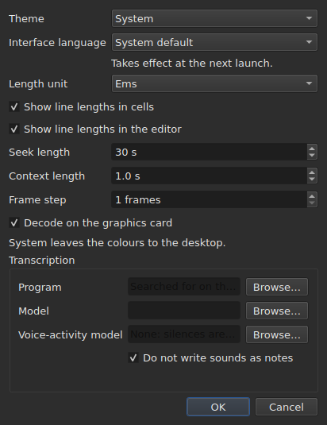

# The preferences

The window remembers what you set with the mouse — **where it was**, **whether
it was maximised**, **the width of its columns**, **the position of the
handle** between the film and the table — and **where you work**, so that
`Open…` opens in the right place. None of this is set through a dialog:
you move, you drag, and it is remembered.

**Six preferences have a dialog of their own**, `Edit ▸ Preferences…`, and that is the
criterion: a preference that already has a gesture does not need a field. The
theme has none, nor has the unit of line lengths, nor the two check boxes that
show them, nor the player's jump and lead. See [The theme](#the-theme),
[Line lengths](#line-lengths) and [The player](#the-player).

**The interface language is in the same dialog, and it is the one that waits**: it applies at the
next launch, not at once. See [The interface language](#the-interface-language).

**The volume has none**: the bar under the picture and two gestures set it, and it is remembered.

**Another one is set where it is used**: the side where `Insert Subtitles…` puts its
lines is a field of that dialog, and the last choice is remembered. See
[Inserting, removing, merging and splitting lines](lines.md#the-side-is-remembered).

**So are the two search options**: `Regular expression` and
`Ignore case` stay checked or unchecked from one opening of the dialog to the
next, and from one session to the next. See
[Find and replace](find-and-replace.md#the-two-options).

**So are the settings of `Adjust Durations…`**: the reading speed, its two
directions, and the three durations with their check boxes — each keeps its value, checked
or not. See [`Adjust Durations…`](operations.md#adjust-durations).

**And the last encoding chosen in `Save As…`**, with its byte order
mark. See [the file](#the-file).

**And what the `Correct Texts…` assistant and `Spell-Check Settings…` set**: the
checked tasks and their code, the pattern check boxes, the line-breaking settings, the language,
the target of the check and the underlining while typing. See [Correct Texts…](correct-texts.md) and
[Check Spelling…](check-spelling.md#spell-check-settings). **The target and the
document of `Correct Texts…` are not remembered.**

**What is not remembered:** the last file opened — see
[The remembered directory](#the-remembered-directory).

## The player

Four fields. **Seek length** and **Context length** are Gaupol's and have its values; **Frame step** and **Decode on the graphics card** are subedit's own:

| Field | What it sets | Default | Bounds |
| :---- | :----------- | ------: | :----- |
| `Seek length` | the jump of `Seek Backward` and `Seek Forward` | 30 s | from 1 s to one hour |
| `Context length` | the lead before the selection, for `Seek Selection Start`, `Seek Selection End` and `Play Selection` | 1 s | from 0 to 60 s, to the tenth |
| `Frame step` | the step, **in frames**, of `Step Backward` and `Step Forward`, and of nudging an edge | 1 frame | from 1 to 1000 frames |
| `Decode on the graphics card` | lets the graphics card decode the film when the machine has one; without a card, nothing changes | checked | checked or not |

They apply **at once**, without waiting for a restart, and are remembered from one session to the next
under `video.seek-length` (in seconds), `video.context-length-ms` (in milliseconds) `video.step-frames` (in frames) and `video.hardware-decoding` (`true` or `false`).
**A value out of bounds, or that is not a number**, does not prevent the window from opening: it
is ignored, the default remains, and the window says so on opening. **The frame step is never in milliseconds**: a step of N frames is always N frames, whatever the film's frame rate — see [Timing from the video](timing.md#frame-by-frame). The volume is remembered in `video.volume`,
from 0 to 100, with the same tolerance.

## The file

```
~/.config/subedit/settings.conf
```

More exactly `$XDG_CONFIG_HOME/subedit/settings.conf` when that variable
is set. It is written **when the window closes**, and read when it opens.
An interrupted program — killed, or stopped by a crash — writes nothing, and the
next session finds what the previous one had left.

The file is text, and it can be edited by hand. That is a property and not
a side effect: it is what makes a setting correctable when the interface
that sets it is precisely the one that is broken.

### Two blocks, one shared with the command line

The file is written in **two blocks**, each under a banner comment:

| Block | Keys | Read by |
| :---- | :--- | :------ |
| `# Operation settings: shared by the window and the command line` | the `duration-adjust.*` and `correction.*` keys | the window **and** `subedit-cli` |
| `# Display preferences: the window's own` | every other key — geometry, columns, theme, interface language, search, spell-check, editor, video, last directory, write encoding | the window only |

**`subedit-cli` reads the operation block by default**: what `Adjust Durations…` and
`Correct Texts…` remember here is also what [`subedit-cli adjust`](../subedit-cli/adjust.md)
and part of [`subedit-cli correct`](../subedit-cli/correct.md) start from, unless an option of
the command line says otherwise. **It never reads the display preferences.** Its
[`config`](../subedit-cli/config.md) command lists the operation keys, shows their values and
changes them — `subedit-cli config set duration-adjust.speed 12` — and the window sees the change
at its next opening. **A change made while the window is open does not survive its closing**: the
window rewrites the whole file with what it holds. `--no-config` makes a command line ignore the
file. See
[The settings file](../subedit-cli/invocation.md#the-settings-file).

The reader takes the keys in any order, with or without the banners: a file written before the
two blocks existed is read unchanged, and rewritten in two blocks at the next closing.

| Option | What it holds | Default |
| :----- | :------------ | :------ |
| `window.geometry` | `x,y,width,height`, in pixels; width and height non-zero | the window sizes itself |
| `window.maximised` | `true` or `false` | `false` |
| `table.columns` | four widths in pixels, separated by commas — `#`, `Start`, `End`, `Duration`, even hidden | the table sizes itself |
| `table.order` | the six columns, **each one once**, in the order the table shows them: `number`, `start`, `end`, `duration`, `text`, `translation` | `number,start,end,duration,text,translation` |
| `table.hidden` | the removed columns, among `number`, `start`, `end` and `duration`; empty, none | none |
| `window.table-share` | the share of the height given to the table, in per cent, from 1 to 99 | the window shares as it always has |
| `file.directory` | an **absolute** directory path | none: `Open…` opens where the program was launched |
| `general.theme` | `system`, `light` or `dark` | `system` |
| `interface.language` | `system`, or a language's name as its catalogue is named: two or three lower-case letters, then optionally `_` and two capitals — `fr`, `pt_BR`; `en` for English | `system` |
| `edit.insert-placement` | `above` or `below` | `below` |
| `file.write-encoding` | the name of an encoding ICU can write, and whose converter does not write its own mark | none |
| `file.write-bom` | `true` or `false` | `false` |
| `search.regex` | `true` or `false` — the pattern is a regular expression | `false` |
| `search.ignore-case` | `true` or `false` — case is ignored | `true` |
| `duration-adjust.speed` | the reading speed, in characters per second, strictly positive; a decimal number is written as short as possible (`15`, `12.5`) | `15` |
| `duration-adjust.lengthen` | `true` or `false` — lengthen what is too short to be read | `true` |
| `duration-adjust.shorten` | `true` or `false` — shorten what stays displayed longer than needed | `false` |
| `duration-adjust.minimum-enabled` | `true` or `false` — the minimum duration is asked for | `true` |
| `duration-adjust.minimum-ms` | the minimum duration, in milliseconds, whole and non-negative | `1500` |
| `duration-adjust.maximum-enabled` | `true` or `false` — the maximum duration is asked for | `false` |
| `duration-adjust.maximum-ms` | the maximum duration, in milliseconds, whole and non-negative | `6000` |
| `duration-adjust.gap-enabled` | `true` or `false` — the gap to the next subtitle is asked for | `true` |
| `duration-adjust.gap-ms` | the gap, in milliseconds, whole and non-negative | `0` |
| `correction.mentions.enabled`, `correction.common-errors.enabled`, `correction.capitalization.enabled`, `correction.line-break.enabled` | `true` or `false` — the task is checked on the first page of `Correct Texts…` | `false`, `true`, `true`, `false` |
| `correction.mentions.code`, `correction.common-errors.code`, `correction.capitalization.code`, `correction.line-break.code` | the code of the task's patterns: `Zyyy`, or `Script[-language[-COUNTRY]]` — `Latn-en-US`; not empty | `Zyyy` |
| `correction.human`, `correction.ocr` | `true` or `false` — the classes of common errors | `true`, `true` |
| `correction.sound-in-brackets`, `correction.sound-in-parentheses` | `true` or `false` — the two check boxes of the `Mentions` page | `false`, `false` |
| `correction.line-break.max-length` | the maximum length of a line, decimal; the dialog bounds it from 1 to 1000 | `24` |
| `correction.line-break.max-lines` | the maximum number of lines, whole; the dialog bounds it from 1 to 100 | `3` |
| `correction.line-break.in-ems` | `true`: the length is measured in *ems*; `false`: in characters | `true` |
| `correction.line-break.skip-on-length`, `correction.line-break.skip-on-lines` | `true` or `false` — the two skip conditions are asked for | `true`, `true` |
| `correction.line-break.skip-max-length`, `correction.line-break.skip-max-lines` | the two skip thresholds, in the chosen unit | `24`, `3` |
| `correction.join-split.enabled` | `true` or `false` — the `Join or Split Words` task is checked | `false` |
| `correction.join-split.join`, `correction.join-split.split` | `true` or `false` — join, split | `true`, `false` |
| `correction.join-split.language` | a locale code — `fr`, `en_US`, `sr@Latn` —; empty: the system's language | empty |
| `correction.remove-blank` | `true` or `false` — `Remove all blank subtitles` | `true` |
| `correction.activations` | the pattern check boxes the user changed, `<type>:<code>:<name>:<0\|1>`, separated by commas; **a comma or a backslash in a name is written preceded by a backslash** (`\,` and `\\`), and an unreadable entry loses only its own setting — it is reported, the others are kept | empty |
| `spell-check.language` | a locale code, such as `fr_FR`; empty: the system's language | empty |
| `spell-check.target` | `selection`, `current-project` or `all-projects` | `current-project` |
| `spell-check.document` | `main` or `translation` | `main` |
| `spell-check.inline` | `true` or `false` — underline unknown words while typing in a cell's editor | `false` |
| `editor.length-unit` | `em` or `characters` — the unit of the line lengths shown by the table and the editor | `em` |
| `editor.show-lengths-cell` | `true` or `false` — each line of a text cell is followed by its length | `true` |
| `editor.show-lengths-edit` | `true` or `false` — a cell's editor shows the length of each line in a margin | `true` |

**The file accepts more than the dialog.** The reader takes any strictly
positive speed and any non-negative duration; the `Adjust
Durations…` dialog, for its part, bounds the speed from 1 to 99 characters per second and each
duration from 0 to 99 s. A value of the file outside those bounds is brought back to the
bound when the dialog opens, and the file keeps it that way once the
dialog is accepted and the window closed. A cancelled dialog changes nothing in what
is remembered.

**`file.write-encoding` remembers the last encoding chosen in `Save As…`, and
never imposes itself on a file.** An open document carries its own encoding,
and that is the one the box proposes: rewriting it in another because a
setting three weeks old says so would lose what reading kept.
What this setting remembers serves the document that has no file — the one
just created.

**It is a deliberate “no” and not an oversight.** Someone who always delivers in
the same encoding and opens inherited files in another chooses it again for
each file; the box proposes it to them, and the round-trip guarantee holds
for everyone.

**`file.write-bom` carries the mark of the same encoding**, and two
lines are indeed needed: the name of an encoding does not say whether it is preceded by its mark, any more
than `--encoding` says what `--bom` says. Both are read together, in
any order, and a `file.write-bom` with no remembered encoding sets nothing.

**A share and not heights for the handle**, and that is what makes it
useful: three heights in pixels no longer mean anything as soon as the window
opens at another size, and a window often opens at another size.
The share replays anywhere. It is **brought back to what the window accepts** if
it is too small — the film's strip has a minimum height.

**Four widths for six columns**, and that is not an oversight: they are those
of `#`, `Start`, `End` and `Duration`, in that order whatever the
table's, and **a hidden column keeps its own** — it finds it again when it is
shown again. The last column shown takes what the others leave, and giving it
a width would do nothing; those of the text and the translation are therefore
not remembered.

## What happens when the file does not say what is expected

A configuration is a comfort. **Its failure costs the comfort and nothing
else**: the window opens in every case.

| Case | What happens |
| :--- | :----------- |
| the file does not exist | all the defaults, and nothing is said — it is the first launch |
| the file exists and cannot be read | all the defaults, and the reason is written on the error stream |
| an option is absent | its default |
| a key is unknown | ignored, without a word, and absent from the rewritten file |
| a value cannot be read | its default is kept, and the option is named on the error stream |

```console
$ subedit-gui film.srt
subedit-gui: /home/vous/.config/subedit/settings.conf: window.geometry: "plus tard" cannot be read, keeping the default
```

**The message goes on the error stream and nowhere else.** A modal
window at start-up for an unreadable preference would stop the user for
a fault that prevents them from nothing, and before they have asked for anything.

## The commented options

The rewritten file contains **all** the known options, and those left at
their default are written as comments:

```
#window.geometry = 0,0,1280,800
#window.maximised = false
#table.columns = 60,110,110,110
#table.order = number,start,end,duration,text,translation
#table.hidden = start,end
```

It is not an affectation. Without it, an option never touched would stay
frozen at the value of the day it was written, and **an improved default
would never reach anyone**. With it, changing a default changes the
behaviour of everyone who has not overridden it — which is exactly
what a default must do.

To override an option: remove the `#` and change the value. To go back
to the default: delete the line, or comment it out again.

The geometry, the widths and the removed columns show a **shape** and
not a value in force: the default of the geometry and that of the widths are
“what the window chooses”, which is not written in numbers, and that of
`table.hidden` is “none”, which cannot be read. The file's header says so
too. `table.order`, for its part, does show the default order.

## The remembered directory

`Open…` opens on the directory of the **last file opened or saved**,
and not on that of a box you cancelled: what counts is where you
work, not where you looked.

**The last file, for its part, is not remembered.** Remembering it would mean
reopening at launch a document nobody asked for. Remembering a directory
*points* a dialog box; remembering a file would open one.

## The theme

`Edit ▸ Preferences…` opens with the theme, a preference with no gesture, above the
[line lengths](#line-lengths).

| Value | What it does |
| :---- | :----------- |
| `System` | **nothing** — the colours stay those of the desktop |
| `Light` | sets a light palette |
| `Dark` | sets a dark palette |

The chosen theme applies **immediately**, without restarting.

**“System” does nothing, and that is not a lack.** The version of Qt on
which subedit is built has no way to ask the desktop whether it wants to be
light or dark, nor to be notified when it changes its mind. Rather than
inventing a reading we do not know how to do, the tool ships the two themes
that can be asked for and lets the toolkit decide for the third —
which is what Gaupol does under the same conditions.

Under a desktop whose theme is already dark, `System` therefore gives a dark
window; under a light desktop, a light window. `Light` and `Dark` override
it, whatever the desktop.

**The anomaly tints stay readable in both palettes** — see
[The table](table.md#the-anomalies). It is not an assumption: the contrast
of the text on each of the tints is checked by a test, on both backgrounds.

## The interface language

`Edit ▸ Preferences…` chooses the language of the window, under the theme.

| Field | Values | Default |
| :---- | :----- | :------ |
| `Interface language` | `System default`; `English`; then each language installed with the program, by its own name — `Français` | `System default` |

**It takes effect at the next launch**, and the dialog says so under the field: the window is
translated as it is built, and a running window keeps the language it started in. The choice is
kept in the settings file, under `interface.language`, and read when the window next opens.

| Choice | The window starts in |
| :----- | :------------------- |
| `System default` | the language of the environment, as before any choice — `LANGUAGE`, `LC_ALL`, `LC_MESSAGES`, `LANG`; see [Language](invocation.md#language) |
| `English` | English, whatever the environment says |
| an installed language | that language, **whatever the environment says**, `LC_ALL=C` included: a choice made here is an explicit one |

The list holds the languages whose catalogue is installed under `<prefix>/share/subedit/locale`;
English is always there, since it is the language the program is written in. A language is shown
by its own name, which no catalogue translates, so that a reader finds the one they read.

**A value the program cannot honour costs nothing but the choice:**

| What the file says | What happens |
| :----------------- | :----------- |
| a language's name with no catalogue installed — a file brought from another machine | the window follows the environment, without a word; `Preferences…` shows that language, by its name or its code, and keeps it unless another is chosen |
| something that is not a language's name — `French`, `fr_FR.UTF-8` | `system`, the default, and the option is named on the error stream, as any unreadable value is |

```console
$ subedit-gui film.srt
subedit-gui: /home/vous/.config/subedit/settings.conf: interface.language: "French" cannot be read, keeping the default
```

**The command line never reads it**: `subedit-cli` chooses its language from the environment
alone, and `subedit-cli config set interface.language fr` is refused as a display preference.

## Line lengths




`Edit ▸ Preferences…` also sets **what the table and the editor show of the
length of lines** — Gaupol's ruler and margin.

| Field | What it does | Default |
| :---- | :----------- | :------ |
| `Length unit` | the unit of lengths: `Ems` or `Characters` | `Ems` |
| `Show line lengths in cells` | each line of a text cell is followed by its length | checked |
| `Show line lengths in the editor` | a cell's editor shows the length of each line in a margin on the right | checked |

**`Length unit` is greyed out when neither check box is checked**: with no
length to show, the unit sets nothing. The choice applies **at once** to the
table, and the editors that open afterwards follow it. The three values are
remembered from one session to the next: `editor.length-unit`, `editor.show-lengths-cell`
and `editor.show-lengths-edit`, in the table [of the file](#the-file). See
[The length of lines](table.md#the-length-of-lines) and
[in the editor](editing.md#the-length-of-lines).

**It is not the assistant's limit.** The unit of `Correct Texts…` — the
length at which it breaks lines — is a separate setting, in its
assistant: you can read ems in the table and break in characters.

## What cannot be set

**Nine remembered settings are chosen in a dialog** — not counting those of
the correction assistant and of the spell check, which each have
their own —, and each in the one where it is used: the theme and the three line-length settings, here; the side of an insertion, in the insertion dialog;
the two search options, in the search dialog; the encoding and
the byte order mark, in `Save As…`; the reading speed, the durations
and the gap of the duration adjustment, in its own dialog. There is no
other: nothing can be set for the diagnostics, the player's volume,
nor the default save format — that one comes from the open file.

And **no number that belongs to a document is kept from one session to
the next**: a shift amount, two transformation markers are true of one
file and false of the next. The dialogs ask for them again at each launch,
deliberately. The settings of `Adjust Durations…` are an exception in the same way as
the two search options: a reading speed, a minimum duration or
a gap are choices of method rather than measurements of a file, and
persist from one session to the next for that reason.

This manual describes what exists: what will come is in the
[roadmap](../../feuille-de-route.md).
