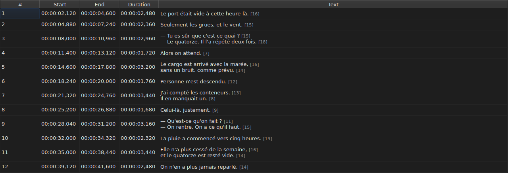
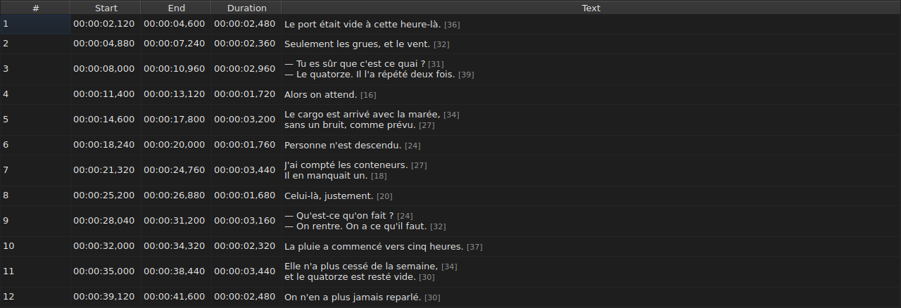
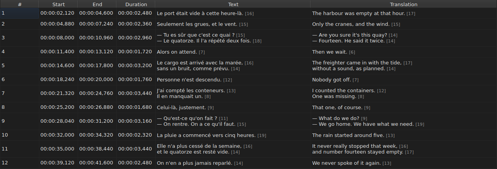
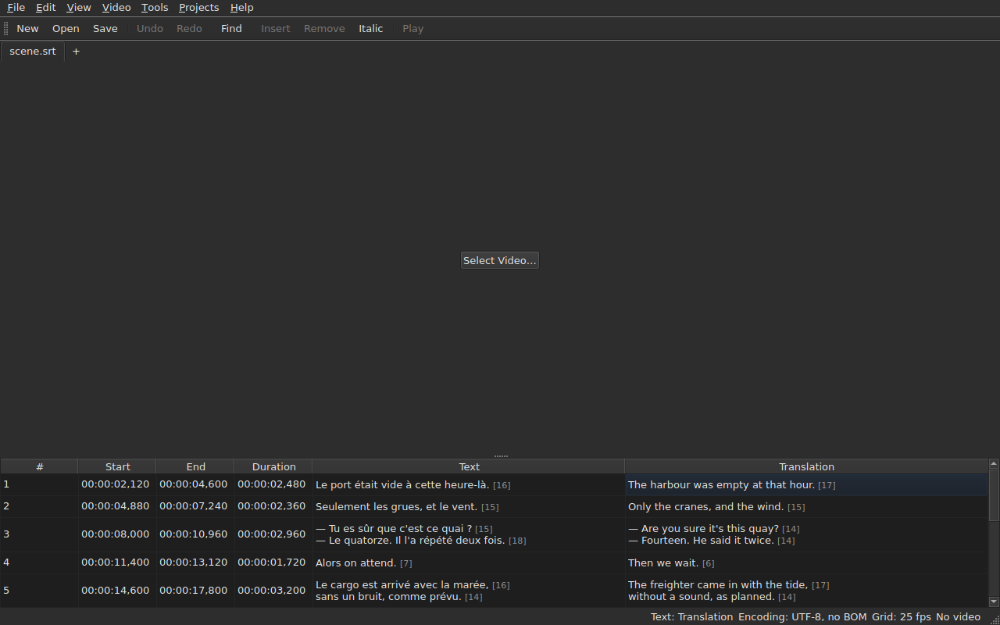

# The table

The window shows the subtitles of the open file, one per line, in five
columns — six when the project carries a translation.

**This manual quotes the window's headings as the English window displays
them**, as it does for the command line; a translated window shows them in
its own language.

| Column | What it shows |
| :----- | :------------ |
| `#` | the rank of the subtitle, from 1 |
| `Start` | the position where it appears, `HH:MM:SS,mmm` |
| `End` | the position where it disappears |
| `Duration` | `End − Start` |
| `Text` | the text of the subtitle |
| `Translation` | the translation of the subtitle — **absent as long as the project has none** |




## The length of lines




**Each line of a text cell is followed by its length**, `[N]`, smaller
and paler — in the `Text` column as in the `Translation` column.
That is what Gaupol does.

| What counts | What the table does |
| :---------- | :------------------ |
| **tags** | do not count: `<i>Bonjour</i>` makes `[7]`, like `Bonjour` |
| **rounding** | downwards: a line of 12.9 ems is displayed `[12]` |
| **an empty line** | has no length; nor has an empty text |
| **the unit** | *ems* by default, or characters — `Edit ▸ Preferences…` |
| **a line too long for the column** | is cut by `…` **before** the number, which stays visible |

**The *em* is Gaupol's, not typography's**: the lower-case alphabet
is worth 0.55 em per letter, under the table's font. A length in *ems* therefore
depends on the font; a length in characters counts code points, an
accent for one.

**The table does not mark a line that is too long.** It shows the number, and it is up to
the eye to compare it with the limit you have set yourself — like Gaupol. It is not
the limit of the `Correct Texts…` assistant, which has its own setting.

**To not see them:** uncheck `Show line lengths in cells` in
`Edit ▸ Preferences…`. See [Line lengths](preferences.md#line-lengths).

## Hiding and moving columns

**`View ▸ Columns`** carries one checkable entry per column, **except `Text`**:
without the main text, there would be nothing left to edit.

| Entry | Column |
| :---- | :----- |
| `View ▸ Columns ▸ No.` | `#` |
| `View ▸ Columns ▸ Start` | `Start` |
| `View ▸ Columns ▸ End` | `End` |
| `View ▸ Columns ▸ Duration` | `Duration` |
| `View ▸ Columns ▸ Translation` | `Translation` — see [The translation column](#the-translation-column) |

Unchecking an entry removes its column, checking it again puts it back, at the width
it had. **The setting applies to the whole window**, all tabs
included: there is a single table, whose project changes with the tab.

**The current cell leaves the column being removed**: it moves into `Text`,
on the same line, and the selection does not move. A current cell in a
column nobody sees would be a cell a keystroke would edit
blind.

**Columns are moved by dragging their header**, any of them, `Text`
included. The last column shown takes the space the others leave.

**The order and the removed columns are remembered from one session to the next**, with
the widths, in the [preferences file](preferences.md) — `table.order`
and `table.hidden`. The translation column is not there: it follows its own
rule, and comes back with each translation opened.

**The number is not data of the file** but the rank of the line. An
insertion or a removal therefore renumbers everything that follows, without anything
being rewritten.

**The decimal separator follows the file's format**: a comma for SubRip,
a point for the eight others. SubRip is the only one of the nine to write a comma.

**It is the separator that follows, not the whole spelling.** The table always writes
the hours and always three decimals; a WebVTT file omits the
hours under one hour, SubViewer 2 and the two Sub Station Alpha count in
hundredths, MPL2 in tenths, TMPlayer in seconds, MicroDVD in frames. A
column whose width followed the format would be more tiresome to read than a
column that is simply not the exact spelling of the file.

What the table guarantees is therefore **the value and the separator**, not the number
of decimals. What a target format would round is said at the moment of
saving — see
[What a format will not carry](files.md#what-a-format-will-not-carry-said-before-writing).

**The duration (`Duration`) is computed**, never stored: typing it moves the
end. A subtitle whose end precedes its
start displays a negative duration rather than zero: it is an anomaly of the
file, and hiding it would make it impossible to find.

**The start, the end, the duration, the text and the translation are edited in place**; the
number is not. See [Editing a cell](editing.md).

**The selection designates what an operation acts on** — see
[The operations](operations.md).

**The height of a line follows the subtitle it carries**: a subtitle of
two lines takes two, one of three takes three. The text is shown in
full, as it will be written.

**What remains cut is a line too long for its column**, and it then
ends with an ellipsis. Widening the `Text` column, or the window, shows it
in full; so does opening the cell. The lines of the text are never
wrapped: only a real line break makes a line, so that the height
of a table row does not change when you drag the edge of a column.

## Positions in frames

**`View ▸ Positions in Frames`** — a checkable entry, a single setting for the window — shows the
`Start` and `End` columns **as frame numbers** instead of timestamps, and **accepts a frame number as input**. The
headers say so: `Start (frames)` and `End (frames)`.

| What changes | What does not change |
| :----------- | :------------------- |
| what `Start` and `End` write, and what they accept | the `Duration` column, which stays a time |
| the headers of those two columns | the document: nothing is modified, the history has no new entry, and **what the file writes is what it wrote** |

**The frame rate that counts the frames** is, in this order:

1. **that of the file**, when it is counted in frames — MicroDVD, which carries numbers and no
   frame rate: **the window then shows the figures of its file**, whatever the video;
2. **the one the associated video declares**;
3. **the grid the positions draw**, when they draw one.

The entry's tooltip says which one was retained: *Positions are frame numbers, counted at 25 fps, the rate the
video declares*. **With none of the three, the entry is disabled, and its tooltip says why**: the file is
not counted in frames, the video declares no frame rate, and the positions fall on no grid.

- **A number is the number of the frame the position falls in**, rounded to the nearest frame. **Typed, it
  gives the instant that frame starts**, rounded **only once** from the exact ratio
  ([ADR 0013](../../adr/0013-mise-a-l-echelle-exacte-des-positions.md)): frame 37 at 23.976 frames per second
  starts at 1,543.04 ms, that is `00:00:01,543`.
- **Only whole numbers are accepted** — with the minus sign, since a start can precede the film. A
  timestamp typed in frame mode, or a number that is not one, leaves the cell as it was.
- **The playback bar follows the same setting**: the position and the duration on either side of the slider
  are written as frame numbers like `Start` and `End`, at the same instant — see
  [The playback bar](player.md#the-playback-bar). The clock drawn at the top of the picture stays a
  timestamp.
- **This setting is not remembered** from one session to the next: it is a setting of the window, not of a
  document, and it is turned back on in one gesture.

## The anomalies

A subtitle whose positions do not hold together is **tinted on its
time columns**, and hovering over it says what is wrong.

| Tint | What it reports | What to do |
| :--- | :-------------- | :--------- |
| red | `ends before it starts` | correct its end, or its start |
| blue | `starts before the previous one starts` | put it back in its place in the order |
| amber | `starts before the previous one ends` | adjust its timing |


Only the `Start`, `End` and `Duration` columns are tinted: an anomaly
speaks only of time, and tinting the text would suggest it had something
to do with it.

**A subtitle can carry several**, and the tooltip names them all. The
tint is that of the first one to repair: a subtitle broken in itself
is broken whatever its neighbours do; a misplaced subtitle is put back in place,
and its overlap goes away with it.

> It is no accident that disorder almost always wins over
> overlap: starting before the previous one starts is starting
> before it ends — unless the previous one is itself broken.

**The marking is recomputed after every change of position**, whether it comes
from an edited cell, an operation or an undo. It says what the
file is now, not what it was on opening.

It relies on no frame grid: as soon as a position is corrected by
hand, it leaves it, and a marking based on it would report the
user's work.

## The translation column

A subtitle carries **two texts and a single pair of positions**: the
translation has no timing of its own, it is attached to that of the subtitle.
The table shows it in a sixth column, `Translation`, to the right of `Text`.




**The column is there only if the project has a translation.** Without one, the table
keeps its five columns, and the window behaves as if the translation
did not exist — nothing is greyed out or added. `File ▸ Open Translation…` opens
one: see [Opening a translation](files.md#opening-a-translation).

**An entry of the `View` menu shows or removes it**:

| Entry | What it does |
| :---- | :----------- |
| `View ▸ Columns ▸ Translation` | checked: the column is shown; unchecked: it is removed |

The entry is **disabled when the project has no translation** — there is nothing to
show — and checked at start-up. **The choice to remove it is the
user's**: it holds from one file to the next, until it is checked
again. Removing the column does not remove the translation: it stays in the
project, and comes back with the entry. Opening a file that carries none removes the
column.

**The translation's cells are typed into like those of the text** — see
[Editing a cell](editing.md).

### The text the operations target

With two texts in a line, text operations must know which one
they rewrite. **It is that of the column of the current cell**: the
translation if the current cell is in the `Translation` column, the main
text everywhere else — in a time column as in `Text`.

| Operation | What it targets |
| :-------- | :-------------- |
| `Italic`, `Case`, `Dialogue`, `Remove Hearing-Impaired Mentions…` | the text of the current column |
| `Cut Texts`, `Copy Texts`, `Paste Texts` | the text of the current column |
| `Find and Replace…` | the text of the current column — see [Find and replace](find-and-replace.md#in-which-text) |
| the position operations, insertion, removal, merging, splitting | **both texts**: a subtitle is a whole |

**The status bar says so when there are two texts**, to the left of the other
indications:

```text
Text: Translation
```

or `Text: Main` for the main text. It stays silent when the column is not
shown: there is then only one text, and there is no point saying so.




**The line drawn on the picture follows the same rule**: it is the text of the
current column. See [The player](player.md#the-drawn-line).

**Nothing is greyed out.** Text operations stay available whatever
the current column, and with no translation column they target the main
text, as before.

## Adding and removing lines

`Edit ▸ Insert Subtitles…` and `Edit ▸ Remove Subtitles` add and remove
lines, `Edit ▸ Merge Subtitles` and `Edit ▸ Split Subtitle` merge and
split them; the table renumbers itself. See
[Inserting, removing, merging and splitting lines](lines.md).

## What the table does not do

**Sorting by column does not exist.** The order displayed is that of the file, and
it is the only one that makes sense for subtitles: the rank of a line *is*
its place in time.
