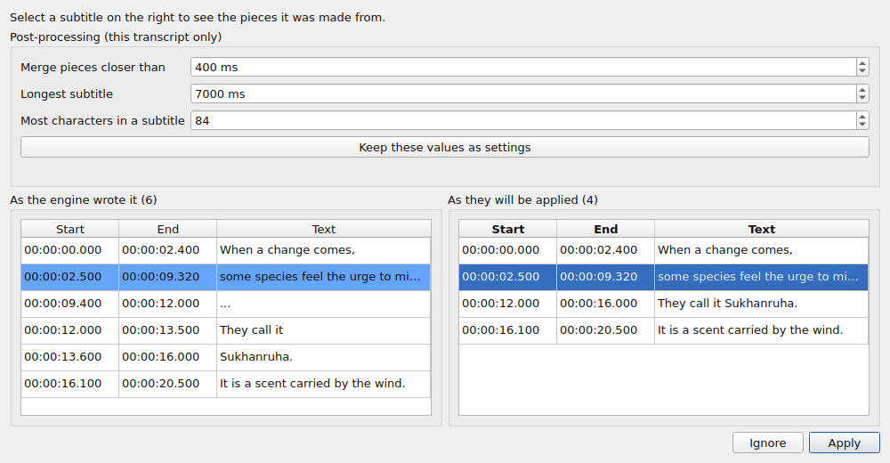
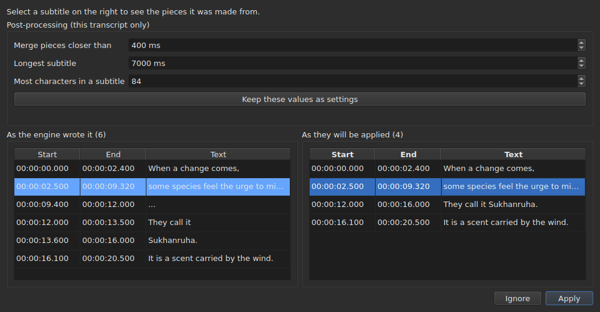

# The associated video

The **Video** menu carries first three commands, and the gestures that drive the film
— see [The player](player.md#moving-through-the-film).

| Command | Shortcut | What it does |
| :------ | :------- | :----------- |
| Select Video… | none | chooses the video file the document goes with |
| Transcribe Audio… | none | transcribes the audio of the film into subtitles that replace the project's — see [Transcribing the audio](#transcribing-the-audio) |
| Play / Pause | `Ctrl+P` | plays or stops the video — see [The player](player.md#playing-and-stopping) |

The associated video is **a property of the open document**, not a setting of
the application: opening another subtitle file starts from scratch. It
is written to no file and disappears with the window.

## The audio track

A film can carry several sound tracks — the original version, a dub, a commentary. The
**`Video ▸ Audio ▸ Language`** submenu lists them, **one entry per track**, and **marks the one playing**:

| What the file gives | What the entry says |
| :------------------ | :------------------ |
| a language and a title | `1: fra — Original` |
| a language alone | `2: eng` |
| a title alone | `3: Commentary` |
| neither | `1` |

The number is **the place of the track in the film**, one by one, in the file's order: two tracks
can say `eng`, and a file silent about its labels still has a first and a second.

**Choosing an entry plays that track.** The mark is the player's answer, not the click: it tells the
track that is playing.

- **The submenu is disabled** with no video or no audio track. With a single track, it stays enabled and
  shows it, checked: it tells the language of the film. The two volume gestures, which are next to it, stay
  enabled in any case: see [The volume](player.md#the-volume).
- **The track is not remembered** from one video to the next, nor from one session to the next: a track number is
  that of its file, and carrying it over to the next film would choose whatever bears that number there.
  Going back to a tab reopens its film on the track the player chooses by itself.
- No shortcut: you change language rarely, and the menu is enough.

## Choosing a video

The dialog opens on the directory of the subtitle file and filters on
the recognised video extensions:

    .avi .flv .m2ts .mkv .mov .mp4 .ogg .ogv .vob .webm

It also offers to show all files. Cancelling the dialog changes
nothing.

The chosen file is **opened at once**: the picture appears in the window,
paused on its first instant. See [The player](player.md).

**Dropping a video file on the window does the same thing** — see
[Dropping files on the window](files.md#dropping-files-on-the-window).

**The video is that of the current tab's project.** Each tab keeps
its own; changing tabs changes the film. **Going back to a tab resumes its
film where you left it**, paused, like any opening. Another film
chosen for that project in the meantime starts, for its part, from the beginning.

## The automatic proposal

When a subtitle file is opened, **if no video has been chosen**,
the window looks for one in the same directory: a video file whose name
without extension is a prefix of ours, up to a dot.

| Subtitle file | Video found | Why |
| :------------ | :---------- | :-- |
| `film.fr.srt` | `film.mkv` | `film` is a prefix of `film.fr` |
| `film.en.forced.srt` | `film.mkv` | likewise, whatever the number of segments |
| `film.fr.srt` | `film.fr.mkv` rather than `film.mkv` | the longest name wins |
| `film.fr.srt` | none, if `film.mkv` **and** `film.mp4` are there | two candidates cannot be told apart |
| `film.fr.srt` | none, if only `fil.mkv` is there | `fil` does not stop on a dot |

**A proposal is not a choice.** It lets itself be replaced by another
proposal — opening another file, saving under another name. An explicit
choice, on the other hand, is never overwritten: once `Select Video…` has been used, the
automatic proposal no longer comes back behind it.

That is what makes the guess acceptable: it can be corrected, and its
correction holds.

## What the status bar shows

On the right of the status bar, a line says what the document goes with. It
is the last of three: the [encoding](files.md#the-encoding-in-the-status-bar)
of the file read comes first, the [frame grid](frame-grid.md) deduced from the
positions next.

| Situation | What is written |
| :-------- | :-------------- |
| a video is associated | `Video: film.mkv` |
| … and `ffprobe` gives its frame rate | `Video: film.mkv, 24000/1001 fps` |
| none | `No video` |

**The frame rate goes with the film rather than beside it.** They are a single fact — what
this document goes with — and a third mention would put it on the same rank as
the [grid deduced from the positions](frame-grid.md), which is another one.

## Transcribing the audio

**`Transcribe Audio…`** writes the speech of the film as subtitles. It is out until a film is open: it
is the audio of **the film of the project**, and never a file you would pick — to transcribe an
audio file, use [`transcribe`](../subedit-cli/transcribe.md) on the command line.

The dialog asks for four things, and says whether it can start:

- **the audio track**, listed as the [`Audio`](#the-audio-track) menu lists them, with the language
  and the title the file declares;
- **the language**, chosen in a **list**: first an entry that detects it, “Detect from the first 30 seconds of sound”, then the languages the
  engine offers for the model, by name in the language of the window and followed by their code — “French (fr)”. The list is the
  engine's own: about a hundred with a multilingual model; with a model for English alone it has the one entry, English, and cannot be
  changed, and a line says that the film will come out as English whatever it speaks. The list starts on the language of the chosen
  track when the file declares one and the engine offers it, follows the track as long as you have not chosen one, and
  **a line under it says where it comes from**. When the file declares no language for the track, the line says so, and warns:
  the model will then detect it from the first thirty seconds of sound, and **a film that opens with music or silence can be taken for
  another language and its speech then translated into it**. Choose the language if you know it;
- **sounds written as notes**: a box, “Do not write sounds as notes”, checked by default. The engine is then told not to write sounds as
  notes, such as `(phone ringing)` or `[MUSIC PLAYING]`; where it has no speech to write it writes `...`, and the pieces that have no letter and no digit
  are dropped by the post-processing. Uncheck the box to keep the notes, for subtitles for the hard of hearing. The box is grey, with the reason,
  for an engine that cannot be told. It is the setting `transcription.suppress-notes`, which the [preferences](preferences.md#transcription)
  also hold;
- **the part of the film**, from one time to another — see [Trying a part first](#trying-a-part-first). Both fields
  empty is the whole film.

**It also says what is missing.** Three lines tell whether the engine, `ffmpeg` and the model are there, and
where; when one is not, `OK` stays out, and the dialog says so with the pointer to
[Installing the transcription tools](../subedit-cli/install-transcription.md). A `Preferences…` button opens
the [preferences](preferences.md#transcription), where the program and the model are set — they are facts
about the machine, not choices to make again at each transcription — and the dialog looks again when they close.

The language is kept for the next time. The engine itself and the limits of the subtitles are
[settings](preferences.md) (`transcription.*`).

**When the project already holds subtitles, the window asks before replacing them**, and says how
many go. It asks before the work, so that declining costs nothing. When the project is empty there
is nothing to ask.

The work runs **in the background**, with a box and a `Cancel` button; the window stays usable around it. **The box
tells where the work stands**, so that you know it is alive and how long it will take:

- **the step**: “Extracting the audio…” first — the box is then busy, with no figure, since extracting says nothing of how far it
  has got —, then “Transcribing the audio…”, with a bar;
- **the time left**, “about 38 min left”: absent at first, shown once the engine has reported enough progress to extrapolate from, and worked
  out from its speed since the start, up to the last minute; it is a few minutes' accuracy, not a promise;
- **the time spent**, “elapsed: 0:05:12”, which moves even when nothing else does;
- **the position**, “0:12:30 of 0:50:00”: how far into the film the engine has got, as soon as it has produced its first text, shown **just above the last text** it stands for;
- **the last text** obtained, so that you can see the work is making sense.

On a long film with a large model on a processor, the first minutes can be long: the engine is loading and working on its first
windows of thirty seconds. The position and the last text move before the engine's own percent does, which only comes in steps
of 5 % of the film.

### The preview

**Nothing replaces the subtitles of the project until you have seen them.** When the work ends — and also when you cancel it, or it fails
after producing something — a window shows the result in two tables side by side, each with **its own start and end**:

- **on the left, “As the engine wrote it”**: everything the engine returned, as it cut it, with no post-processing at all — what
  [`--raw`](../subedit-cli/transcribe.md) would write —, the placeholders (`...`) included;
- **on the right, “As they will be applied”**: the subtitles after the post-processing, exactly what will go into the project. It runs in
  three steps, each over the whole transcript before the next begins: the pieces with no letter and no digit (`...`) are dropped; the
  close pieces of one sentence are merged; the ones that are too long are cut — **at a sentence end first (`. ? ! …`), then at a comma, a
  semicolon or a colon, and in the middle of a sentence only when there is no punctuation to cut at**. A cut that would leave a subtitle too
  small to read (a few characters, a fraction of a second) is avoided when another exists. A subtitle that begins a piece keeps its start,
  and one that ends it keeps its end: the times of the words are used only for the cuts inside a piece.

Above the tables, **“Post-processing (this transcript only)”** holds the three limits of the post-processing: “Merge pieces closer than”,
“Longest subtitle” and “Most characters in a subtitle” — the settings `transcription.merge-gap-ms`, `transcription.max-duration-ms` and
`transcription.max-characters`. **Changing one makes the right-hand table again at once**, with no engine involved, and the subtitle you had
selected stays selected. The values you type hold for **this transcript only**: whether you apply or ignore it, the settings of the application are as they were. **“Keep these values as settings”** hands the three
values to the settings of the application — those of [Preferences](preferences.md), saved with them —, and the window says so; closing the window
does not do it by itself.

The two do not line up row for row, which is why each has its own times. **Selecting a subtitle on the right highlights, on the left, the pieces it
was made from**, and scrolls the left side to them; one subtitle at a time, in that direction only. Neither table can be edited: what no setting gets right is edited afterwards, in the table of the project, like any subtitle.

Two buttons close it. **“Apply”** replaces the subtitles of the project **as a single operation**: one `Undo` gives back what was there, translation
texts included. **“Ignore”** drops the result, and it is lost. “Apply” is out when there
is nothing to apply.

**When the run was stopped**, the window says so — “Partial result: the work stopped at …” — and offers what had been obtained up to there, to apply
or to ignore, so that a long run stopped late does not lose its work unasked. Those pieces have no timed words (the engine writes them at the end), and the
post-processing cuts at the pieces' own limits. A failure is first said in a box, as for any failure; a cancellation says nothing of the kind.

### Trying a part first

A range lets you **judge a model or a language on two minutes before committing to two hours**. The fields “Part of the film” take a beginning and an end, each written `HH:MM:SS`, as the fields say (`2:00` and a number of seconds, `90`,
are read too); one alone is allowed (from there to the end, or from the start to there). `OK` stays out while a field is
not a time or the end does not come after the beginning, and a line under the fields says which.

- **The subtitles keep the time of the film**: what is said at 2:10 is at `0:02:10` in the result.
- **It goes through the preview like any transcription**, and replaces the subtitles of the project once applied; one `Undo` gives
  them back. To try a range without touching your work, ignore the preview, or save first.

**What it needs is not shipped**: an engine (whisper.cpp), a model, and `ffmpeg` to extract the audio.
See [Installing the transcription tools](../subedit-cli/install-transcription.md).

## When there is no film

The window shows a **`Select Video…`** button where the picture would go, rather than
nothing at all. It is the same command as the one of the `Video` menu, within
reach of the mouse: an absence you cannot act on is hard to tell from a
fault.

The button disappears as soon as a film is open, and the picture takes **all** its
place: the height the table leaves above it — the one
[`window.table-share`](preferences.md) remembered from one session to the next —, and
never less than the minimum height of the picture, which the table yields if needed.
When the film goes away, the button takes back the same place.

**The file's name, never its path.** A path of two hundred characters
would push everything else out of the bar; the full path is the one the
dialog showed.

## `ffmpeg` is not required

`subedit-gui` queries `ffprobe` — shipped with `ffmpeg` — for one thing and one
thing only: **the frame rate the container declares**. It is read once
per film, when it is associated.

| With `ffprobe` | Without |
| :------------- | :------ |
| the status bar writes the frame rate beside the film's name | it writes only the name |
| the conversion dialog proposes the film's frame rate in the bottom field | it proposes nothing, and opens as before |
| the alignment dialog opens on it | it opens on the project's frame rate |

**Nothing else depends on it, and no operation refuses.** The player, for its part,
does not need `ffprobe` at all: it relies on `libmpv`, which is a
build dependency. The film's duration, the one used to report what
goes past the end, comes from the player and not from `ffprobe`.

**The transcription is the one thing that does need `ffmpeg`**: it extracts the audio of the film. See
[Installing the transcription tools](../subedit-cli/install-transcription.md).

It is therefore not a degraded mode but **the normal operation** of a machine
that has never installed `ffmpeg`: the data comes from the user, and `ffprobe`
proposes it when it is there.

A frame rate read is an **exact rational** — `24000/1001`, not `23.976`.
That is the reason `ffprobe` is kept for that answer: the
player knows the same thing as a floating-point number, and an approximate frame rate
would re-time the whole file slightly off.
